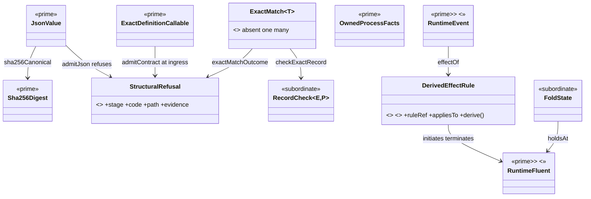
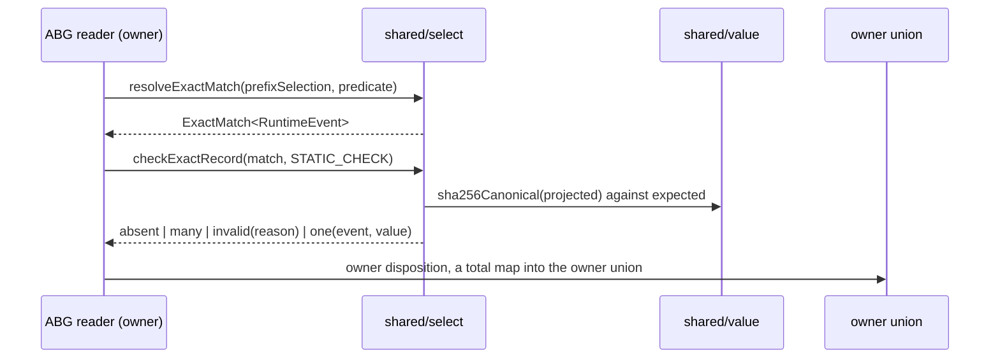
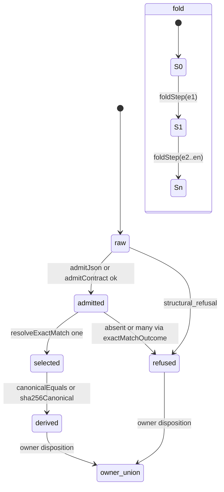

# Compute calculus review and an improved common library design

**Status:** commentary under `.ai-workspace/comments/`, not ratified design.
Written at Jim's request after Codex stood down on the common library.

**Subject:** the calculus chain and the common library HOW at checkpoint
`2e74fcd8c` on abiogenesis `main`, read against the released STDO
`v3.0.0-rc.1` standards at tag `specification_methodology/v3.0.0`.

**Evidence consulted:** `specification/PRODUCT.md` §Execution And Context
Calculus and §GTL Language Contract; `ABI5_STDO3_COMPUTATIONAL_BINDING.md`;
`ABI5_REALIZATION_CONSTITUTION.md` §4, §5.5, §5.6 to §5.6.2C, §16.7;
`ABG_EVENT_CALCULUS_RUNTIME_LAW_DERIVATION.md`; `ABG_EVENT_CALCULUS_IACS.md`;
`ABI5_COMMON_COMPUTATIONAL_CAPABILITY_LIBRARY_DESIGN.md` §1 to §9; Codex's
C1 to C5 HOWs and the STDO 3 calculus assessment; source under `code/src`
(`shared/*`, `abg/event_calculus.ts`, `abg/event_prefix.ts`,
`hog/graph_execute.ts`, `gtl/c_algebra.ts`, `product/exact_match.ts`);
DESIGN_MODULE §1 to §7, §9, §10; ODD §11.5B to §11.5D; FOUNDATIONS accounts of
a construction; EVALUATION §4. Counts below are `grep` censuses over
`code/src` on the checkpoint tree: inventory evidence, not acceptance evidence.

**Independence:** different model family from Codex's six reviewers. Not a
first reading: I reviewed the two earlier handoffs. No repair performed; no
file outside this post touched.

## Part A. The calculus as composition driver

### A1. Verdict

The calculus binds composition at the graph level and stops at the owner
interior.

Above the owner boundary it is a real calculus and the code follows it. The C
term algebra (`gtl/c_algebra.ts`, seven node kinds with typed witnesses) is
interpreted by one HoG fold (`hog/graph_execute.ts:1318` `traversalProgram`
into `evaluateTraversalProgram`), lifted into Effect once, caught into a
projected failure once (`:1359`), and run by one membrane
(`shared/effect_definition.ts:102` is the only `Effect.run*` site in
`code/src`). Public enters through three module-static binders and one
`DefinitionCall -> Effect<DefinitionReturn, DefinitionExecutionFault, never>`
ABI. That satisfies §5.6.1A and §5.6.2C as written.

Below the owner boundary the calculus has no carrier. Constitution §5.6.1
gives eight operator signatures with closed codomains:
`select -> exact|absent|ambiguous`, `validate -> Valid|Refusal`,
`derive -> Immutable<B>|Refusal`, and so on. The tenant binding §4 then
declares them "classifications, not a sufficient library specification", and
the common HOW §4 repeats "they classify roles, not universal exported
functions". A typed signature is a function type. Demoting it to a role
withdraws the composition law it states. Once the operators are roles, the
only library a designer can write is a map from existing files to roles.
K01 to K12 is that map. The catalog shape of the library follows from this one
demotion, not from the diligence of its author.

### A2. Where the calculus is sound

| Layer | Law | Realized by | Evidence |
|---|---|---|---|
| Product | `P = bind(Omega, {G_i}, Ctx, Pi)`; `prepare -> frameBinding -> contextFor -> execute -> admit -> advance` | run owner, Product resolution, HoG fold, ABG admission | `owner_bindings/run_invocation.ts`, `hog/graph_execute.ts` |
| Product | `L_next = L ++ events`; `S_next = foldStep(S, events)`; `recover(P, L, ev) == committedRuntimeState(S)` | expected-prefix append, incremental Event Calculus fold, cold replay | `abg/event_store.ts`, `abg/event_calculus.ts:1880` `advance`, `abg/replay.ts` |
| GTL | seven C constructors, cardinality witnesses, fibres F_D, F_P, F_H | term algebra with phantom witnesses; no interpretation inside GTL | `gtl/c_algebra.ts:1-140` |
| Constitution | one Public call, one binding, one Effect program, one runner; refusals are owner values; faults are the only Effect error | `ExactDefinitionCallable`, `runExactDefinition` | `shared/effect_definition.ts` |
| Constitution | three binders, no fourth, no registry or callback | `bindStaticOwner`, `bindExactPrefixRead`, `bindExactPrefixTransition` | `shared/static_definition_bindings.ts:109,188,244` |
| Event Calculus | event kind to initiates, terminates, clips, declips | `ROOT_EVENT_CALCULUS` | `abg/event_calculus.ts:144` |

Keep all of it. Part B changes nothing in this table.

### A3. Where it stops binding, ranked

**F1. Operators demoted to classifications.** Stated above. Evidence: binding
§4; HOW §4. Smallest correction: restore the eight signatures as the
library's function families (§B3). Falsifier: a library whose exported atoms
are not instances of those signatures.

**F2. No structural refusal carrier; three failure encodings.** `validate` is
realized as Valibot `safeParse` inside the binders, as `IJsonAdmissionError`
throws in `shared/i_json.ts`, as 1,194 `throw new TypeError` sites (defects
and expected refusals share the type), and as `null` returns
(`exactMatchValue`, `admittedEventReceipt`). `select` is realized as
`ExactMatch<T>` (`product/exact_match.ts`, 5 call sites), as two local
`one()` (`abg/runtime_liveness.ts`, `abg/worksite_input_provenance.ts`) and
as 213 inline `length === 1` tests. A function that throws cannot compose with
one that returns `null` without a hand-written adapter at every call. That is
why every owner interior sequences by hand and why `c_call.ts` is 7,331 lines.
Correction: one `StructuralRefusal` carrier and a Kleisli `then` for the pure
layer (§B3, §B4). Owner unions stay owner-local as §5.6.2C requires; the
library refuses structurally and the owner maps that refusal into its union
once.

**F3. `derive` equality admits `unknown`.** Twelve
`sameCanonical*(left: unknown, right: unknown)` definitions
(`shared/public_function_family.ts:175` through `hog/parent_rehydration.ts:62`)
plus 39 inline `canonicalJson(a) === canonicalJson(b)` comparisons. The
constitution's `derive: Immutable<A> -> Immutable<B>|Refusal` cannot refuse an
input it never typed. `execution_basis.ts:529` encoded a body view as
`{"length":N}` and compared it equal: the C2 bug. Correction:
`canonicalEquals(JsonValue, JsonValue)`, with `unknown` entering only through
`admitJson` (§B3). Codex's C2 chose this signature. This design adds the
ingress rule that closes O-TYPE instead of leaving it an owner obligation.

**F4. Contextual Event Calculus effects live in the fold loop, not in a
declared carrier.** `ROOT_EVENT_CALCULUS` covers per-kind effects. The Run
terminal census (`event_calculus.ts:1908-1951`), per-process cleanup
terminations (`:1952-1974`), the liveness validator (`:1888`) and dependency
selection (`eventCalculusDependencies`, `:1740`) are imperative branches
inside `advance`. The IACS names `RuntimeDerivedFluentRule`, "ramification
hook over replayed fluents", as a prime carrier; `grep RuntimeDerivedFluentRule
abg/event_calculus.ts` finds nothing. Both lifecycle counterexamples sit here:
line 258 initiates `actor_cleanup_pending` with no live process; the census at
line 1909 selects `actor_process_live` only. Two readings of one law coexist
because the law has no carrier. Correction: a declared rule table beside the
axiom table, C1's lifecycle law as its first rule, and a pure `foldStep`
(§B3 project family, §B4 fold row).

**F5. `shared/` depends upward.** `shared/static_definition_bindings.ts:17-18`
imports `abg/definition_event_resource` and `abg/event_store`;
`shared/definition_binding_mechanics.ts:2` imports `product/exact_match`;
`shared/owner_contract_source_set.ts` imports thirteen product, abg and
validator contract modules. A common library that imports its consumers is
not a lower layer. FOUNDATIONS reference-only imports and DESIGN_MODULE §10
Coupling both require a declared dependency direction. Correction (§B2):
`bindStaticOwner` stays common; the two exact-prefix binders move to `abg/`;
`exact_match` moves down to `shared/select`; the contract source set moves to
`public/`.

**F6. Composition laws stated in prose only.** HOW §4 lists Closure, Identity,
Ordered composition, Higher-order selection, Effects and cardinality, Reuse as
sentences. DESIGN_MODULE "Atomic functions and higher-order composition"
requires each higher-order category to name its composition and effect
algebra with identity, closure, associativity, cardinality, effect and
authority laws. None of the six has a combinator or a test. Correction: §B4
gives each a function and a falsifier.

**F7. Three accounts declared, not applied.** Binding §3 and HOW §4 say the
algorithmic, informational and computational accounts must agree. No atom in
the HOW has the three rows. Correction: §B7.

**Residual uncertainty.** I did not run the test suite. I did not read
`abg/replay.ts` or `abg/runtime_liveness.ts` beyond their exports; the claim
that four projections re-derive lifecycle rests on Codex's C1 inventory plus
the earlier traced `actor_process.ts:631` case. **Invalidation:** ratified
text that re-establishes the eight signatures as function families
invalidates F1 and the premise of Part B.

### A4. What the calculus must supply for the library to compose

1. One structural refusal carrier, total over the pure layer.
2. The eight operators as typed function families with admitted domains.
3. A pure fold step for the Event Calculus, with contextual effects as
   declared rules.
4. A declared dependency direction: `shared/` imports nothing above it.
5. Three-account rows per atom family.

Part B supplies these five.

## Part B. Improved common library design

### B1. Boundary, change class, authority

- **Change class:** `design_reframe` of
  `ABI5_COMMON_COMPUTATIONAL_CAPABILITY_LIBRARY_DESIGN.md` and the affected
  rows of `ABI5_STDO3_COMPUTATIONAL_BINDING.md` §4. Requirements are stable
  (EVENTS-018, PROJECTION-001, -002, -013, BINDING and PUBLIC-CONTRACTS as
  cited by §16.7). PRODUCT.md is unchanged; its §5.0 compression boundary and
  common-library prerequisite authorize this work.
- **Constitution:** no amendment to §5.6.2C. The three binders remain the
  complete binding algebra. This design adds no fourth combinator, registry,
  callback, controller or runtime. It adds pure atoms below the binders, which
  §5.6.2C permits: "Family modules may statically compose their own imported
  leaves".
- **Boundary in:** `code/src/shared/`, the atoms now private in `abg/`,
  `product/`, `hog/`, and the fold interior of `abg/event_calculus.ts`.
  **Out:** HoG traversal, GTL term algebra, Event Store append, Product
  install and verify, actor transport protocol.
- **Decision completeness:** `U(B)` is listed in §B10. None of its members is
  a material semantic alternative inside the library, so co-evolution is
  admissible for every step except the rule table (step 5), which is
  design-gated because it moves where runtime law lives.

### B2. Module boundaries derived from the operator algebra

| Module | Operator family | Role (DESIGN_MODULE §9) | Imports | Effect class |
|---|---|---|---|---|
| `shared/refusal.ts` | carrier | carrier | none | pure |
| `shared/value/` | `derive` over `JsonValue` | semantic kernel | refusal | pure |
| `shared/admit/` | `validate` | ingress | refusal, value | pure; Valibot and jsonc-parser as foundations |
| `shared/select/` | `select` | semantic kernel | refusal | pure |
| `shared/binding/` | lift at Public | effect boundary | refusal, admit | constructs Effect programs; never runs them except `runExactDefinition` |
| `shared/process/` | `materialize` facts, not the effect | effect boundary | refusal | Node child process and timers |
| `abg/calculus/` | `project`: fold and HoldsAt | semantic kernel, ABG-owned | shared/* | pure; memoized class as realization |
| `abg/exact_prefix_bindings.ts` | `admit` and `transition` lift | effect boundary, ABG-owned | shared/binding, abg/event_store | Effect |

Dependency direction:
`refusal <- value <- admit <- select <- {binding, process} <- abg/calculus <- owners`.
`shared/` imports nothing from `abg/`, `product/`, `hog/`, `gtl/`,
`validator/` or `public/`. The three upward imports of F5 move:
`bindExactPrefixRead` and `bindExactPrefixTransition` to
`abg/exact_prefix_bindings.ts`; `product/exact_match.ts` to
`shared/select/exact_match.ts`; `shared/owner_contract_source_set.ts` to
`public/owner_contract_source_set.ts`.

`traverse` stays in `hog/`. `admit` as append stays in `abg/event_store.ts`.
`materialize` effects stay in Product install and verify and in ABG actor
transport. The library never owns an owner decision (FS-17; §5.6.2C last
prohibition).

### B3. Atomic function families

Each family is one typed family with closed variants (DESIGN_MODULE: atomic
function families with typed parameters instead of peer functions). The
signatures are instances of constitution §5.6.1.

**Carrier**

```ts
type StructuralRefusal = Readonly<{
  kind: "structural_refusal";
  stage: "validate" | "select" | "derive";
  code: string;             // closed per family, listed below
  path: readonly string[];  // JSON pointer segments where known
  evidence: Readonly<Record<string, JsonValue>>;
}>;
type Outcome<A> = Readonly<{ kind: "ok"; value: A }> | StructuralRefusal;
function ok<A>(value: A): Outcome<A>;
function refused(outcome: unknown): outcome is StructuralRefusal;
function then<A, B>(outcome: Outcome<A>, next: (value: A) => Outcome<B>): Outcome<B>;
```

Admitted domain: the pure layer. A `StructuralRefusal` carries no owner
meaning (FS-11). An owner maps it into its own union exactly once at the owner
boundary. It never crosses `DefinitionExecutionFault`. Defects keep `throw`;
expected refusals never do.

**`validate` family** (`shared/admit/`)

| Atom | Signature | Replaces | Codes |
|---|---|---|---|
| `isRecord` | `(value: unknown) => value is Readonly<Record<string, unknown>>` | 2 definitions, 32 inline bodies, 5 typed aliases in `admission_predicates.ts` | guard |
| `hasExactKeys` | `(value: object, keys: readonly string[]) => boolean` | 5 NUL-joined bodies | guard |
| `admitJson` | `(raw: unknown) => Outcome<JsonValue>` | the throwing path of `i_json.ts` for new callers | the seven existing `IJsonAdmissionFailureCode` values |
| `admitContract` | `<T>(schema: v.GenericSchema<T, T>, raw: unknown) => Outcome<T>` | inline `v.safeParse` in three binders and in owners | `contract_mismatch` with `path` |
| `admitRef` | `(value: unknown) => Outcome<string>` | `requireRef` throw | `blank_ref` |

Ingress collapse (DESIGN_MODULE §3): `unknown` enters the pure layer only
through this family. A `derive` or `select` export whose input is `unknown`
is a defect of the library.

**`select` family** (`shared/select/`)

| Atom | Signature | Replaces |
|---|---|---|
| `resolveExactMatch` | `<T>(values: ExactMatchSource<T>, predicate: (v: T) => boolean) => ExactMatch<T>`, codomain `absent | one | many` | existing, moved down; 213 inline `length === 1` sites migrate as touched |
| `exactMatchCardinality` | `(length: number) => "absent" | "one" | "many"` | C3 |
| `onlyExactMatch` | `<T>(selected: readonly T[]) => ExactMatch<T>` | 2 local `one()`; C3's `T | null` variant is dropped for the union |
| `exactMatchOutcome` | `<T>(match: ExactMatch<T>) => Outcome<T>` | lifts `absent` and `many` to `select` refusals for Kleisli use |
| `checkExactRecord` | `<E, P>(match: ExactMatch<E>, check: RecordCheck<E, P>) => CheckedRecord<E, P>` | C3's `checkExactRuntimeRecord`, generalized; ABG instantiates `E = RuntimeEvent` for its 74 readers |

```ts
type RecordCheck<E, P> = Readonly<{
  project: (event: E) => Outcome<P>;
  digest: null | Readonly<{ expected: (event: E, value: P) => Sha256Digest; actual: (value: P) => Sha256Digest }>;
}>;
type CheckedRecord<E, P> =
  | Readonly<{ kind: "absent" }>
  | Readonly<{ kind: "many"; values: readonly E[] }>
  | Readonly<{ kind: "invalid"; event: E; reason: "record_projection" | "record_digest" }>
  | Readonly<{ kind: "one"; event: E; value: P }>;
```

`ExactMatch<T>` is the closed `select` codomain of §5.6.1. `checkExactRecord`
is `select`, then `validate`, then `derive`, composed once. The owner supplies
`project` and `digest` as a module constant per reader, never as a runtime
argument (§5.6.2C). Both malformed null-digest partitions yield `invalid`, as
Codex's execution-basis correction decided.

**`derive` family** (`shared/value/`), domain `JsonValue` only

| Atom | Signature | Replaces |
|---|---|---|
| `canonicalJson`, `writeCanonicalJson` | existing | none |
| `canonicalEquals` | `(left: JsonValue, right: JsonValue) => boolean` | 12 `sameCanonical*` and 39 inline comparisons |
| `sha256Canonical`, `sha256Bytes` | existing | none; the 57 inline digest comparisons stay as `===` on the branded string once their inputs are typed by ingress |
| `writeCanonicalRecord` | `<T>(entries: readonly (readonly [string, T])[], writeMember: (member: T, key: string, sink: CanonicalJsonSink) => void, sink: CanonicalJsonSink) => void` | 3 hand-rolled record writers (C4) |
| `deepFreeze`, `isDeeplyFrozen` | existing | none |

Codex's `canonicalJsonEquals(left, right, encode)` and `canonicalJsonEqualsOrFalse`
are not adopted. An `encode` parameter is a runtime-supplied function. The two
"native composite classifications" it was meant to serve are ingress
questions (D3 in §B10), not equality variants. Installed equality with an
owner codec is `canonicalEquals(a, b)` after both sides passed `admitJson`.

**`project` family** (`abg/calculus/`, ABG-owned, library-shaped)

```ts
type HoldsAt = ReadonlyMap<string, RuntimeFluent>;   // fluentRef -> fluent
type FoldState = Readonly<{ holds: HoldsAt; ordinal: number; /* transitions, probe and interruption facts */ }>;
type DerivedEffectRule = Readonly<{
  ruleRef: string;
  appliesTo: readonly RuntimeEvent["kind"][];
  derive: (state: FoldState, event: RuntimeEvent, dependencies: readonly RuntimeEvent[]) => EventCalculusEffect;
}>;
const ROOT_EVENT_CALCULUS: AxiomTable;                  // existing
const ROOT_DERIVED_RULES: readonly DerivedEffectRule[]; // new: terminal Run census, process cleanup, liveness, actor process lifecycle (C1)
function effectOf(axioms: AxiomTable, rules: readonly DerivedEffectRule[], state: FoldState, event: RuntimeEvent, dependencies: readonly RuntimeEvent[]): EventCalculusEffect; // pure
function foldStep(axioms: AxiomTable, rules: readonly DerivedEffectRule[], state: FoldState, event: RuntimeEvent, dependencies: readonly RuntimeEvent[]): FoldState;           // pure
function holdsAt(state: FoldState, pattern: RuntimeFluentPattern): readonly RuntimeFluent[];
```

`RuntimeEventCalculusDerivation` remains as the memoized realization of
`foldStep` with `forkAt`. Its `advance` becomes "for each event, state =
foldStep(...)", with the class caching transitions. Equality between the class
and the pure fold is a proof obligation (P-FOLD), which is PROJECTION-002's
live and cold agreement stated as a test. The rule table is the
`RuntimeDerivedFluentRule` carrier the IACS already declares.

Codex's C1 `decideActorProcessLifecycle` becomes the body of one rule,
`actor_process_lifecycle`, with its formulas unchanged: `processLive = S and
not T`; `terminationUnconfirmed = not T and U`; `cleanupPending = not A and (T
or U or (R and formerlyActiveActor))`; cleanup token frontier at the matching
Run stop. The difference from C1 as designed: the rule produces fluents inside
the one fold, and `actor_process.ts`, `replay.ts` and `runtime_liveness.ts`
read those fluents through `holdsAt`. Four consumers that must agree become
one producer and three readers, which is what PROJECTION-013 requires. The two
counterexamples become the rule's declared domain. Line 258's unconditional
`actor_cleanup_pending` initiation leaves the axiom table for the rule, which
can see whether a process was ever started. The census at line 1909 becomes
the rule's `formerlyActiveActor` set over `actor_process_active or
actor_process_live` for the matching Run.

**lift family** (`shared/binding/`): `bindStaticOwner`, `runExactDefinition`,
`runEffectProgram` unchanged in behavior; `bindStaticOwner` consumes
`admitContract` instead of inlining `v.safeParse`. `bindExactPrefixRead` and
`bindExactPrefixTransition` move to `abg/`.

**process facts** (`shared/process/`): existing `createOwnedProcessLifetime`
and `OwnedProcessFacts`; add the pure `hasConfirmedOwnedProcessBoundary(facts)`
from C1. The cross-consumer handoff from Codex's accepted HOW is not adopted;
B13 gives the reason and the replacement.

### B4. Higher-order composition with laws

| Category | Library combinator | Laws | Owner of anything beyond |
|---|---|---|---|
| unit, lift | `ok`, `exactMatchOutcome`; `Effect.succeed` at the binder | `then(ok(a), f) = f(a)` | none |
| sequential | `then`, Kleisli over `Outcome` | associative: `then(then(o, f), g) = then(o, a => then(f(a), g))`; refusal-absorbing: `then(r, f) = r` for every refusal `r`; identity: `then(o, ok) = o` | Effect `flatMap` for the lifted layer, existing |
| parallel, applicative | none | none | `C.batch`, graph fan-out and fan-in |
| fold | `foldStep` | `fold(L ++ s) = foldStep*(fold(L), s)` at equal axioms and rules; cold equals warm at the same cut | ABG |
| retry, recovery | none | none | `C.retry`, HoG retry lifecycle |
| recursion, fixed point | none | none | `workflow.C`, HoG recursion lifecycle |
| projection | `holdsAt`, `checkExactRecord` | read-only: no outcome of a projection is an admission | ABG and Product owners |

Authority law for every row: a composed function has no more authority than
its inputs and constituents (FS-11; DESIGN_MODULE Authority model). Nothing
here reads a prefix, appends an event, selects a target or decides a
continuation. Falsifier for the sequential row: a `then` whose refusal branch
is not the identity. Falsifier for the fold row: an admitted prefix where
`advance` and the pure fold disagree on `holds`.

### B5. Prime atoms, admitted domains, falsifiers

| Atom | Admitted domain | Falsifier |
|---|---|---|
| `canonicalEquals` | two `JsonValue`s: finite numbers, `-0` as `0`, keys sorted by code unit | equal under RFC 8785 and false, or unequal and true |
| `sha256Canonical` | `JsonValue` | digest differs from the hash of `canonicalJson(v)` bytes |
| `isRecord` | `unknown` | a non-null, non-array object returning false |
| `hasExactKeys` | own enumerable string keys against a key list | sets equal under code-unit order and false; or a NUL-containing key colliding |
| `admitJson` | `unknown` | an I-JSON value refused, or a non-I-JSON value admitted |
| `admitContract` | `unknown` with a strict Valibot schema | `safeParse` success with refusal, or failure with `ok` |
| `resolveExactMatch` | finite source and total predicate | cardinality disagreeing with the filter length |
| `checkExactRecord` | `ExactMatch<E>` with a static `RecordCheck` | `one` when `project` refused or digests differ |
| `effectOf`, `foldStep` | admitted event in prefix order with declared dependencies | an effect differing from `advance` on the same event |
| `then` | any `Outcome` | the laws in §B4 |

Whole-family Prime contraction. Does any atom duplicate another's domain? No:
digest comparison is native `===` on a branded string and is not an atom. Does
any atom increase authority centres? No: all are pure and read nothing. Review
burden: ten atoms replace roughly 400 private bodies by census.

### B6. IACS and promotion test

| Carrier | Standing | Reason |
|---|---|---|
| `JsonValue` | prime | identity of every canonical comparison and digest |
| `Sha256Digest` | prime | identity of admitted bytes |
| `StructuralRefusal`, `Outcome<A>` | prime | the one failure carrier of the pure layer |
| `ExactMatch<T>` | prime | the `select` codomain |
| `RuntimeEvent`, `RuntimeFluent`, `EventCalculusEffect` | prime, ABG-owned | existing IACS |
| `DerivedEffectRule` table | prime, ABG-owned | the IACS's `RuntimeDerivedFluentRule`, realized |
| `OwnedProcessFacts` | prime | the one process-termination evidence carrier; it is admitted once, as the payload of the refusal or exit event, and never retained or copied past that admission (B13) |
| `DefinitionCall`, `DefinitionReturn`, `ExactDefinitionCallable`, `DefinitionExecutionFault` | prime | §5.6.2C ABI |
| `ExactMatchSource<T>`, `RecordCheck<E, P>`, `CheckedRecord`, effect rows, probe and interruption facts, `FoldState` internals | subordinate | parameters or derived views; the promotion test fails for each: no independent identity, admission or lifecycle |

No new peer type per table row.

### B7. Three accounts per family

| Family | Algorithmic | Informational | Computational |
|---|---|---|---|
| derive | one canonical traversal (`writeCanonicalJson`); hash over its parts | RFC 8785 equality on `JsonValue`; a digest identifies admitted bytes | linear in value size; equality may stream both sides to one comparator without a second string, proved byte-equal by P-EQUAL |
| validate | jsonc-parser tree walk; Valibot `safeParse`; own-key sort | the ingress contract: what the owner may assume afterwards | linear; foreign input parsed once |
| select | one filter or one indexed lookup | cardinality before value; no first-match authority | full filter or preselected count, declared per call (Codex D03 keeps this distinction) |
| project | pure fold step; memoized class with `forkAt` | HoldsAt is the only current truth; rules are declared law | incremental suffix fold; cold equals warm (P-FOLD); body views transient (K08 retained) |
| lift | three binders; one runner | refusals are owner values; faults are substrate | one Effect program per Public call; no nested runner |
| process | one lifetime per launched process; deadline, grace, drain | termination evidence with uncertainty preserved | Node child process and timers; handles released on every path |

### B8. Three views

Domain:



Sequence, one checked-record read (the C3 case):



State, `Outcome` and fold:



The views carry the same carriers and transitions; the sequence view adds no
carrier the domain view lacks. The ten-column cross-view axiom matrix is the
gate owner's to run. This is a candidate pack, not an accepted gate.

### B9. Consumer retirement, ordered

| Step | Change | Retires (census) | Blocks on |
|---|---|---|---|
| 1 | `shared/refusal.ts`; move `exact_match` down; move two binders up; move the contract source set out | the three upward imports | nothing |
| 2 | `shared/admit/`: `isRecord`, `hasExactKeys`, `admitJson`, `admitContract`, `admitRef` | 5 NUL bodies, 5 typed record aliases, 32 inline guards as touched | nothing |
| 3 | `shared/value/`: `canonicalEquals`, `writeCanonicalRecord` | 12 `sameCanonical*`, 39 inline comparisons, 3 writers | step 2, for ingress of `unknown` comparands |
| 4 | `shared/select/`: `onlyExactMatch`, `exactMatchOutcome`, `checkExactRecord` | 2 local `one()`, 13 C3 helpers, then the 74 readers' private algorithms | step 1 |
| 5 | `abg/calculus/`: `effectOf`, `foldStep`, `ROOT_DERIVED_RULES` with the lifecycle rule; `advance` rewritten over `foldStep` | inline census, cleanup and liveness branches in `advance`; lifecycle re-derivation in `actor_process.ts`, `replay.ts`, `runtime_liveness.ts` | D1 |
| 6 | `shared/process/`: `hasConfirmedOwnedProcessBoundary`; failure facts returned as a refusal carrier into `failTraversal`; `terminationConfirmed` payload copies retired for the fluent | the divergent "scope absent" reading in command and HTTP; the `process-failure.json` side channel | D5 (see B13; the cross-consumer handoff is withdrawn) |

Steps 1 to 4 and 6 are each one `realization_refactor` under this design.
Step 5 is the `design_reframe`. FS-19: steps 1 to 4 remove bodies and add
only the ten atoms; step 5 removes four lifecycle derivations and adds one
table.

### B10. Proof obligations and open decisions

Proofs, with ASSURANCE §13 whole-path where marked:

- **P-EQUAL:** `canonicalEquals(a, b)` equals `canonicalJson(a) === canonicalJson(b)` over a generated `JsonValue` corpus including `-0`, nested keys out of order and empty containers.
- **P-INGRESS:** no `derive` or `select` export accepts `unknown`; `tsc --noEmit` plus a lint rule on the two directories.
- **P-KEYS:** `hasExactKeys` agrees with set equality on own string keys; a NUL in a key is the counterexample the old bodies fail.
- **P-SELECT:** `resolveExactMatch` cardinality equals the filter-length classification for every source kind.
- **P-RECORD (whole-path):** both malformed null-digest partitions yield `invalid`; the execution-basis adapter maps `invalid` to its refusal.
- **P-FOLD:** for every admitted prefix in the T120 and replay fixtures, `advance` and `foldStep*` yield identical `holds`, `clippedFluentRefs` and `declippedPatternRefs`; cold replay equals warm fork at every cut.
- **P-LIFECYCLE (whole-path):** counterexamples A (`actor_process.ts:631`) and B (`event_calculus.ts:1909`) as tests over the rule; a no-child launch failure yields `terminationConfirmed` false on worker, command and HTTP alike.
- **P-BIND:** the three binders typecheck and behave unchanged after `admitContract` substitution; still exactly one `Effect.run*` site.
- **P-LAYER:** a `grep` for upward imports from `shared/` returns none.

Open decisions, `U(B)`, each an owner's:

- **D1 (ABG, design-gated):** accept the rule table as the carrier of contextual effects. Alternative: keep contextual effects in `advance` and accept that the IACS's `RuntimeDerivedFluentRule` stays unrealized.
- **D2 (ABG):** whether `checkExactRecord`'s digest leg hashes before or after projection for large bodies; a per-reader static choice.
- **D3 (Product):** the two native composite classifications from C2 become ingress questions: which owner admits them to `JsonValue`, or refuses. No equality variant is created for them.
- **D4 (tenant):** whether the throwing `i_json.ts` API is retired after `admitJson` migration or kept for the Event Store's fail-fast paths with a recorded reason.

Codex's O-RESOURCE, O-SHAPE, O-CODEC, O-SCHEMA and O-KEY obligations remain
open as recorded. This design narrows O-TYPE to D3.

### B11. What changes relative to Codex's C1 to C5

| Codex | This design | Why |
|---|---|---|
| C1 standalone `decideActorProcessLifecycle` consumed by four projections | one derived rule inside the fold; three projections read `holdsAt` | one producer instead of four agreeing consumers; PROJECTION-013 |
| C3 `checkExactRuntimeRecord` on `RuntimeEvent` | generic `checkExactRecord<E, P>`, ABG instance | typed parameter instead of a peer function; same semantics |
| C3 `exactMatchValue` and `onlyExactMatch` returning `T | null` | `ExactMatch<T>` and `exactMatchOutcome` | `null` is a third failure encoding (F2) |
| C2 `canonicalJsonEquals(left, right, encode)` and the `OrFalse` variant | `canonicalEquals(JsonValue, JsonValue)`; `unknown` through `admitJson` | an encoder parameter is a runtime function; O-TYPE closes at ingress |
| C5 `isRecord`, `hasExactKeys` | same | none |
| C4 `writeCanonicalRecord` | same | none |
| cross-consumer handoff | not adopted: failure facts enter the log as a refusal carrier; the inspector is a projection at the successor prefix (B13) | no second store beside the log; A5-F10 |
| K01 to K12 as review coordinates | six operator-family modules with a declared dependency direction | signatures as function families (F1); layering (F5) |
| HOW §4 prose laws | §B4 combinators with laws and falsifiers | F6 |

### B13. Addendum (2026-10-22): recovery from the event log, not copies between interfaces

**The invariant.** PRODUCT.md states it twice. The live-state law:
`L_next = L ++ newlyCommittedEvents; S_next = foldStep(S, newlyCommittedEvents);
recover(P, L, referencedEvidence) == committedRuntimeState(S)`. And A5-F10:
"replay, not caller memory, derives the result, next execution state, and
explanation of workspace change." The ratified tenant design binds the
realization the same way: constitution §4.1, Distribution And Risk
Proportionality (the owner's ruling of 2026-09-26), "Crossing a function,
module or role boundary alone introduces no serialization, historical
reconstruction or renewed authentication obligation", and "Machinery whose
sole justification is an unselected deployment or threat model is removed".
Read together: a runtime fact exists once, as an event in `L`. Every consumer derives it by folding `L`. No interface
hands a copy of a fact to another interface, and no interface keeps a second
store beside `L` that another interface reads back. The design above treated
this as a property of the fold (step 5) and did not state it as a library
invariant. This addendum states it and corrects the one place the design
violated it.

**Traced case: `terminationConfirmed`.** One fact, "the child process is gone",
takes four forms in the tree.

1. Computed at the edge with two formulas. `abg/worker_transport.ts:461`:
   `facts.scopeAbsence === "absent" && facts.directExit !== null`.
   `implementation/worksite_command_helper.ts:769` and `:1136`:
   `facts.scopeAbsence === "absent"`.
2. Copied interface to interface as a boolean field. `worker_transport.ts:598`
   and `:630` into the transport observation; `abg/actor_process.ts:1149` into
   the actor observation that becomes an event payload (`abg/event_store.ts:301`
   and `:732` list it as a payload field); `abg/c_call.ts:2033`, `:2100`,
   `:3842`, `:6708` into the classified observation and the result artifact.
   `c_call.ts:6607` then checks two copies against each other
   (`exitObserved === terminationConfirmed`).
3. Recomputed from the log by a different rule. `abg/replay.ts:2444` derives
   it as `processExited !== undefined`, the presence of `actor_process_exited`,
   ignoring the copied field and the scope-absence condition.
4. Consumed from the copies. `abg/transport_contracts.ts:71` and `:76`,
   `abg/worksite_construction_recovery.ts:228` and `:262`,
   `validator/qualification.ts:52`. `abg/invocation_admission.ts:512` projects
   it from the prefix, but through the copied payload field.

The log already carries the primitive events: `actor_process_exited`,
`actor_process_termination_unconfirmed` (emitted at `actor_process.ts:1324`),
`actor_process_spawn_failed`, `actor_invocation_failed` (`:1339`, `:1381`).
What is missing is the fluent. Under step 5, `actor_process_lifecycle` in
`ROOT_DERIVED_RULES` initiates `actor_process_terminated(processRef)` from
those events under the scope-absence condition, and every reader in 2, 3 and 4
becomes `holdsAt(state, { kind: "actor_process_terminated", processRef })`.
The boolean field leaves the event payloads and the artifacts. This is the
realization of A5-F10 for the lifecycle; the earlier text of step 5 said
"three readers" and should have said "every reader of the copied field".

**Step 6 as designed above violated the invariant.** Codex's cross-consumer
handoff HOW
(`.ai-workspace/work/T287_COMMON_LIBRARY_DELIVERY_01/realization/e03-cross-consumer-handoff-design-01/HOW-proposal.md`)
retains the frozen `OwnedProcessFacts` object and raw capture buffers in
memory, passes them adapter to main through an assignment callback, writes
them as a create-only `process-failure.json` sibling in the attempt archive,
and adds a "stateless inspector" that reads that file back. The HOW says so
itself: "No runtime event ... is introduced" and the file is "not
authenticated ABG history; it neither admits an event". That is a second
store beside `L`, filled by copy and read by recovery, between interfaces of
one program. I carried it into step 6 unchanged. Withdrawn.

**Why the side channel was built.** The failure path loses the facts before
the log. `worker_transport.ts:451` rethrows `firstError`; `hog/ccall_lifecycle.ts:551`
catches it around `invocation.complete` and calls `failCCall` with the
`effectReceipt`, not the facts. The facts travel by throw, which is finding
F2. Whatever travels by throw cannot reach `failTraversal`, so the HOW routed
it through a file. The refusal path, by contrast, already works:
`ccall_lifecycle.ts:541` takes `actor_process_effect_refusal` and `failCCall`
(`:ccall_lifecycle.ts`, `failTraversal({ store, ..., candidate })`) admits the
candidate into the store at the successor prefix.

**Replacement for step 6.** Three changes, all `realization_refactor` under
F2 and step 5, plus one owner decision.

1. The owned-process lifetime returns its terminal facts as a refusal carrier,
   not a throw. `runProcess` yields `Outcome<ProcessObservation>` whose refusal
   carries `OwnedProcessFacts` as evidence. Command and HTTP adapters do the
   same. The first error is the refusal's `evidence.firstError` description,
   not a rethrown object.
2. `ccall_lifecycle` passes that refusal to `failCCall` as the candidate.
   `failTraversal` admits it. The facts are now in `L` once, at the successor
   prefix, in the event the fold already consumes.
3. The inspector is a projection: `holdsAt` over the prefix for the lifecycle
   fluent, plus the admitted refusal event for the raw facts. No file read,
   no retained references, no `process-failure.json`. The helper child's
   `task.json`, `launch.json` and `result.json` stay as transport across the
   real process boundary (`worksite_command_helper.ts:727`, `:1038`), because
   that is a spawn boundary; they are read once by the parent and admitted,
   never read back as truth by a second consumer.

**D5 (ABG, design-gated):** retire `terminationConfirmed` as a payload field
of `actor_*` events and result artifacts, which changes
`ROOT_EVENT_CONTRACT_DIGEST`. Alternative: keep the field as a redundant copy
and add a fold-time check that it equals the fluent, which keeps the digest
and keeps one copy. The first is the invariant; the second is a transition.

**Second instance, not designed here.** `HeldWorkflowSuspension`
(`hog/traversal_completion.ts`), `HeldRecursionSuspension` and the
`HeldParentTraversalSuspension[]` input of `rehydrateParentReturnFrames`
(`hog/parent_rehydration.ts:51`) carry `parentGraph`, `parentClosureContract`,
`parentCCall`, `parentGraphInput`, `parentInput` and `childInput` as in-memory
copies across a hold, and `rehydrateParentReturnFrames` rebuilds the return
frames from the copies with the prefix alongside. No `suspension` reaches
`abg/continuation.ts`, `event_store.ts` or `c_call.ts`, so a hold lives in
caller memory. Every field I can see is an admitted fact already in `L`
(the CCall, the basis, the scope, the inputs by digest). The repair is the
same shape: a hold is an event, and the return frame is a projection at the
prefix. I have not traced whether `application` and `sourceCursor` are
recoverable from events, so this stays a flagged follow-up under step 5's
rule table, not a step.

**Prime atom added.** `holdsAt` was listed as a projection reader. It is
also the only admitted way to answer "is this process gone". Falsifier: any
module outside `abg/calculus/` that computes or copies a lifecycle boolean
from event payloads or process facts instead of calling `holdsAt`.

**What this does not cover.** I did not grep for every payload field that
duplicates a derivable fact; `terminationConfirmed` is the traced case, and
`exitObserved`, `timedOut` and `signalSequence` sit beside it in the same
payload lists and are candidates for the same treatment under D5.

### B12. Conformance claimed and not claimed

Claimed: functional bias (immutable carriers, one explicit failure carrier,
ingress collapse, small transforms, no effectful helper that decides
meaning); atomic families with closed variants; higher-order categories named
with laws; Prime atoms with domains and falsifiers; IACS with promotion test;
three accounts; three views; FS-11, FS-12, FS-15, FS-17, FS-18, FS-19 and
FS-20 respected (no registry, no callback, no fourth binder, no foundation
reproduction; Effect reused through the existing ABI only); ODD §11.5B (no
library surface owns traversal, actor invocation, retry, event append or
closure).

Not claimed: design-gate acceptance, which is the owner's; decision
completeness for D1 to D4; any runtime proof; independence from my own
earlier two reviews.
