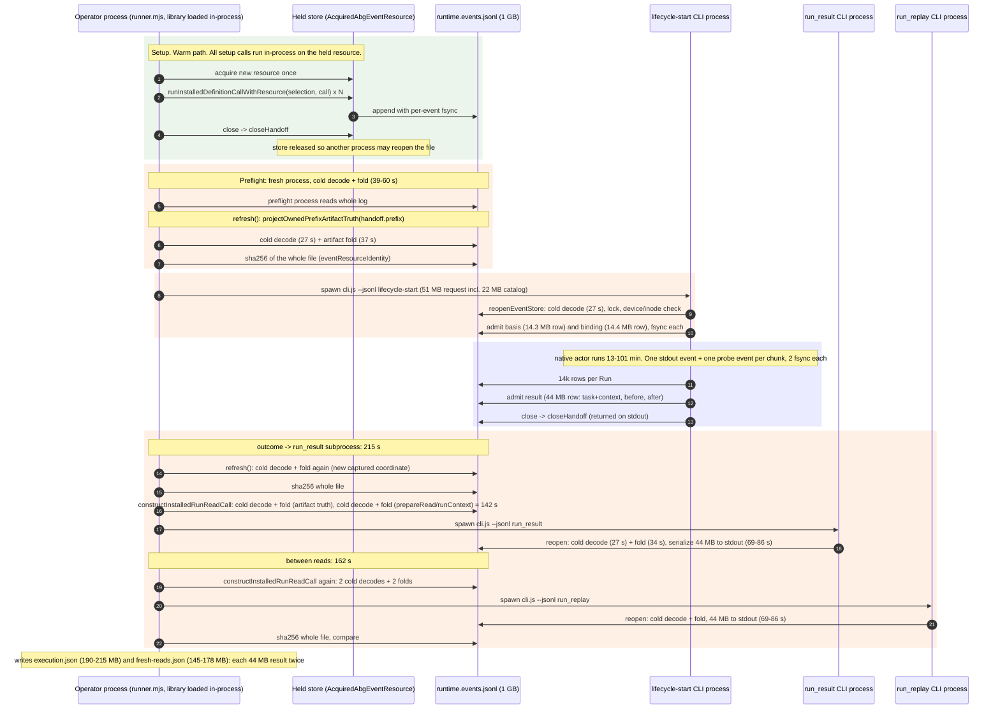
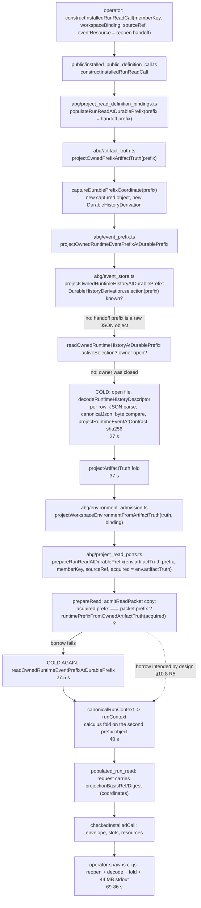
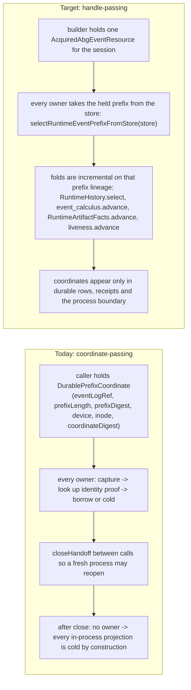
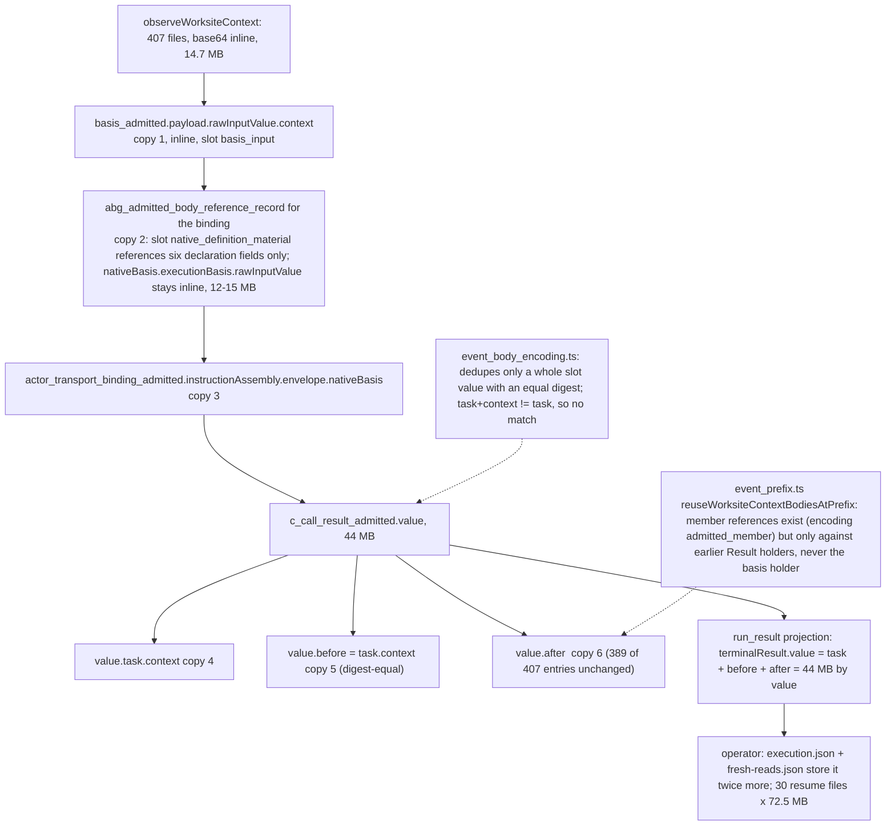
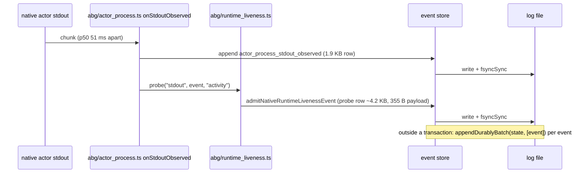
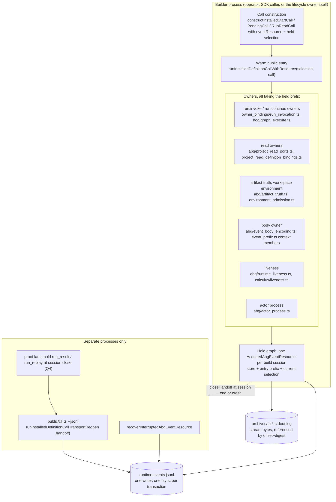
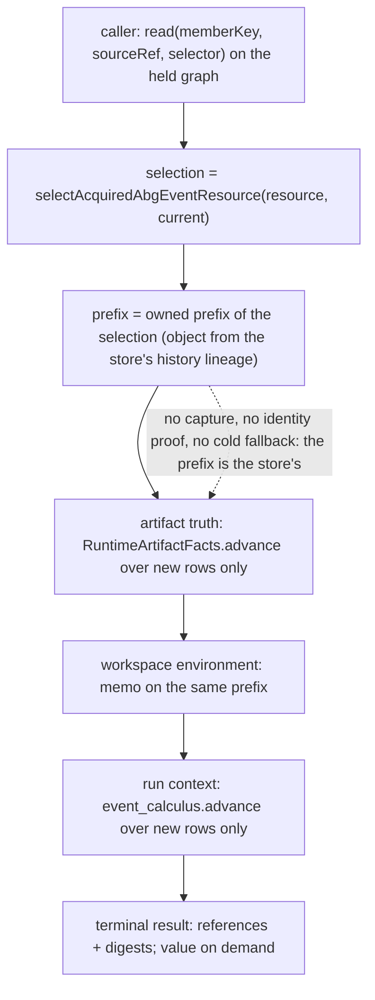
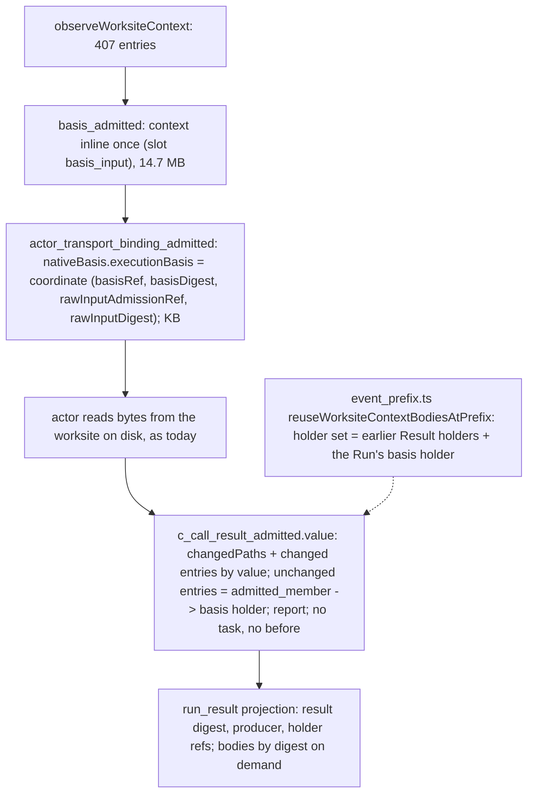
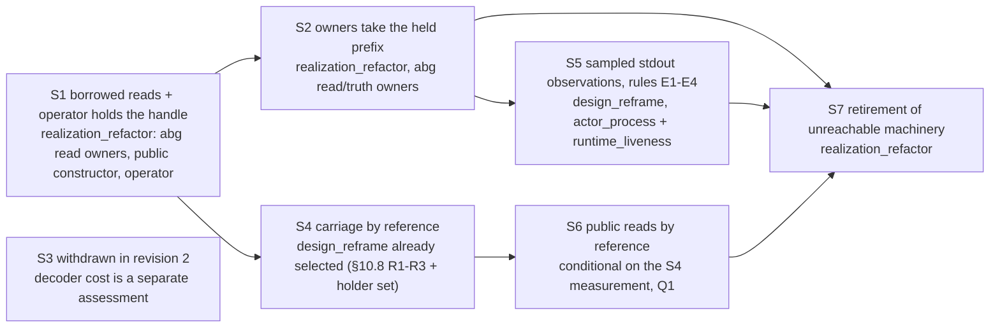

# Design: one held graph interface for the single-process builder

Commentary, not ratified design. Reviewer: Claude Fable 5.1. Pen stays with
Codex. Nothing is pushed. The owner asked for a design and plan that address
one defect: the layers of handoff between the operator, the public entry, the
read owners and the event store that exist for a distributed, untrusted graph
and cost 500–730 s of framework time per Run on a one-process builder.

Companion review with the measurements:
`.ai-workspace/comments/claude/20261106T024745Z_REVIEW_RC6_RC7_OPERATIONAL/README.md`.
Owner scope record: `release-qualification-rc6-01/ROOT_RC7_OVERHEAD_SELECTION.json`.
Codex's causal map: `single-address-space-consolidation-01/CONTEXT_AND_CAUSAL_MAP.md`.

Subject: RC6 source `e7179b19b50c3b2f918e59425667ed79239e4a68`, installed under
`release-qualification-rc6-01/runtime-001/sandbox/installed/abg/node_modules/@abiogenesis/typescript-tenant`,
operator `release-qualification-rc6-01/operator-client/{runner,public-setup}.mjs`.
All file paths below are under `build_tenants/abiogenesis/typescript/code/src/`
unless stated.

## Revision 2 (2026-11-06)

A review forwarded by the owner on 2026-11-06 found three material problems
in the plan and two corrections. Each was verified against the RC6 source at
`1f62c0095` and this post is amended in place; revision 1 is commit
`05cb2275a`. The diagnosis (§1, §2) stands. The rules (§4.2) are restated and
the plan (§6) is rewritten.

| Review point | Verified | Change here |
| --- | --- | --- |
| S1 cannot be operator-only: the read constructor accepts only a reopen handoff, the read binding rejects a held selection (`invalid_resource_assertion`, exit 70), and completion closes the resource | yes: `public/installed_public_definition_call.ts:651`; `abg/project_read_definition_bindings.ts:113–127` (schema), `:880–886` (admission), `:253` (`closeReadEventResource`); `abg/exact_prefix_bindings.ts:118`. The lifecycle owner already accepts a held selection and completes without closing (`owner_bindings/run_invocation.ts:1056`, `:1230`); the read owners do not | S1 now adds borrowed-read support to the read owners, then the operator lifetime change |
| S3 treats the decoder's per-row work as redundant verification; its hashes establish physical row identities and prefix ancestry that lazy body reads and historical cuts depend on, and a whole-file digest replaces neither | yes: `abg/event_store.ts:3739–3741` (per-row `physicalDigest` and running `prefixDigest`), `:3614` (lazy body read verifies `physicalDigest`), `:1778` and `:1840` (`cut` and historical coordinates derived from the per-row chain), `:3712` and `:3729–3731` (canonical form and restamp consistency) | S3 withdrawn. Full verification at acquisition is kept; the saving is one acquisition per session (R-C restated). Decoder cost is a separate assessment |
| S5 does not establish unchanged liveness: activity must come from admitted observations, the last-progress time must survive sampling, progress must be told from protocol noise, observations must be committed before timeout decisions, and archive/log ordering needs a rule | yes: REQ-R-ABG3-PROJECTION-016/017; `abg/calculus/liveness.ts:752` (last activity from the admitted probe's `elapsedMs`), `:768` (lease deadline from it), `:610–620` (a timeout is checked against the projection at its own cut) | R-E and S5 rewritten with rules E1–E4 and a differential equivalence lane; S5 follows S2 |
| S6 is a public-contract migration; measure after S4 first | agreed | S6 conditional on the S4 measurement; Q1 is a product reprice question |
| Q4 contradicts R-G: no close handoff can be issued while the resource stays open | agreed | each Run records its completion successor prefix; the close handoff is issued at close; Q4 restated |
| "exists only for distributed execution" is too broad; ownership, snapshot identity, crash recovery and liveness matter on one machine | agreed | §4.6 reworded to what each piece defends against and what stays; §4.7 extended |

## 1. The defect in one sentence

In-process interfaces pass **coordinates** (plain JSON that describes a
prefix of the log) where they should pass the **graph** (the held store that
owns the log), so every consumer must rediscover, through identity proofs and
re-authentication, whether the coordinate it was handed is the history it
already has; when the proof fails, or when the owner was closed so that a
separate process can reopen the file, the consumer silently falls back to the
cold path and reads the whole 1 GB log again.

The cold path is correct. That is why nothing refused and why three
consolidation rounds (RC3, RC4, the single-address-space activation) did not
move the numbers: they migrated callers onto canonical seams but kept the
coordinate-passing shape and the close-then-reopen protocol, which together
make the cold path the only path once a Run ends.

## 2. Problem, traced

### 2.1 One native Run today



About eleven complete passes over the log per Run. None is needed by the
actor. The measured framework share: 15.7%, 10.7%, 46.7% of host wall on the
three author Runs; it grows with the log.

### 2.2 The read layer stack and where it goes cold



Nine layers between the operator's intent ("the result of this Run") and the
bytes. Each layer takes a coordinate and must re-establish, through a WeakMap
keyed on object identity (`durableHistoryDerivations`, `OWNED_PREFIXES`,
`ArtifactTruthDerivation`, `acquiredSelections`), that the coordinate denotes
history this process already holds. Three of those checks can fail quietly:

| Check | Where | Falls back to |
| --- | --- | --- |
| `DurableHistoryDerivation.selection(prefix)` needs the exact captured object | `event_store.ts` ~3570 | cold read |
| `activeSelection` needs an open owner (`!durableAppendClosed`) | `event_store.ts` ~1760 | cold read |
| `acquired.prefix === packet.prefix` and `runtimePrefixFromOwnedArtifactTruth` | `project_read_ports.ts` ~700 | cold read |

Traced on the installed RC6 build (`build/code/src/abg/project_read_definition_bindings.js:447`):
`populateRunReadAtDurablePrefix` calls
`prepareRunReadAtDurablePrefix(input.prefix, …, environment.artifactTruth)` with
the **raw** handoff coordinate as the prefix and the artifact truth as the
acquired value. `prepareRead` captures the raw object into a new coordinate,
so `acquired.prefix === packet.prefix` is false, and the fallback
`readOwnedRuntimeEventPrefixAtDurablePrefix` refuses to borrow a cold-bound
selection ("explicit freshness never borrows a closed owner"), so it decodes
the log again. Measured: `prepareRead` cold read 27.5 s and
`canonicalRunContext` fold 40 s after `projectOwnedPrefixArtifactTruth` had
already decoded (26.8 s) and folded (37 s) the same bytes.

The worktree source at review time already passes
`environment.artifactTruth.prefix` instead (design §10.8 R5, the RC7
candidate). Measured on the installed build with an in-process probe over the
live campaign log: with the acquired coordinate the preparation costs 4.3 s
(the run-context fold is memoized on the same prefix lineage); without it,
68.8 s. R5 therefore takes one read construction from 142 s to about 68 s,
still one full cold decode and fold. It does not change the shape: the same
raw handoff object presented twice to `projectOwnedPrefixArtifactTruth` costs
two full cold reads (68.6 s, then 98.4 s), because each call captures a fresh
coordinate and keys its derivation on that copy. The operator presents
the same handoff object to `refresh()`, to the `run_result` construction and
to the `run_replay` construction, and then to two CLI processes. R5 removes
one of those eleven passes. A borrow that depends on `===` between two JSON
values to avoid a 27 s re-read is the defect; repairing one `===` is not the
fix.

### 2.3 Coordinate versus handle



### 2.4 Carriage: six copies of one context per Run



Both codecs that could remove the copies exist. Neither is pointed at the
copies that occur.

### 2.5 Liveness and durability per chunk



84,498 chunks became 169,503 rows, 51% of the log, and about 170,000 fsyncs.
The liveness fold (`abg/calculus/liveness.ts`) needs, per scope, the last
activity sample and the declaration and budget ordinals. It does not need one
durable row per chunk.

## 3. The 99% that already exists

| Capability | Owner | State |
| --- | --- | --- |
| Held store with durable descriptor, lock, incremental validated history, inline body table, per-prefix memoized derivations | `abg/event_store.ts` `AbgEventStore`, `RuntimeHistory.select`, `runtimePrefixComputation` | exists, used during setup and inside the lifecycle process |
| Resource lifecycle: acquire new or reopen, borrow a selection of a held resource, complete, close, recover | `abg/definition_event_resource.ts` `acquireAbgEventResource`, `selectAcquiredAbgEventResource`, `completeAbgEventResource`, `closeAbgEventResource`, `recoverInterruptedAbgEventResource` | exists |
| Warm public entry on a held resource | `public/installed_definition_call_transport.ts` `runInstalledDefinitionCallWithResource` | exists; the operator uses it for every setup call (`public-setup.mjs` `invoke`) |
| Cold public entry for a separate process | `runInstalledDefinitionCallTransport`, `public/cli.ts` | exists; correct for recovery, proof and foreign processes |
| Public call construction accepting a held selection | `constructInstalledStartCall` (`eventResource: AbgEventResourceInput`), `constructInstalledPendingCall` (`ReopenedAbgEventResourceInput`, which includes a held selection) | exists for the lifecycle; `constructInstalledRunReadCall` (`public/installed_public_definition_call.ts:651`) accepts a reopen handoff only |
| Borrowed acquisition and completion without close | `acquireAbgEventResource(selection)` marks the copy borrowed; `completeAbgEventResource` returns `abg_event_resource_completion` with a successor selection instead of closing | exists; used by the lifecycle owner (`owner_bindings/run_invocation.ts:1056`, `:1230`); not by the read owners |
| Read owners on a held selection | `abg/project_read_definition_bindings.ts` resource schema (`:113–127`), admission check (`:880–886`), `closeReadEventResource` (`:253`); `abg/exact_prefix_bindings.ts:118` | missing: reads require `reopen_abg_event_resource` and close on completion. Reproduced by the forwarded review: a held selection returns `invalid_resource_assertion`, exit 70 |
| Owned prefix from the held store | `abg/event_prefix.ts` `selectRuntimeEventPrefixFromStore`, `selectOwnedRuntimeEventPrefix` | exists |
| Incremental folds | `abg/event_calculus.ts` `advance`, `abg/artifact_truth.ts` `RuntimeArtifactFacts.advance`, `abg/calculus/liveness.ts` `advance` | exist |
| Transactions with one durable batch | `admitRuntimeEventTransactionAtDurablePrefix`, `admitRuntimeEventBatch` → `appendDurablyBatch(state, admitted)` | exist; probes and stdout rows bypass them |
| Body by reference | `abg/event_body_encoding.ts` (three slots, retained route), `abg/event_prefix.ts` `reuseWorksiteContextBodiesAtPrefix`, `resolveWorksiteContextBodyAtPrefix`, `admitted_member` encoding | exist; not pointed at the basis holder or the task copy |
| Binding without raw input | design §10.8 R3 (`envelope.nativeBasis.executionBasis` as coordinate; `rehydrateExecutionBasisAtPrefix`) | designed, not realized in the measured install |
| Stdout archive on disk | `runtime-001/resources/archives/fp-<id>-stdout.log` | exists alongside the per-chunk rows |
| Single-address-space rule | `ABI5_REALIZATION_CONSTITUTION.md` §4.1: crossing a function, module or role boundary introduces no serialization, reconstruction or renewed authentication | ratified |

What is missing is one small capability, reads on a borrowed selection, and
the rule that in-process callers hold the graph and hand the graph on. The
layers that exist only to cope with callers that do not can then go.

## 4. Target architecture

### 4.1 Components



Nothing new is introduced. The held graph is the existing
`AcquiredAbgEventResource`. The warm entry is the existing
`runInstalledDefinitionCallWithResource`. The cold entry is the existing CLI.
The change is which one the builder uses between Runs, and which inputs the
owners accept: the read owners gain the borrowed selection that the lifecycle
owner already accepts.

### 4.2 Interface rules

| Rule | Statement | Replaces |
| --- | --- | --- |
| R-A handle in, handle through | Every in-process owner that needs history receives the held prefix (`selectRuntimeEventPrefixFromStore(store)` or the selection's owned prefix) or the resource. No in-process owner accepts a raw `DurablePrefixCoordinate` to locate history. | `captureDurablePrefixCoordinate`, `DurableHistoryDerivation.selection/activeSelection` borrow logic, `runtimePrefixFromOwnedArtifactTruth`, the `acquired.prefix === packet.prefix` check |
| R-B coordinates at boundaries only | `DurablePrefixCoordinate` and `closeHandoff` appear in durable rows, receipts, request records and the process boundary. They are identity, not access. | per-call `reopen_abg_event_resource` in the operator; `projectionBasisRef/Digest` as a lookup key |
| R-C one acquisition per session | The only function that turns bytes into history is acquisition (`new`, `reopen`, `recover`), with its per-row verification unchanged: canonical form, restamp consistency, per-row physical digest and the prefix-digest chain. It runs once per build session, not once per call. | the second decode inside one read; one decode per CLI process per call |
| R-D one body, one owner | A worksite context is admitted once (basis input). The binding carries the execution-basis coordinate. The Result carries changed entries by value and unchanged entries as `admitted_member` references to the basis holder; no `task` copy, no `before`. | §10.8 R1–R3 realized; member reuse extended from Result holders to the basis holder |
| R-E liveness by admitted observation, sampled; durability by transaction | Stdout bytes go to the archive file. One `actor_process_stdout_observed` row per bounded window carries archive offset, length, digest and the capture time of the window's first and last chunk on the actor clock; the probe admitted for the window carries the last chunk's elapsed time as its activity sample (E1). Which bytes count as progress is unchanged until Q5 decides otherwise (E2). The pending window is admitted and durable before any timeout or effect decision reads the projection, and the timeout observation is admitted after it (E3). Archive bytes are written and fsynced before the row that references them is admitted; replay refuses a row whose archive bytes are missing or differ (E4). Probes keep their producers and clocks and are admitted inside the enclosing transaction; one fsync per transaction. | one stdout row and one probe row per chunk; `appendDurablyBatch(state, [event])` outside transactions |
| R-F public reads by reference (conditional) | `run_result` and `run_replay` return the typed terminal result with `value` as digest plus holder coordinates; bodies are fetched on demand through the body owner by digest. This changes what consumers receive; it is decided after S4 is measured (Q1). | 44 MB by value through stdout; operator storing it twice |
| R-G closed means session end | The builder closes the resource when the build session ends or on failure, not between calls. Each Run records its completion (successor prefix coordinate and receipt digest) as the committed prefix; the close handoff exists only at close. A crash leaves the recovery path as today. | close after setup, close after each lifecycle call |

### 4.3 One native Run under the held graph

```mermaid
sequenceDiagram
  autonumber
  participant O as Builder process (operator)
  participant G as Held graph (AcquiredAbgEventResource)
  participant RUN as run.invoke owner (in-process)
  participant ACT as native actor process
  participant L as runtime.events.jsonl
  participant AR as stdout archive
  participant C as cold CLI (proof lane, optional)

  rect rgb(235,245,235)
    Note over O,G: session open: acquire once (new or reopen). One decode. Setup calls as today.
    O->>G: acquire
    O->>G: setup calls via runInstalledDefinitionCallWithResource
  end

  rect rgb(235,245,235)
    O->>G: constructInstalledStartCall(eventResource = selectAcquiredAbgEventResource(resource, current))
    O->>RUN: runInstalledDefinitionCallWithResource(selection, call)
    RUN->>G: admit basis (context once, 14.7 MB) and binding (coordinate, KB)
    G->>L: one transaction, one fsync
    RUN->>ACT: spawn actor
    loop per bounded window (S5, after S1 and S2 are measured)
      ACT-->>RUN: stdout chunks, capture time each
      RUN->>AR: append bytes, fsync (E4)
      RUN->>G: one stdout row (offset, length, digest, first/last capture time) + probe with the last chunk's elapsed time (E1)
      G->>L: one transaction, one fsync
      Note over RUN,G: a timeout or effect decision flushes the pending window first (E3)
    end
    ACT-->>RUN: exit
    RUN->>G: admit Result: changed entries by value, unchanged as member refs, no task, no before
    G->>L: one transaction
    RUN-->>O: receipt with completion successor (held, not closed)
  end

  rect rgb(235,245,235)
    Note over O,G: reads on the same handle (borrowed read, S1): incremental folds, no decode
    O->>G: constructInstalledRunReadCall(eventResource = current selection)
    O->>G: runInstalledDefinitionCallWithResource(selection, run_result)
    G-->>O: terminal result, shape unchanged (by reference only if S6 is taken)
    O->>G: run_replay the same way; completion without close
    O->>O: record the Run's committed prefix (completion successor)
  end

  Note over O,G: session end: close -> closeHandoff recorded
  opt proof lane at session close (Q4)
    O->>C: cli.js run_result per Run at the close handoff (reopen, one full-verification decode)
    C-->>O: terminal result; digest compared with the warm read at that Run's committed prefix
  end
```

### 4.4 Read path through the handle



The first read after acquisition pays the fold once; every later read pays
only the rows appended since. On the measured log a cold open costs 27 s of
decode and 34–37 s of fold; under this design that happens once per session.
The decode itself is unchanged (R-C).

### 4.5 Carriage by reference



Per-Run log growth drops from about 88 MB of context carriage to one context
plus changed bytes. The existing `resolveWorksiteContextBodyAtPrefix` checks
(same scope, same digest, same authority basis and binding, declared
cross-Run use) are unchanged; only the holder set widens.

### 4.6 What is deleted

| Machinery | What it defends against | Goes or stays |
| --- | --- | --- |
| `DurableHistoryDerivation` capture/borrow logic, `captureDurablePrefixCoordinate`, `OWNED_PREFIXES` identity table, `runtimePrefixFromOwnedArtifactTruth`, `ArtifactTruthDerivation` | a coordinate handed across a layer that does not denote history this process holds | goes (S2, S7): under R-A the caller hands the history; snapshot identity stays in the coordinate and the receipt |
| per-call `reopen_abg_event_resource` and `closeHandoff` in the operator between Runs | a fresh process reopening a file another process still owns | goes from the operator (S1): the file stays held; the CLI reopen remains for foreign processes and the proof lane |
| read owners that accept only a reopen handoff and close on completion | a read on an unowned or stale file | changes (S1): reads accept a borrowed selection and complete without closing; the reopen path remains |
| one durable row and one fsync per stdout chunk; probe per chunk | losing the last observed activity on a crash | changes (S5): sampled windows that preserve the last-progress time and are committed before decisions (E1–E4) |
| `before: task.context` and the `task` copy in the Result; raw input inside the binding | a consumer without access to the earlier holder | goes (S4): consumers read through the basis holder with the existing refusal codes |
| 44 MB result by value over stdout; operator duplicate stores | a consumer without access to the log | conditional (S6, Q1) |
| per-row canonical check, restamp check, physical digest and prefix-digest chain in `decodeRuntimeHistoryDescriptor` | tampered, noncanonical or restamped rows; lazy body reads and historical cuts without a second physical read | stays; runs once per session (R-C) |
| tmpdir lock per open, device/inode re-check | a second writer | stays; runs once per session |

Ownership, snapshot identity, crash recovery and liveness semantics matter on
one machine as they do on many; nothing in this plan removes them. What goes
is the repeated proving and re-reading between layers of one process.

Unexercised subsystems (consensus, retry, fan-out, lease, governed-context
endpoint, 576 unreferenced exports; review F9) are a separate retirement row.
They are not on this defect's path and this plan does not touch them.

### 4.7 What is preserved

- The event log is the only recovery source. Nothing is cached beside it; the held history is the fold of the log, not a side store.
- Prefix digest ancestry, `eventContractDigest`, `payloadDigest` and the close handoff are unchanged as durable identity.
- Cold acquisition with full per-row verification is unchanged and remains the only way bytes become history: once per session, for recovery, for the proof lane and for any foreign process.
- Replay reconstructs the same facts: context bodies resolve through the basis holder with the existing refusal codes (`missing`, `stale`, `tampered`, `foreign`, `pending`).
- Transaction rollback, expected-prefix admission and refusal semantics are unchanged; batching changes when bytes hit the disk, not what is admitted.
- Liveness meaning (activity, artifact pending, timeout, external interruption) is unchanged and stays replay-derived from admitted observations (REQ-R-ABG3-PROJECTION-016); only the admission cadence of stdout observations changes, under E1–E4.

## 5. Why this time

The three earlier rounds changed callers; this changes the contract callers
are written against.

| Round | What changed | Why the profile did not move |
| --- | --- | --- |
| RC3/RC4 F4, F5 | route body copy; per-Run log size | carriage symptom, not the read protocol |
| RC5 liveness | liveness fold incremental | correct, and visible: liveness is 9.7% of a cold read now; the cold read itself was untouched |
| single-address-space-consolidation-01 (native-01..09, IR-01/02) | callers migrated to canonical seams (`selectRuntimeEventPrefixFromStore`, owned prefix, authenticated instruction basis) | the seams still take coordinates and borrow by identity; the operator still closes before each cold process; after close, every seam is cold |
| §10.8 R5 (worktree, RC7 candidate) | `populateRunReadAtDurablePrefix` passes the acquired coordinate | repairs one identity inside one construction (142 s → 68 s measured); the handoff object is still raw at every other entry, so each entry re-decodes |

The discriminator that proves the thesis: after S1 (borrowed reads plus the
operator lifetime change), run the operator with the resource held across
lifecycle and reads and count calls to `readOwnedRuntimeHistoryAtDurablePrefix`
and `reopenEventStore` per session. Today: about eleven per Run. Target: one
per session plus the proof lane.

## 6. Plan

One activation per step, one Return, one ledger line. Reviews at the close of
each step, not inside it. The sandbox gate per package applies: deploy the
pack, one live Run on the RC6 campaign shape, the named lanes for touched
owners.



| Step | Change | Owner files | Discriminator |
| --- | --- | --- | --- |
| S1 | Product: the read owners accept a borrowed selection. The resource assertion schema (`:113–127`) and the admission check (`:880`) admit `acquired_abg_event_resource_selection`; completion uses `completeAbgEventResource` (unchanged prefix, no close) and the receipt schema admits the completion; `constructInstalledRunReadCall` takes `AbgEventResourceInput`; `exact_prefix_bindings` the same. Cold verification and the public result shapes are unchanged. Operator: keeps the resource acquired in setup; `invokeLifecycle` and `freshReadbacks` go through `publicCaller.invoke` with `eventResource` = current selection; each Run records its completion successor prefix; close once at scenario end; proof lane per Q4 | `abg/project_read_definition_bindings.ts`, `abg/exact_prefix_bindings.ts`, `public/installed_public_definition_call.ts`, `public/installed_definition_call_transport.ts` (resource check for warm reads), owner contract regeneration if the receipt shape is published; `operator-client/runner.mjs` (`invokeLifecycle`, `freshReadbacks`, `runScenario`), `public-setup.mjs` (`invoke`, `close`) | lanes first: warm/cold agreement (the result digest of the warm `run_result` and `run_replay` at each Run's committed prefix equals the cold read at the close handoff) and interrupted-session recovery under a held resource; then counters: cold decodes per Run 11 → 0 (plus the proof lane), folded rows, bytes read, RSS, framework seconds per Run |
| S2 | `populateRunReadAtDurablePrefix`, `prepareRead`, `projectOwnedPrefixArtifactTruth` and `projectWorkspaceEnvironmentFromArtifactTruth` take the owned prefix of the held selection; the capture/borrow branch and the second decode are removed; raw-coordinate entry exists only in the cold transport | `abg/project_read_definition_bindings.ts`, `abg/project_read_ports.ts`, `abg/artifact_truth.ts`, `abg/environment_admission.ts`, `abg/event_prefix.ts`, `abg/event_store.ts` (derivation binding) | a read on a held store after N appended rows performs O(N) fold work, never O(log); one decode per process in the CLI profile |
| S3 | withdrawn (revision 2). The decoder's per-row work establishes physical row identities and the prefix chain that lazy body reads and historical cuts depend on, and checks canonical form and restamp consistency. Whether its cost can be reduced without changing what it establishes is a separate assessment after S1 is measured | `abg/event_store.ts` | none here |
| S4 | Context once; binding carries the basis coordinate (§10.8 R3); Result without `task` and `before`; unchanged `after` entries as member references with the basis holder added to the holder set; consumers listed in §10.8 read `task` through the basis | `product/native_workspace_work.ts`, `abg/instruction_assembly.ts`, `abg/execution_basis.ts`, `abg/event_body_encoding.ts`, `abg/event_prefix.ts`, the §10.8 consumer list | per-Run log growth: 88 MB context carriage → one context + changed bytes; replay and body refusal lanes unchanged |
| S5 | Stdout bytes to the archive, fsynced before the row that references them (E4); one `actor_process_stdout_observed` row per bounded window with offset, length, digest and first/last capture time; one probe per window carrying the last chunk's elapsed time (E1); progress classification unchanged (E2, Q5); flush-before-decide for timeout and effect decisions (E3); probes inside the enclosing transaction; `admitNativeRuntimeLivenessEvent` no longer fsyncs per event | `abg/actor_process.ts`, `abg/runtime_liveness.ts`, `abg/event_store.ts` (`admitRuntimeEventInternal`), `abg/calculus/liveness.ts` (window sample) | equivalence lane: replay the RC6 campaign's chunk stream (84,498 chunks with their capture times) through per-chunk and sampled admission and compare the liveness projection's disposition and `lastActivity` at every decision point; timeout and interrupted-session lanes unchanged; rows per Run 14k → hundreds; fsyncs per Run 14k → transactions |
| S6 | conditional on the S4 measurement (Q1): `run_result`/`run_replay` projections carry result digest, producer and holder refs; `value` fetched by digest through the body owner; contract catalog regenerated; consumers migrated | `abg/project_read_ports.ts`, `public/binding/*` generated contracts, operator records | read result: 44 MB → KB; operator archive per Run: 400 MB → MB; taken only if S4 leaves the read result material |
| S7 | Delete the machinery in §4.6 that S1–S6 make unreachable; dead exports in touched owners | the owners above | export census on touched files; no behaviour lane changes |

Order: S1 first; it is the smallest Product change that lets the operator
hold the handle, and its lanes prove warm/cold agreement and recovery before
any measurement is trusted. S2 makes the owners correct by construction so the
operator's good behaviour is not optional. S4 is already selected and follows
the S1 measurement. S5 follows S2 and carries its own equivalence lane. S6 is
decided on the S4 numbers. S7 closes.

### 6.1 Owner decisions

| # | Decision | Default if not decided |
| --- | --- | --- |
| Q1 | Public read result by reference (S6) changes the generated `run_result`/`run_replay` result contracts and what consumers receive. Taken at all? | not taken until S4 is measured; if taken, a product reprice, not HOW-only |
| Q2 | Window cadence: bounded interval (for example every 30 s of actor wall) or turn boundary (structured message) or both | both: turn boundary when the parser is `claude_stream_json`, interval otherwise |
| Q3 | Stdout rows: one per window with archive offset, length, digest and first/last capture time, or none (archive only, digest at exit) | one per window; the archive is durable before the row (E4) |
| Q4 | Proof lane: cold reads at session close against the close handoff, compared with the warm reads at each Run's committed prefix; or close and reopen per Run (two decodes per Run) | at session close; per Run only when a qualification campaign declares it |
| Q5 | Progress classification: every stdout byte counts as activity (today), or only the parser's progress messages (keepalive and protocol frames excluded) | unchanged; a change is a liveness policy decision separate from S5 |

### 6.2 Expected numbers

Estimates from the measured components; the discriminators above decide.

| Measure | Today | After S1 | After S1, S2, S4, S5 |
| --- | --- | --- | --- |
| whole-log decodes per Run | ~11 | 0 (+ proof lane at session close) | 0 |
| framework per Run | 500–730 s, growing with the log | admission + dispatch + the per-read fold increment; any in-process re-read that survives is counted by the S1 discriminator and removed by S2 | under 30 s, constant in log size |
| log growth per Run | 87–198 MB | same | one context + changed bytes + hundreds of rows |
| rows per Run | ~14,000 | same | hundreds |
| fsyncs per Run | ~14,000 | same | one per transaction |
| cold open of a 1 GB log | 69 s / 4 GB RSS | same, once per session | same, once per session (S3 withdrawn) |
| read result size | 44 MB | 44 MB | smaller after S4 removes the copies; KB only if S6 is taken |

## 7. Limits

- This is a design and plan from a reviewer; the owners and Codex select and realize it.
- The R5 identity break was pinned by reading the installed build and by one in-process probe on the live campaign log (read only, 2026-11-06); the probe's second-call cost (98.4 s versus 68.6 s) includes memory pressure from holding two decoded histories.
- The worktree carries uncommitted source at review time; only the one line relevant to R5 was compared, nothing else in that work was read.
- Expected numbers are derived from the measured components of the RC6 campaign, not from a run of the new shape.
- S4's consumer migration list is the one in §10.8; it was not re-verified here.
- Revision 2 verified the forwarded review's three problems against the RC6 source at `1f62c0095` by file and line; the review's own probe (exit 70) was not re-run here.
- Warm/cold agreement at the same committed prefix and interrupted-session recovery under a held resource are S1's lanes; neither has been run.
- Same-family review; no independent assessment is established.
