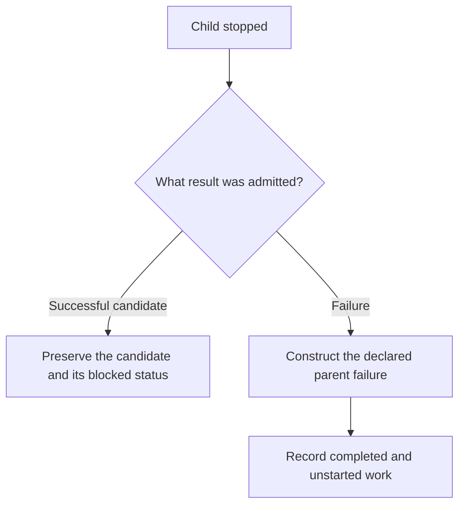

# ABIogenesis review findings explained and recommended next steps

Date: 29 October 2026. Author: Codex, for the Product owner. Commentary and recommendations, not a change to Product requirements or an implementation grant.

Product frame: ABIogenesis 5.0 has fifteen selected outcome families. For the work discussed here, it must execute declared development workflows on a trusted developer machine, preserve completed work and failures in the ABG event log, and recover the correct remaining work. GTL owns the declarations, HoG executes them, and ABG admits runtime facts. Public adapters, tests and reports cannot invent those facts. The active work is T-287 Phase D, now stopped at qualification.

Most of the concrete Phase C problems identified on 27 October have since been repaired. The earlier review described runtime commit `acb5200a8` and closure record `51bc5d2d8`. This post checks their explanation and subsequent disposition against `d152f45bc`, whose runtime code and contracts still equal candidate `fd38e8227`.

The immediate decision has therefore changed. Repeating the Phase C repairs would waste work. The next useful work is a bounded repair of qualification, a truthful decision about one unfinished capability, and a measured assessment plan. One recommendation from my earlier review also needs correcting: adding a new graph effect for command-launch preparation was too broad.

## The context behind the terminology

Consider a development workflow that edits three files, runs a checker, repairs a failure and runs the checker again. Three parts cooperate:

- **GTL** describes the permitted steps, their inputs, results and failure contracts. A contract is the declared shape and meaning of an operation's input or output.
- **HoG** follows that graph, calls the appropriate implementation and passes results between steps. An owner is the module responsible for a particular operation.
- **ABG** checks an operation's proposed facts and commits accepted facts to the event log. That check is called admission. Replay reconstructs what happened from those facts. A cold read does this after reopening, without relying on the previous process's memory.

A saga preserves which effects happened and which work remains when a multi-step operation stops partway through. It may have declared compensating actions, but a failure does not automatically undo a file that was already written.

The labels below are lookup aids: C1 and C3 name workflow test scenarios; D0, R2 and similar labels name work packages; Q numbers name owner questions; P1–P6 name the current qualification findings. They do not describe additional runtime components.

Effect supplies internal composition, failure handling and resource scope. It does not replace ABG's durable history or determine the meaning of retries and partial completion. The [Product runtime contract](../../../specification/PRODUCT.md#hog-and-abg-runtime-contract) and [deployment design](../../../build_tenants/abiogenesis/typescript/design/ABI5_REALIZATION_CONSTITUTION.md#41-distribution-and-risk-proportionality) already select this bounded architecture.

## A failed child was misunderstood by its parent

This was the most important runtime finding, previously called question 11.

Suppose the workflow successfully writes file A, discovers that file B has changed since it was inspected, and therefore never touches file C. The correct report must preserve all three facts: A changed, B could not safely change, and C remains unstarted. If this workflow is a child of another workflow, the parent needs the same failure information to decide what to do next.

The old code confused two different questions: **may execution advance**, and **did the child produce a successful or failed result**. Both a valid candidate awaiting a decision and an actual failed operation can have a blocked execution route. The parent treated every blocked child as carrying a successful candidate.

It consequently submitted the child's failure under the parent's success contract. ABG correctly rejected that mismatch. The parent then reported a result-admission problem instead of the declared child failure. In a nested branch, that early exit also prevented the outer summary of completed and unstarted members from being recorded.

The event log still contained the constituent operations, and the safety check prevented false success. The defect was the handoff and aggregation of their meaning. This matters directly to repair and restart: the caller should receive the actual partial failure, rather than have to diagnose a second error caused by reporting it incorrectly.

The correct distinction is:

**Root cause:** a route-status shortcut substituted for the admitted result's classification. Successful blocked candidates and blocked failures were placed in the same branch.

**Fix and current position:** `93119c1b2` added a reader of the child's admitted result and its contract. The workflow now distinguishes the two cases before constructing the parent result. The repair record traces the C1 and nested C3 lifts from refused success-contract submissions to admitted failures. C1 subsequently exposed a separate obsolete assertion, which was handled in R2. The classification is visible in `childResultIsFailureClass` and its caller in [workflow_lifecycle.ts](../../../build_tenants/abiogenesis/typescript/code/src/hog/workflow_lifecycle.ts). See the [D1/D4-a disposition](../../work/T287_RELEASE_RESUMPTION_01/phase_d.md#d1d4-a-disposition-executive-2026-10-27).

**Recommended path:** retain this repair and its ordinary, nested and blocked-candidate controls. No new failure vocabulary, saga framework or workflow engine follows from this finding.

## Some advertised public functions had no callable connection

The public contract described result assessment and two materialization operations: producing configuration and preparing a context bootstrap. But the transport tried to load named binding exports that did not exist.

This is similar to publishing an API route whose handler has never been connected. The declarations can be internally consistent and the underlying implementation can exist, yet a real caller still cannot reach it. Every admitted request to those routes stopped with `installed_binding_unavailable`.

**Root cause:** declaration, implementation and public dispatch had not been completed as one chain. Tests that checked packet shapes and catalog entries did not prove that the advertised operation could actually be called. Some implementation functions also had different context and result shapes from the public contracts, so adding an export alone was insufficient.

**Fix and current position:** R2-b at `6e7a5246d` connected result assessment through the admission authority. R2-c at `19700d8f7` connected both materialization members through their owners and the checked artifact-admission path. Positive and refusing calls ran through the installed transport. The exports now exist in [product/index.ts](../../../build_tenants/abiogenesis/typescript/code/src/product/index.ts). The [R2-b](../../work/T287_RELEASE_RESUMPTION_01/phase_d.md#r2-b-disposition-executive-2026-10-27) and [R2-c](../../work/T287_RELEASE_RESUMPTION_01/phase_d.md#r2-c-disposition-executive-2026-10-28) dispositions state their remaining proof limits.

Five interaction-response variants were a separate matter: Product reserves them for 5.1. The later ruling retains their declarations and truthful unavailable response. They were not five additional 5.0 implementations to build.

**Recommended path:** preserve the three repaired 5.0 routes and include their remaining relevant refusal cases in qualification. A broader public adapter framework would not address the original missing connections more directly.

## Why the test results did not establish complete coverage

At the Phase C close, failures fell from 56 to six. The arithmetic was correct, but the fifty removed failures had different meanings:

| What happened | Cases | What it established |
|---|---:|---|
| A formerly failing case passed | 9 | Its particular assertion now passed; several changes were to fixtures or expectations. |
| A failing case became a skip | 35 | Its missing input was identified; its behavior was not exercised. |
| A failing case was deleted | 6 | Its old fixture was retired; this supplied no replacement proof of the underlying behavior. |

A lane is a test file or separately run group of tests. A skipped wrapper can contain several cases, so even the skip count is not a complete inventory of untested obligations.

**Root cause:** completion of test cleanup was being compressed into completion of behavioral proof. Removing invalid historical fixtures was useful. Calling the remaining red set the entire defect set was an unsupported further step.

A concrete example exposed the problem. One deleted file mixed historical comparison tests with a current test of a declaration-data guard. That current test ensured that mutable data, getters and proxies could not be certified as safe reusable declarations. The whole file was classified by its historical input requirement, so the independent current case disappeared with it.

The extracted case passed against the Phase C runtime, and deliberately removing the guard made it fail. It was useful coverage. Its deletion was not evidence that the runtime guard was currently broken.

**Fix and current position:** the [Phase C close correction](../../work/T290_DEBT_WAVE_01/phase_c.md#phase-c-close-correction-executive-2026-10-27-after-the-owners-review-of-acb5200a8-and-51bc5d2d8) accepts the five review findings and withdraws the claim that the red set is the defect set. The lost case was restored in [t287-runtime-failure-diagnostic.test.mjs](../../../build_tenants/abiogenesis/typescript/test_env/tests/t287-runtime-failure-diagnostic.test.mjs), and the other deleted files were censused. The skipped and retired behavioral claims became qualification intake.

**Recommended path:** qualify claims by their actual execution evidence, including the negative case that would falsify each important claim. Preserve the cleanup already done. Restore current tests when their obligations still apply, and construct valid owner-driven replacements where historical fixtures cannot establish those obligations.

This remains relevant today: qualification has now identified a catalog claim for behavior that is not implemented. A green test suite cannot supply missing feature evidence.

## Correction to my earlier recommendation about preparation effects

The graph's `effects: []` looked inconsistent with preparation writing task and launch manifests. My earlier recommendation was to add the missing graph effect. That recommendation was too broad.

In this implementation, the graph's `effects` field selects a specific set of handler-routed operations. It is not an inventory of every physical action performed by an authorized process operation. Command execution already has its own operation contract and Run grant. Creating its launch manifests beneath the archive root is part of preparing that execution.

**Root cause of the review disagreement:** the general word “effect” and the particular graph field were being treated as the same category. Adding a new graph member would require a new handler, handler digest and lifecycle authorization for work already governed through the process owner.

**Current resolution:** R3 retains `effects: []` and explicitly classifies attempt preparation under process execution. The closed handler vocabulary is visible in [implementation/contracts.ts](../../../build_tenants/abiogenesis/typescript/code/src/implementation/contracts.ts); the reasoning is in [the R3 disposition](../../work/T287_RELEASE_RESUMPTION_01/phase_d.md#r3-disposition-executive-2026-10-28-worker-commit-0f6258433).

**Recommended path:** keep the existing process-owner grant and its archive-boundary checks, and keep that ownership explicit in the design and tests. I withdraw the earlier recommendation to add another graph effect solely because these manifest files are written. This is precisely where a seemingly stricter abstraction could create the duplication you were concerned about.

## The other original questions in practical terms

| Issue | Why it mattered | Fix or disposition now |
|---|---|---|
| Command limits and environment | Reading PATH, locale or time limits deep inside a supposedly deterministic function makes its result depend on hidden machine state. | R3 through R3-c capture and validate these at the operation boundary, then pass the captured values through the execution basis. The recommendation to add new public Program input keys was withdrawn. |
| Missing evidence-contract field | A reconstructed value claimed to have a field that it did not contain. That makes the type misleading and can endanger future readers. | D0 took the bounded type/guard correction. The original review did not demonstrate a harmful admission through the inspected successful-result readers. |
| Replay changed after another event | The test compared the complete replay response at two different log positions. Prefix-wide metadata naturally changed even though the completed run did not. | R2 checks equality at the same log position and separately preserves terminal meaning across later events. |
| Repeated historical-source resolution | The cache stored a validity ordinal but never retained the resolved value. Calls repeated the work. | D1/D4-a retains the value within the owning store generation. Closing, rollback or invalidation prevents reuse; R2 added retention controls. |
| Extra digests, unused refusal codes, a typed retry-reason field | These were possible refinements, not demonstrated failures of the selected workflow. | Existing declarations and digest-bound diagnostics remain. They need no new package without a concrete consuming obligation. |

The important rule is to capture external facts at the real boundary, preserve them in their owning admitted relation, and reuse established facts while valid. It does not require every internal function boundary to acquire a new context object, re-read the log or re-authenticate the whole history.

## What blocks delivery now

The current stop is D5-c, the qualification stage. Qualification asks whether one exact package satisfies all the claims it intends to release, including its own assessment and independence rules. Native self-conformance means using ABIogenesis's own assessment workflow to establish that verdict. The suite recorded at this point has 1,056 passes, no failures and 171 skips. Six selected application workloads are recorded as passing, but no final native self-conformance verdict has been produced. The candidate therefore cannot yet be released under its current Product requirements.

The [D5-c disposition](../../work/T287_RELEASE_RESUMPTION_01/phase_d.md#d5-c-disposition-executive-2026-10-29-worker-commits-92498a2d2-test-territory-and-e1a041fd9-record-phase-d-stops-here-for-the-owner) names six issues. They have different causes and should receive different remedies.

**P1 — The verification checks point at an oversized evidence object.** The rule connecting these checks to their evidence selects the entire command-result state. Its reconstructed rendering is about 7.53 MB, even though a compact verification object is about 145 KB. These sizes come from source reconstruction and a helper measurement, not a completed live qualification execution. The oversized material prevents the relevant assessments from fitting their input envelope. Truncating the prompt would remove required evidence. The fix is to change the rule explicitly to consume sufficient compact evidence, preserving which package it describes, where it came from and its links to supporting material. This needs a design decision as well as a code change. The reference selection is visible in [self_conformance.ts](../../../build_tenants/abiogenesis/typescript/code/src/validator/self_conformance.ts), and the full-result rendering in [qualification_proof.ts](../../../build_tenants/abiogenesis/typescript/code/src/abg/qualification_proof.ts).

**P2 — An unchanged plan is checked with repeated pairwise comparisons.** The coverage matcher repeatedly searches one list for each member of another. With thousands of criteria this grows quadratically; invoking it repeatedly for assessment starts multiplies the cost. This is ordinary implementation work: compare precomputed canonical coverage keys using sets or indexes, preserve duplicate and missing-member refusals, and avoid repeating unchanged validation within its valid scope. The index remains disposable derived data. The [current matcher](../../../build_tenants/abiogenesis/typescript/code/src/validator/qualification.ts) is `qualificationPlanMatches`. Measure the actual plan after the repair before accepting a duration estimate.

**P3 — The independence check compares different identity kinds for externally constructed work.** In the external-construction branch, authors are returned as actor-identity references, while the assessor is compared using an actor reference. Two different reference strings can still describe the same underlying actor. A comparison that fails to recognize this cannot enforce author/assessor independence. The native-construction branch already returns actor references, so the report's unqualified “never matches” wording is too broad; the mismatch remains relevant to the current inherited-source qualification. The fix is to resolve both sides to the same defined identity, with a negative test where the same author appears through different references and a positive test for a distinct assessor. This is a correctness issue even if the final verdict would otherwise be green. The comparison is in `resolveQualificationAssessments` in [qualification_proof.ts](../../../build_tenants/abiogenesis/typescript/code/src/abg/qualification_proof.ts).

**P4 — Some assessment packets exceed a configured bound.** Seven assessment jobs containing supplementary proof exceed the selected size limit. The plan requires each criterion to be covered by a complete assessment, so simply dividing its evidence across jobs is not an allowed workaround. First measure the complete rendered input against the actual supported context. If it fits with sufficient margin, a bounded size ruling may be enough. If it does not, explicitly revise the assessment arrangement to preserve complete coverage and the required independence. Arbitrarily dividing a criterion into partial approvals would weaken the assessment.

**P5 — The current assessment driver runs calls sequentially.** This is a time cost, not by itself a correctness failure. A single durable writer does not, on its own, prove that external computations must always run sequentially; any concurrency proposal would still have to preserve owned resources and serialized admission. For this release, fix the excessive material and repeated validation first, then measure the remaining serial cost. Do not introduce a scheduler or weaken the append lock merely to address an estimate.

**P6 — One claimed behavior is not implemented, and seven others need qualifying examples.** The catalog claims `yield_continuation`, but the current implementation does not supply the continuation reference needed to resume that yielded work. Seven other behaviors need runnable examples and their recorded evidence. These are different gaps: adding tests cannot implement missing behavior, and deleting a coverage row cannot remove a Product promise. Decide explicitly whether yield is required for the selected 5.0 workflows. If it is, implement and prove it. If it is not, reserve it for 5.1 consistently across Product, requirements, coverage and release claims, then supply the seven remaining examples.

## Why the work kept expanding

The records show several causes rather than one continuing architecture problem.

Some failures were found late because declarations, implementations, public bindings and proof were checked separately before their complete path was exercised. That explains how an advertised operation could survive shape checks while remaining uncallable.

Some repair grants excluded the very dependency needed to finish the repair. R2 required repeated activations as it reached additional admission gates. R3's disposition explicitly records that its activation treated the intended declaration changes as stops. These were work-scope errors; adding another abstraction would not fix them.

Some descriptions compressed “classified,” “test cleanup complete” and “feature proven” into “closed.” Qualification is now exposing the remaining differences. The earlier closure wording was corrected, but the continuing control is to keep a small claim-to-evidence table that includes skipped and missing cases.

The practical prevention is to name the complete affected caller-to-owner-to-admission-to-replay path in each bounded grant and run its decisive example early. Extend the grant only across the dependencies needed for that example. Preserve the relevant successful and refusing cases as regression tests.

## The recommended path from here

1. **Preserve the completed runtime repairs.** The child-failure, public-binding, retention and current-test findings have concrete successors. Do not reopen them as a general HoG redesign.
2. **Make one explicit yield-scope decision.** My preference for a bounded developer-machine release is to reserve yield if none of its selected mandatory workflows depends on it. If one does, realize that capability. Either choice must keep the claims truthful.
3. **Repair qualification before paying for the full run.** Correct evidence selection, coverage matching and identity comparison. Resolve the seven oversized packets under measured bounds and supply the missing behavior examples. Prove these controls with a small representative set that includes deliberate failures.
4. **Choose a sufficient material-selection plan.** Prefer declared selections of the evidence relevant to each criterion, with the assessor allowed to return unknown when the selection is inadequate. Keep the criteria and coverage obligations intact. Carry exact references so insufficient material can be reacquired.
5. **Freeze the resulting candidate and qualify that package.** Reuse evidence whose subject and relation remain valid. Reprove affected installed paths and the required candidate-bound delivery checks, then run native self-conformance within an explicit measured budget. Publication follows the required verdict and acceptance.

For the four questions Claude has put to you, that recommendation maps to:

| Owner question | Recommended direction | What the decision permits |
|---|---|---|
| Q19 — Missing behavior and examples | Explicitly reserve yield to 5.1 if the mandatory 5.0 workflows do not need it; otherwise implement it. Supply the seven examples. | A truthful capability list and evidence for what remains in scope. |
| Q20 — Evidence selection and run cost | Prefer declared, relevant selections with complete criteria and an honest unknown outcome when evidence is insufficient. | A smaller assessment plan, followed by a measured budget decision before the full run. |
| Q21 — Repair and candidate change | Make the bounded qualification repairs, then repeat the affected checks on the resulting package. | A new candidate with corrected qualification controls; no general runtime redesign. |
| Q22 — Remove this release's native qualification gate | Keep the gate for now. Reconsider only as an explicit smaller release contract if corrected costs remain disproportionate. | No silent weakening of the current release promise. |

Claude's current projections are approximately USD 520–950 per attempt for full bodies, or USD 100–150 with declared selections; the latter is a proposed plan, not a measured completed run. The runtime and token estimates must be recalculated after the repairs, and a first assessment may still return failures or unknowns. They are not reasons to purchase a larger run before fixing its inputs and controls.

Deferring native self-conformance to 5.1 is an alternative Product decision, recorded as question 22. It changes what 5.0 promises to prove. I recommend repairing the bounded qualification path before taking that alternative. If its corrected cost still exceeds the value of the intended release, then compare a deliberately smaller release contract with the full one, explicitly preserving whichever safety and independence claims remain.

The event log and saga approach remain proportionate to the intended single-machine workflows. The unresolved problems concern specific handoffs, qualification algorithms and release claims. None of the evidence establishes a need for Temporal or another durable workflow platform.

## Evidence scope and reading routes

The independent runtime tests described in the earlier review belong to 27 October: twelve lanes, 100 cases, 99 passed and one skipped, plus the targeted failure and mutation probes. This explanatory update inspects the current source and accepted delivery records; it does not claim a new full qualification run. Current repair status is recorded acceptance supported by those sources, with the stated residuals.

The current method basis is STDO 3.0.2, independently verified against the manifest selected by [stdo_abiogenesis.json](../../../stdo_abiogenesis.json). Historical Phase C evidence retains its original basis.

- [Product and completion predicate](../../../specification/PRODUCT.md#product-completion-predicate): what the release must actually establish.
- [Phase C close correction](../../work/T290_DEBT_WAVE_01/phase_c.md#phase-c-close-correction-executive-2026-10-27-after-the-owners-review-of-acb5200a8-and-51bc5d2d8): accepted findings, withdrawn wording and assigned remedies.
- [Phase D record](../../work/T287_RELEASE_RESUMPTION_01/phase_d.md): D0; D1/D4-a; R2-b and R2-c; R3 through R3-c; D2 and D3; D5-c and its current decisions.
- [Current ticket](../../tickets/active/T-287-deliver-abiogenesis-5-feature-waves.md): current activation, candidate and remaining release gates. Its current header is more recent than the historical status sections lower in the file.
