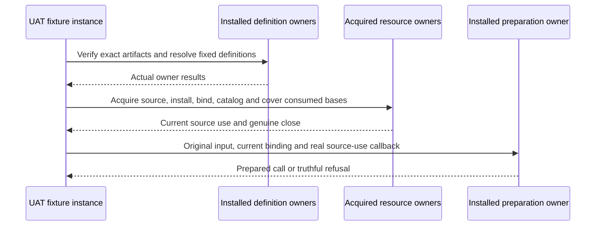
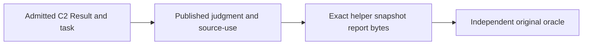

# ABG tests

Unit and owner tests in `tests/` check generic contracts, algebras, admission,
effects, traversal, evidence and replay. Integration tests exercise their
composition. A test's purpose follows its current owning contract; age or a
historical ticket name alone does not make it obsolete.

Sandbox UAT tests exercise ABG as a user would: start with a clean deployment,
supply an application specification through supported installed Public
interfaces, obtain actual construction and execution through the generic
default library, and check the application against an independent oracle.
Fresh reads must preserve the admitted result and its producer. These are
end-to-end integration tests used for user acceptance.

The seven workloads are `basic-cli`, `js-tenant-test`, `js-sdlc-bootstrap`,
`rust-cli`, `rust-service`, `parallel-js`, and `data-mapper-full`. Their source
inputs and independent acceptance oracles belong in
[`fixtures/sandbox-uat/`](fixtures/sandbox-uat/). They are test data, excluded
from the shipped ABG product. Hello World is a minimal test program; Data Mapper
is the larger test workload. Neither supplies ABG runtime authority.

[`uat/`](uat/) owns the runner and clean-deployment checks. Runtime execution
uses the installed ABG public interfaces and default library. Acquisition
provenance can name the original donor; execution must resolve every workload
locally without odd_glc. Deterministic or supplied worker responses qualify
only their declared boundary; real external-worker behavior requires a live
run. Preparation and skipped cases are not UAT passes.

Every sandbox run retains its exact artifact identity, inputs, install truth,
commands and streams, worksite observations, runtime events, and available
fresh result/replay reads in a new persistent archive before cleanup. Blocked
and failed runs retain evidence too. `npm run clean` preserves test evidence.
Historical green results apply only to their original subjects. A successful
UAT run does not by itself qualify or release an RC.

[`uat/continuation.mjs`](uat/continuation.mjs) owns the shared installed UAT
continuation call-through. One fixture instance selects the exact artifacts,
actor, physical worksite, historical declaration, admitted source and current
controls. Eventless verification and fixed Product resolution precede history
acquisition. The helper then uses the installed SDK's existing grants, slots,
installation, binding, catalog, consumed-basis witness and source-use owners;
it never supplies replacement admission or compatibility authority. An owner
refusal stops preparation while retaining committed effects and the genuine
close receipt. The canonical one-line SDK request and existing fresh-read
runner are shared. Future executions use this helper instead of copying a new
phase-specific preparation algorithm; frozen historical scripts remain evidence.

For an unchanged installed pair, `current.reuseInstalledPair: true` selects
the existing admitted environment through its authentic binding and install
owners. The helper reconstructs the Catalog/View from the verified pair and
compares them to the source invocation's exact admitted declarations; it does
not issue replacement verification, resolution, installation, binding, Catalog,
View or witness admissions. Every consumed basis still needs its applicable
existing binding cover. Missing or changed dependencies refuse this branch;
the changed-candidate branch remains the ordinary owner-effect path. Both
branches preserve original source/Program, currentness and the real post-close
Product preparation callback. The former helper always used the changed-pair
path, so it could not establish this unchanged-pair restart relation.

The shared helper consumes the installed Event Store's authenticated private
prefix and indexed owner reads for source, retained Results, consumed bases and
current use. It does not materialize all Events to find one producer or count
the prefix. Its post-close callback retains only the defining immutable
selection relation needed by that consumer; copied/foreign selections and
changed material still enter the canonical owner checks. Preparation supplies
no Run/model dispatch, and positive genuine continuation remains a separate
installed composition proof.

The independent command oracle acquires XML from each selected admitted C2
observation's exact task/attempt helper snapshot, rather than the mutable
application tree. The published C2 judgment and, for earlier Runs, explicit
admitted-source-use owner must validate that observation first. Each original
report identity/path, byte count and digest must match its confined physical
snapshot file. The latest matched original command supplies the eight-report
set, pass floor and depth-name evidence; each mutant/restoration episode uses
its own authenticated report population. Application/original-file checks
remain in the worksite. Historical XML alone grants no current execution or
semantic UAT credit, and the full original criteria remain binding.

The original exact report-set predicate also supplies the complete matching
inventory from that same selected C2 observation and its exact original task
declaration. Its base-relative measured paths must equal the original eight
paths as a set, with no extra, missing or duplicate entry. Eight named report
rows alone do not establish that inventory. Every mutant/restoration episode
must satisfy its own inventory join; another observation's inventory cannot
replace it. Physical report byte checks and all other original criteria remain
binding.
