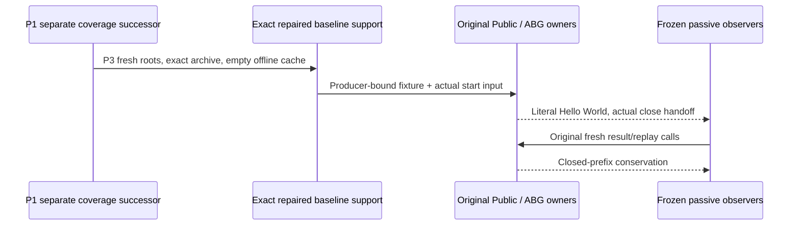

Product/requirements own exact external F_D Hello World and ABG admitted runtime truth. Accepted L2 and frozen measurement protocol own observation HOW. Original baseline archive, emitted owners and three repaired physical-dependency support files remain the selected subject.

Prospective coverage permits only source-owned exact archive list/member read shapes. The one fixture archive identity is instantiated from actual installed-environment.additionalProducts[0], artifact-1 and verifiedProducts[1], then matched byte-for-byte to its retained producer source. The frozen rule does not guess the fresh scratch name or archive digest. No non-Node internal quantities become zero. First prerequisite/attachment/workload/oracle/coverage/preservation failure stops without retry.
