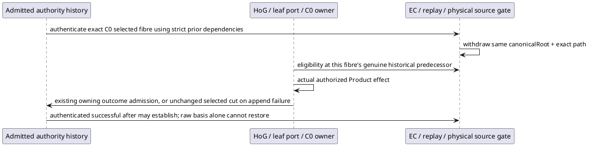

# Activated selected HOW binding

Root activation C0-POTENTIAL-EFFECT-REALIZATION-01 selects proposal freeze 63ffbc96fef785a6a2e032e168f55827863329eb9fe5e351269bd9cace1ac7c7. Product 700–704/PROJECTION026, design cb8dae9f7e684f9b6be730b74125294524ecd7e4d1f035fc03734d7ff1d1160b and L2 65f4007521634d808a3fd94bc87707ae4183ddb00ec4ec0da49e37381ee403c1 remain fixed. Exact source territory/preimages are in activation.json/source-preimages.json. No new Product outcome, event, runtime, schema, barrel, freshness token or restoration after an unobserved refusal.

The common join lives in c_call_outcome and performs no EC/replay fold. EC gathers the physical observation population separately. Anti-revival scans selected cause rows with their strict authentication support; it currently filters the selected dependency population per candidate (bounded O(causes × selected dependencies)); no hidden constant-time claim. The three dispatch consumers reuse existing exact-prefix EC derivation and keep their present owner/phase/authority checks. Replay intersects physical currentness from authority history with only the selected Run's existing observation/fluent population. Physical origin invalidation uses admitted binding root/path while transfer retains full authority equality.

## F5 ordinary semantic input admission selected by Root

The first Catalog includes the existing constructSemanticStageModulePublication alongside C0. A second actual WorkspaceAuthorityBasis/WorkspaceBinding at the same physical root uses admitWorkspaceBinding, then reconstructs its Catalog from that exact binding candidate and the same verified installs/publications. The ordinary C0 invocation/basis uses this Catalog. Conditional root-installed-environment support adds only existingEnvironment reuse and an optional publicInvocationRef; its default path is unchanged.

The retained-input witness constructs a pure requirement handoff candidate and existing D2 lifecycle declaration as explicit supplied input premises. It makes no claim of performed source handoff or semantic authoring. The actual installed semantic Program is selected from the first Catalog, validated with the existing rawProgramInput/publication helpers, and receives one ordinary invocation and execution-basis admission of a Product-constructed SemanticStageEnvelope. Its worksite grant is the actual semantic invocation's grant. No F_P dispatch, semantic Result, generic surrogate basis/event or C1/C2 task is created.

projectWorksiteRevisionOrigins derives the genuine admitted_input origin; worksiteRevisionOriginSurvives consumes an explicitly assembled retention row carrying that origin. This is the admitted-input/retained-origin consumer proof, not an admitted C1/C2 execution claim. Full/indexed/cold views compare before selection and after the real C0 cause. Full authority inequality remains a refusal for provenance transfer. All principal cases reuse this same bounded fixture route; physical effects remain four selected C0 attempts.

## Prospective execution boundary

One isolated copied complete source/dependency stage, one TypeScript compile, existing generator/material validation, one ignore-scripts archive. Freeze the actual source, dependencies, scripts, tools, archive/member correspondence and effect/resource configuration before installed workloads. Principal order: B04-06 replace; B04-02 rename-successor-read; B04-05 append-complete; B04-07 failed-rename. Each command selects one named test, at most 600000ms, retained scratch/hosts/caches under the granted /private/tmp parent. First unexpected failure stops before any retry or next case. Two fresh readonly Node children per principal case use the existing owned proof option. Eight native physical-scope/grant regressions and component C0 controls remain supporting supplied-premise evidence.

The actual selected-fibre prefix is recorded before physical owner dispatch. Append-failure equality is checked at the original unchanged outcome cut; a later raw-basis anti-revival suffix is a separately recorded cut. Fresh reopen after that suffix is not described as the unchanged original cut. Historical full/indexed/cold projections are preserved. A deterministic equal-ref successful successor is not claimed as an actual physical case unless achieved by the real owner.

No main generated files or old cuts are changed. No final campaign, independent review, semantic acceptance, completed refactor or release is claimed.

Root conjoined the closed independent Proof/F5 source-feasibility assessment: ordinary input admission suffices without F_P execution. Initial semantic input has assets:[] and evidence:null. The alias observation ref differs from the executing C0 predecessor ref. The post-Result origin check is mandatory in addition to fibre-only withdrawal, so predecessor equality cannot mask the distinct-authority physical invalidation. This paragraph is an attributed Executive summary, not a full independent report or acceptance.
