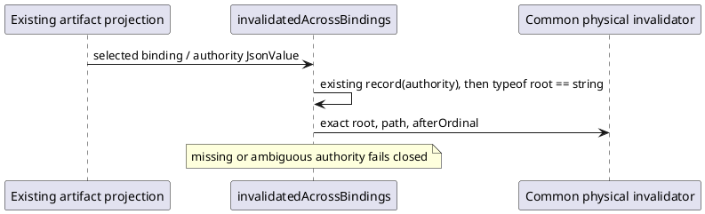

# Typed-root successor binding

Executive activation C0-TYPED-ROOT-02 retains the selected C0 potential-effect HOW/proof and ordinary unexecuted semantic input-admission route. The preceding stopped subject is immutable at freeze 8f19f66fa30a969f4cf00352cde8e1d9cf2b0a18c037e8a22baa076982663563. Its first compile failure and zero physical workload are preserved, not retroactively passed.

The originating defect is a TypeScript typed handoff: projectArtifactTruth exposes workspaceAuthorityBasis as JsonValue. Optional property access does not narrow that union. The existing local record predicate is now applied to the selected authority before reading canonicalRoot. Absent/non-record/non-string roots still invalidate; strict afterOrdinal and the common authenticated invalidator are unchanged. No assertion cast, owner contract, Product relation, dependency extent, runtime or algorithm change is selected.

Only worksite_revision.ts changes in the main tree. All other nine-file realization, two tests and bounded support bytes are copied from the exact failed source snapshot. The fresh stage has independent dependency inodes and one new compile. The failed stage is never rebuilt. Generator/material checks and one ignore-scripts archive follow only a successful compile. The complete source, support, dependency, emitted and archive inventories will be preserved; this permits later Executive consideration of archive adoption but grants no final campaign or acceptance.

The original finite proof is unchanged: first actual installed C0 owner sunny day, then actual unavailable-after owner admission, actual completed effect with append failure, and prepublication refusal; cross-authority/Run and genuine semantic input-origin checks are included in these cases. The supplied pure requirement-handoff value is raw semantic input only. The installed semantic Program receives actual invocation/basis admission with assets:[] and evidence:null and is never dispatched. No generic semantic surrogate basis, Result or C1/C2 task is fabricated. Two readonly fresh Node children per principal case; zero native/provider actors. The eight existing native physical-scope/grant controls remain supplied-premise supporting proof.

New physical cases are confined to the absent successor-02 subtree under the original granted parent. Each evidence/host/scratch/cache child is declared and checked before use. At most five principal physical C0 attempts, at most 10 GiB total new retained logical bytes including the stopped predecessor, and 600000 ms per supervised command. Exact archive/tool/fixture/fault/oracle/resource pins precede installed effects. First unexpected failure stops before repair/retry/next case. No cleanup, Git, continuation17, main generated mutation or independent review is selected.
