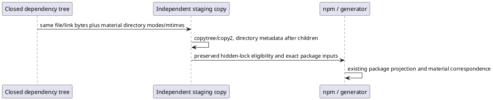

# Staging metadata successor

C0-STAGE-METADATA-03 retains the selected C0 HOW and finite proof. Source, tests, support and successful TypeScript emissions are exact copies of successor02. No compile or main source mutation is selected. Prior stopped freezes and their first failures remain immutable.

The material failure removed two CHANGELOG locators, with zero additions. The prior report's additions wording was incorrect; the preserved raw assertion and manifest inventory identify removals. This correction does not rewrite the stopped report.

Root conjoined the actual npm log and installed Arborist/npm-packlist source. The per-file copier had preserved the hidden lock's timestamp but recreated newer dependency directories. Npm rejected that hidden lock, loaded actual package manifests with files whitelists, and omitted the changelogs. The original closed baseline used copytree preserving directory metadata. This is staging input drift, not permission to waive Product payload identity or delete files. Reuse that exact baseline dependency tree and copy semantics; no synthetic touching to manipulate npm. Record the directory metadata now recognized as consumed producer input, independently from file identity and live runtime authority.

The new wrapper uses an explicit bounded effective environment and records the unchanged selected Node/npm paths, package versions, relevant configuration existence/digests and only noncredential configuration content. It does not reconstruct or claim completeness for the prior inherited environment.

After exact source/emission/dependency preservation, run the existing generator once and unchanged material assertions once, then one ignore-scripts archive and exact payload/member correspondence. On pass, freeze exact fixture/fault/oracle/resource/command pins before setup/install. The first genuine owner sunny day is the earliest runtime discriminator. The subsequent three principal cases, actual second binding/Run and ordinary unexecuted semantic invocation/basis route, deep negatives and eight native physical-scope/grant controls remain exactly selected. No generic semantic basis, native/provider actor, cleanup or broad sweep. First unexpected failure stops before repair/retry/next case. Budget includes all retained prior/new logical bytes, capped at 10 GiB.
