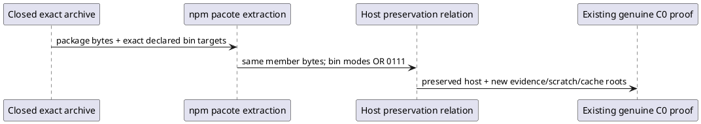

# Focused host mode proof successor

C0-HOST-BIN-MODE-04 retains the selected C0 HOW/proof and exact successor03 package. Root conjoined the actual two-only mode delta with pinned npm pacote source: local-file extraction makes declared bins executable using mode | 0o111. The selected command has --bin-links=false; bin-links is not the actual normalization mechanism. The violated assumption was the new verifier's unconditional archive-to-installed mode equality. No Product, C0 source, generator or package defect is established by that failure.

Only the archive's exact two declared bins use the pinned installed-mode relation. Every non-bin mode, member byte, path population and no-symlink condition remains exact. The original verifier failure, logs and immutable host remain preserved. Corrected check is new successor evidence, not retroactive success. The sunny host is reused read-only without reinstall. Three later selected cases may install the exact archive once each with existing offline ignore-scripts forms. No compile, generation, pack, chmod, source/test/support change or broad candidate copy.

The unchanged owner test runs the sunny day first and returns its result immediately to Root. All remaining ordered semantic oracles are the original proof freeze dc4931ca55fc37265b64ab8b3a29502873113a054370335fa5120e138acc8f9c: actual second binding/Run; genuine semantic invocation and basis with supplied raw handoff premise and no F_P dispatch; distinct authority/observation and post-Result F5; unavailable successor, unadmitted effect, no-publication refusal; anti-revival; deep consistent negatives; full/index/cold parity; own successful after and existing component controls. No semantic oracles were changed here.

Commands retain 600000 ms group supervision, at most five principal attempts, two fresh read-only Node reopen children per case, zero native/provider actors and 10 GiB aggregate retained bytes. Original physical resources and all failed cuts stay immutable; no cleanup. First unexpected selected preflight, owner, preservation or oracle failure returns before repair/retry/next case. All final campaign, review and acceptance claims remain separately selected.
