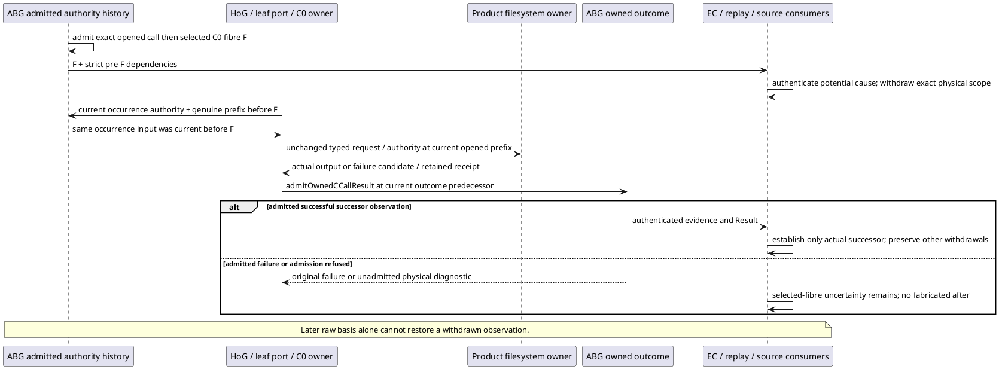

# Proposed L2 supplement: C0 potential-effect currentness

Status: **proposal awaiting Root selection**, not an implementation grant. Governing basis is in [activation.md](activation.md), [method-resolution.json](method-resolution.json), [source-pins.json](source-pins.json), and [triage](review-attribution-and-triage.md). Exact requested frame anchor exists: `repo://abiogenesis/build_tenants/abiogenesis/typescript/design/ABI5_PROJECT_REFERENCE_FRAME_BASIS.md#f-worksite-causality`. Integration, authority, lifecycle and proof are conjoined locally for this one increment and return to Root.

## Selected relation proposed to Root

Use the existing, exactly authenticated C0 `c_call_fibre_selected` as a **potential-effect boundary**. It proves that the declared effect-capable C0 occurrence was selected, not that a syscall or effect occurred. Before that event, currentness is decided at the genuine historical prefix. At and after it, dependent observations over the same canonical root and exact subject path are no longer current until an existing authenticated owner observation establishes currentness. This is necessary because an unadmitted physical outcome adds no durable fact by which pure replay can distinguish before/after mutation.

No new event, Result, rollback, observation, Public operation, pending-state authority, filesystem read in projection, global cache or observation freshness token is introduced. The unknown condition is reconstructible from the admitted cause, physical scope and absence of an authenticated establishment; existing fluent absence alone is not described as evidence that a write happened. Keep the original failure/result class, value, evidence and diagnostic semantics unchanged.

## Canonical typed handoffs and one authentication join

| Handoff | Existing owning contract and deciding relation |
|---|---|
| Request → admitted basis | Product `WorksiteFileReplaceRequest`, ABG `ExecutionBasis`, invocation/grant/binding relations; raw input digest and exact root/child authorization remain checked. |
| Basis/opened/fibre → potential cause | ABG `RuntimeEvent` / `RuntimeEventPrefix`, admitted implementation set and selected resolution; Product `constructWorksiteEffectAuthorization` reconstructs the exact authorization. Cause is the actual fibre event plus strictly earlier support. |
| Current occurrence → dispatch eligibility | Existing `CCall`, `LeafExecutionAuthority`, durable current prefix and canonical request. The same exact fibre identifies the historical pre-selection cut. Eligibility is a pure answer, not a replacement execution authority. |
| Owner → candidate → outcome admission | Existing `LeafRealizationCandidate`, `ClosedLeafOwnerReceipt`, Worksite output or typed post-publication failure; `admitOwnedCCallResult` retains its exact evidence/Result checks. |
| Cause/establishment → currentness | Existing observation-current fluent and existing authenticated success transition. Physical target population is selected independently of immutable binding/authority identity. |

In existing `abg/c_call_outcome.ts`, factor the request/binding/basis/implementation/opened/fibre reconstruction currently inside `projectWorksiteFailureBasis` into one internal helper independent of a failure value. Reuse it for potential cause and preserve the existing failure wrapper's `isWorksitePostPublicationFailure` and `worksitePostPublicationFailureMatches` exactly. Do not generalize a typed failure to any failed Result. Keep `projectWorksiteTransitionForResult`'s public return shape unchanged.

The shared reconstruction must establish unique exact basis, opened and fibre rows; event and payload call/basis/graph/Run/frame identities; declared C0/F_D implementation binding, requirement key, program locus and complete selected contracts; binding artifact and authority correspondence; request/basis raw digest and value; invocation's exact grant and actor/scope; root or child graph permission; and strict binding/implementation/invocation/basis/opened/fibre order plus required causal support. Use existing owner reconstruction/constructor checks, not a parallel permissive predicate. Exact predecessor observation identity is part of the request. The potential-cause helper needs no target-observation population or EC/replay fold.

The strict selector in that same module obtains the existing aggregate, basis, invocation, parent basis/call, binding artifact and implementation-set dependencies from the genuine pre-fibre prefix. Supply the cause separately; do not use a later Result or later repaired basis to authenticate its past. The failure Result selector still cuts before its evidence/Result and preserves every existing join. No new module or barrel is needed. Existing function-level ABG cycles are already present; added internal calls must be hoisted/runtime-only with no new top-level evaluation or recursive authentication → replay → authentication path.

## Three dispatch gates and Run scope

Add one internal historical eligibility operation in `event_calculus.ts` that consumes the **full authority prefix**, exact current CCall and request, and the shared authenticated occurrence. Resolve the actual fibre event from that authority prefix, derive its strict historical prefix, and decide the requested predecessor's physical currentness there. Also reject a different occurrence, wrong cut, later intervening physical cause, or stale current-prefix authority. Only the occurrence's own fibre withdrawal is exempted when deciding dispatch eligibility; this exemption must never restore public currentness or forgive another cause.

Reuse that operation in `hog/ccall_lifecycle.ts`, `implementation/leaf_invocation_port.ts`, and `implementation/worksite_file_replace.ts`. Retain each existing `requireCurrent`/held-store check, call phase, exact selected implementation, grant, request, installed environment, graph effect and owner physical precondition. Keep `LeafExecutionAuthority.predecessorPrefix` at the current opened prefix, including its admitted liveness observations; it is not replaced with the historical prefix. Parents/native branches retain their existing meaning. A genuine owner sunny-day execution is the first post-compile discriminator.

The existing EC derivation can answer an exact historical held-fluent question, with its existing derivation/selection validity. Reuse it; disclose cold/full-prefix work and hot reuse. Do not rebuild a whole history three times per dispatch under a hidden helper. The pure cause authenticator and ordinary native invalidation gate remain selector-bounded and never invoke EC/replay. Any realization that requires a new runtime cache or broad reauthentication must return to Root before changing this proposal.

In `replay.ts`, use the already-available authority prefix to filter physical currentness of the Run's existing observation candidates and matching `worksite_observation_current` active fluents. Leave all non-worksite fluents, Run candidate population, provenance, results and causal edges scoped as before. Do not inject foreign Run observations. A bare Run-only prefix can establish only its supplied projection domain; the owning durable-prefix APIs already carry the authority prefix and must use it. The same committed boundary, with the same full authority, governs full/indexed/cold forms.

## Basis anti-revival and establishment

An admitted raw basis may preserve an already-current exact observation or establish the initial authorized request under the existing rule when no earlier scoped uncertainty/withdrawal contradicts it. It may **not** erase an earlier physical invalidation merely because its admission is later, its Run is new, its binding changes, or its request has been re-digested. Apply this at the EC basis initiation, using the same authenticated physical causes at the strict pre-basis cut. The physical-scope guard must also cover a newly named binding/observation at an already-uncertain path; suppressing only a repeated observationRef is insufficient.

A later authenticated successful owner successor establishes its actual observation, even if the deterministic observationRef equals an earlier value. Order and owner evidence provide the occurrence relation; the ref itself supplies no freshness. The existing Result successor initiation and exclusion of its own after from retirement remain. An identical raw request repeated after withdrawal supplies no such evidence and leaves currentness false. A basis repeated after an already established exact owner successor may preserve that held ref; it must not reattribute establishment to the basis or recreate other binding aliases. Historical cuts remain exact.

An authenticated C0 pre-publication/no-effect refusal does **not** automatically restore O0. The fibre had established a potential-effect boundary; neither that refusal nor the absence of a receipt is an actual new observation. This proposal deliberately remains conservative. `observeWorksiteSubject` performs a Product read and returns a value, but a later bare raw basis does not prove when that read occurred. `native_work_reacquisition.ts` has its own native C2 provenance contract, not a generic C0 restoration token. The inspected C0 history does not supply a standalone fresh-observation admission that can be invented here. Recovery after a terminal refusal/admission loss may therefore remain unavailable on that path until a separately lawful owner-observation route is selected. This is an explicit availability limit, not authorization to synthesize an event or weaken the gate. In-flight genuine successful owner observation can establish currentness through its existing outcome admission.

For computation, basis anti-revival must derive the physical cause/establishment relation from the existing indexed observation dependency population and strict supporting joins. It must share the ordered relation with full EC and expose all needed dependencies. It may use the existing EC derivation's exact-prefix facts; it must not recursively call full replay at every basis. Cost and selected dependency extent are proof obligations.

## Physical consumer closure and F5

Extend `runtime_history.ts`'s existing `worksite-observation-dependency` candidate bucket to route C0 fibres; membership is never authorization. Add fibre authentication/physical targets to EC, native invalidation and basis dependency closure. Keep strict prefixes and the prior success/failure/native authentication relations. A valid C0 fibre remains a cause even when a forged later outcome is rejected.

Use `worksiteCommandSourcesInvalidatedAfter`'s common authenticated cause relation for `worksite_revision.ts::invalidatedAcrossBindings`, resolving the subject's binding/authority through the existing admitted artifact relation and comparing only canonicalRoot plus exact path for physical invalidation. Retain its strict `afterOrdinal`. This brings pending fibre, admitted C0 success/failure and existing scoped native causes into the consumer relation. Preserve the full-authority and eligible-ancestry equality used by `deriveCurrentOrigins`, `samePhysicalSubject`'s transfer callers, binding cover and semantic projection. No producer authority transfers across distinct authorities merely because their files overlap.

All origin arms must conjoin their original producer/provenance proof with the common later-physical-cause query: admitted input, initial-job bridge, admitted binding projection, replacement, and retained dependencies. This does not require inventing a C0 fluent for a native observation that was never established by that fluent's owner. Missing/ambiguous binding-root authentication fails the origin's applicability; it must not silently mean “not invalidated.” Preserve exact sibling/other-root controls and known/unknown native write scopes.

## Selection, proof and limits

The prospective grant and finite exit proofs are in [prospective-grant-and-proof.md](prospective-grant-and-proof.md). This HOW changes no current source. It is a source-grounded lawful candidate for Root's selection, conditional on the exact occurrence authentication, historical eligibility, conservative recovery and complete physical consumer conjunction described above. It is not yet executed or independently accepted. F1 remains blocking; final combined artifact, installed proof and L5/Executive acceptance must be rebound to any selected successor.
