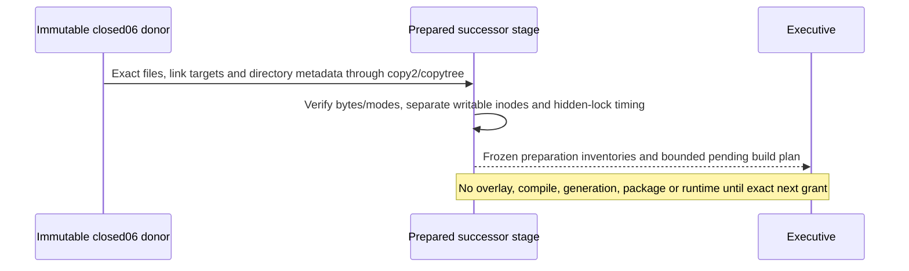

# C2 candidate stage preparation

Executive C2-CANDIDATE-STAGE-01 selects the integration frame and filesystem preparation only. Donor is closed06 freeze80c749e3ad666b8d6ae08e9b4c4f8e56a274072926f1005e6d8049b40b5671cd, archive25e7f390a899f3bd9c49fa11a15feba1f59cb2a1d2ba4bad1f62c1abc4224079. No moving-main source is copied. Exact C2 execution_basis.ts and owning HOW remain a separate frozen input and future Executive activation.

The existing npm producer consumes dependency directory modes/mtimes and hidden-lock freshness as well as file bytes. Preserve the complete donor directory tree metadata after children, preserve typed relative symlinks, verify containment, and require distinct file/directory inodes. No hardlinks, synthetic timestamp adjustment, network or dependency install. Verify donor members against their closed inventory before copying and copied members against the same bytes. Retain the old emitted files only as predecessor evidence; they are not a newly compiled C2 candidate.

Source-route inputs may include owner-generated contract files. Select their actual closed06 post-generation bytes, retaining the original source-route inventory and exact declared generated deltas; do not mistake a pre-generation source manifest for final stage bytes. Reuse closed tooling shapes and pinned Node/npm/TypeScript identity. Proposed build actions remain disabled pending the source/HOW grant; tests are separately selected and test_env remains outside the package.

Protect main's existing936 generated bytes through its existing manifest; no main build/clean/prepack or stage mutation outside this new root. Additional logical retention <=2GiB. Preserve all older cuts and no continuation17 access. First selected failure stops to Root before repair/retry. Preparation records freeze this copy relation; the prepared stage can become a later output only under the next exact activation. No acceptance or release claim.
