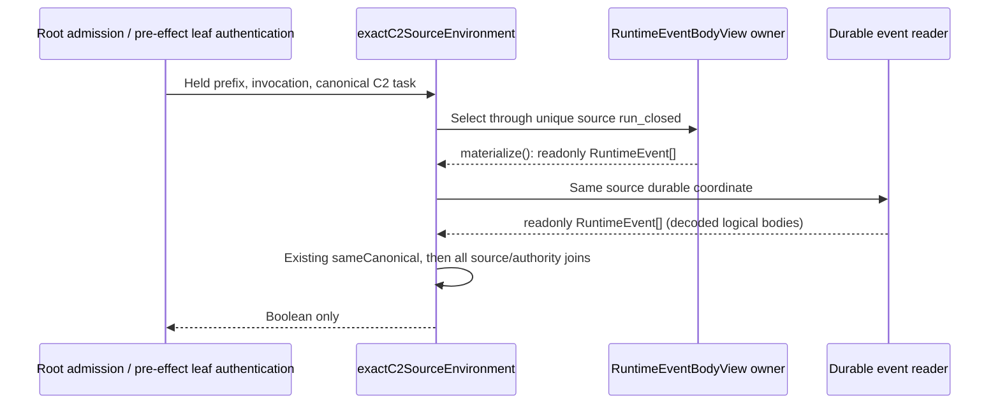

# C2-SOURCE-PREFIX-REPAIR-01: before-effects HOW

The fixed Product permits exact closed C1/C3 construction results to supply C2 while ABG alone admits execution. Product execution/admission (681–704), common-library prerequisite (1239–1250), REQ-R-ABG3-PROJECTION-002/025, accepted K08 and C2 HOW 169–199 govern. No Product meaning, guard, prefix coordinate, equality algorithm, event or result shape changes.

The actual installed 07 C1 source failed the complete-prefix equality guard because the source side was `RuntimeEventBodyView`, canonically `{"length":186}`, while the durable reader returned 186 full logical events. This is a pre-existing supported-path defect, also present in HEAD according to Executive source verification. The existing observed/native/child early branches and earlier pure fixture checks did not exercise the closed construction-source path. Original 07 refusal and pure read-only diagnostics remain evidence; a counterfactual success is not installed acceptance.

Typed handoffs use the existing owners: `RuntimeEventPrefix` through the actual source closure -> `runtimeEventBodiesAtPrefix` -> `RuntimeEventBodyView.materialize()` -> complete `readonly RuntimeEvent[]`; `DurablePrefixCoordinate` through that closure -> `readRuntimeEventsAtDurablePrefix` -> complete `readonly RuntimeEvent[]`. `sameCanonical` compares these same semantic carriers. Physical codec JSONL extent/digest authenticates the durable coordinate; raw physical rows are not this logical equality operand. The complete output relation already requires complete source-prefix expansion; materialization is transient O(source-prefix events/body bytes) work, not a cache, authority or permission to repeat whole-history expansion at unrelated handoffs. The view and canonical owners are unchanged.

The sole source edit appends `.materialize()` at this boundary. Root `admitExecutionBasis` and `hasExactWorksiteCommandLeafSourceAtDurablePrefix` (via leaf authority verification) retain the same private predicate. C1-root and C3-reducer branches share it; this finite witness is C1 only. All currentness, source-value, uniqueness, durable-validation, source-result rehydration, A/W and owner guards remain.

Effects: create this directory, immutable preimage copies, source/HOW delta, one finite read-only Node diagnostic and its local output/receipt. Reuse retained 07 event store, installed modules and exact existing prefix as read-only inputs; Node compile cache disabled. No append, EventStore open-for-write, runtime admission, helper/command/HTTP/actor/provider, build, packaging, existing-file cleanup, or generated-main mutation. A pure Node host is diagnostic machinery only. No child process is spawned by it.

Preflight binds original module/source/task/outcome/store/toolchain hashes and verifies source delta exactly once. Fixed population: original same-prefix false; adapted same-prefix true; adapted wrong source-result value false; missing source basis false; foreign source run false; authentic earlier prefix before source closure false. Capture each result before checking its expected Boolean; first unexpected result stops, with no correction/retry. These negative operands are controlled in-memory variants of actual retained inputs, not authenticated runtime admissions.

Exit evidence includes module/event-log unchanged hashes and exact source correspondence, two-file diff and successor hashes. Existing full installed P5 (actual C1→C2 command/HTTP/admission/fresh replay) is the later selected regression. This step supplies no installed, C3 execution, P5, independent acceptance or release credit.
