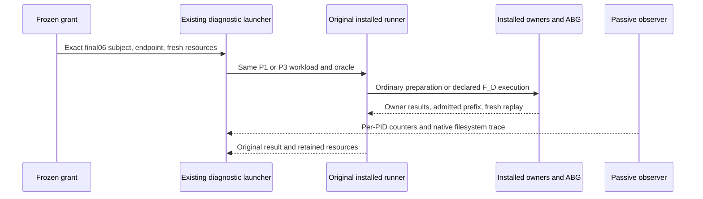

# Candidate passive diagnostics

Product Frame: fixed ABI5.0 fifteen-family Product; active T287 common-library L4 observation only. GTL/HoG/exact owner/ABG/fresh replay authority is unchanged. No semantic or release acceptance is inferred.

The original configuration and effect-grant contracts are instantiated with fresh roots, run identities, empty offline cache and distinct empty npmrc files. The passive configuration uses the existing prepared contract. Stage/package/support bytes are referenced unchanged; the original runner performs its own required inventory preflight. The observer attaches only after exact module authentication and keeps original bodies and oracles unchanged.

External tar archive-list/member-read and du footprint edges use the closed baseline coverage rule and remain uninstrumented. Actual archive identities are bound through their producers after successful work, never normalized away. Unexpected edges or failed observations return to Executive. Existing measurement.md and output-correspondence.json govern units, overlaps, unsized channels, original scopes and limitations. No repeated baseline, P4 or speed threshold.

No concurrent host workload is controlled by this proof. Start/end load snapshots are context, not causal attribution or an isolated overhead estimate. Physical roots and raw outputs remain retained.
