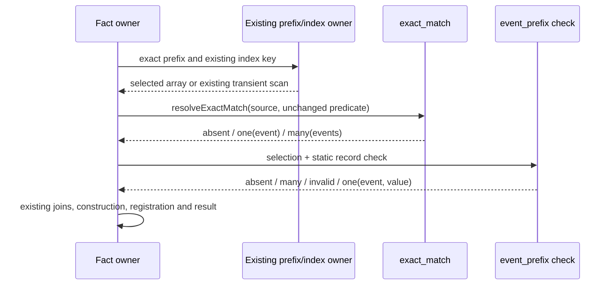

# C3 — Common exact selection and checked record facts

**Status: proposed HOW; construction result, not acceptance or implementation.**
Writer: `/root/stdo3_checked_fact_design_writer`. Frame:
`repo://abiogenesis/build_tenants/abiogenesis/typescript/design/ABI5_PROJECT_REFERENCE_FRAME_BASIS.md#f-end-to-end-interface-integration`.

Root's [decision](../common-consolidation-reentry-01/decision.md) selects this
bounded K04/K08 re-entry. Its freeze is
`f46164cd09d190feac86c1f375b1f404a05ec46c0526f8341379bf31c291b686`.
The unchanged common HOW is `cb8dae9f7e684f9b6be730b74125294524ecd7e4d1f035fc03734d7ff1d1160b`;
current L2 is `281a4e31840203fb249ce9cf1d10ca5d3d07f0769fb9175080e7514bae489615`.
The operative method is STDO `v3.0.0-rc.1`, manifest
`069285ad5a79d59ca2dd835e34a54b3e537b0eeef99c29994b18c339dbe62232`,
resolved through the manager; composition is empty. Exact inputs are in
[source-inputs.json](source-inputs.json).

Product's common-library prerequisite and 5.0 Compression Boundary select actual
retirement in this family. EVENTS-001/002/003/018/024 and
PROJECTION-001/002/004/005/013 retain sole ABG admission, causal history,
durable publication and EC truth. The fixed fifteen families, GTL language,
direct HoG and thin Public adapters do not change. This proposal creates no
Product schema, new admission, registry, cache, dispatcher, barrel or runtime.

## 1. Selected outcome and actual contraction

There will be one cardinality implementation in existing
`code/src/product/exact_match.ts`, used by all thirteen inventoried local
`one()` bodies. Nine perform a filtered selection; four consume an already
selected array. The two latter owners that throw retain their exact errors.
U1's combined selection/payload/digest routine also delegates checked-record
mechanics to existing `code/src/abg/event_prefix.ts`.

The second callable capability combines exact selection with an explicitly
checked record projection. U1's whole-event payload, provenance's successful
Result value and revision's record payloads are concrete consumers. The
execution-basis, invocation, implementation-set and Run-identity samples also
adopt common multiplicity at their actual singleton decisions. Their remaining
owner constructions and joins are listed, not described as one identical
reader. The route and phase-fed Result samples retain supported ordered-first
and identity contracts. [The map](retirement-consumer-proof-map.md) is the finite
retirement and retention obligation; it is not an all-repository census.

Default shared mechanics is the design rule. A retained different owner step
must have a supported distinguishing input/outcome, owner and falsifier. Missing
equivalence evidence leaves an open obligation. No row is deferred merely
because its helper is pure.

## 2. K04 callable contracts

The following are internal direct-module functions, with no package-root export.
`ExactMatch<T>` remains the existing `absent | one(value) | many(values)` type.

```ts
type ExactMatchSource<T> = Readonly<{
  filter(predicate: (value: T) => boolean): T[];
}>;

// Input is an array's finite nonnegative integer length.
function exactMatchCardinality(length: number): "absent" | "one" | "many";
function resolveExactMatch<T>(
  values: ExactMatchSource<T>, predicate: (value: T) => boolean,
): ExactMatch<T>;
function exactMatchValue<T>(match: ExactMatch<T>): T | null;
function onlyExactMatch<T>(alreadySelected: readonly T[]): T | null;
```

`exactMatchCardinality` owns the only zero/one/many count decision.
`resolveExactMatch` retains the existing direct `values.filter(predicate)` call,
then uses that decision. It preserves the current frozen result wrappers and
frozen copy for `many.values`, and never freezes candidates. `exactMatchValue`
is the common projection `one -> original value`, otherwise `null`.
`onlyExactMatch` uses the same count decision over an already selected array;
it does not filter, copy, freeze or inspect its members unless length is one.
The two throwing owners use `exactMatchCardinality(rows.length)` and preserve
their own throw before reading an element when not one. A thin named domain
error wrapper is permitted; a private cardinality implementation is not.

This split preserves a real computational distinction: preselected cardinality
is O(1), whereas selection must run its full predicate. For example, an array
with two data rows already produced by a declaration filter must not be scanned
again merely to raise that owner's ambiguity error. On generic arrays, sparse
holes, native filter callback arguments/receiver, snapshot length, deletions,
insertions, getters and predicate throws retain `Array.prototype.filter`
behavior because the same call is retained. No iterable loop, early exit at
match two, deduplication or extra predicate invocation is substituted. A
`RuntimeEventBodyView` retains its own current ordered `filter` behavior. Only
arrays and that existing view are selected production implementations of the
structural source contract; arbitrary third-party filters gain no guarantee.

The five existing `resolveExactMatch` call sites remain users. The widened
source input accepts `RuntimeEventScan` without `.materialize()` or a cast.
An existing indexed bucket is still materialized by `indexedRuntimeEvents`;
this change adds no whole-history acquisition and claims no index growth gain.

## 3. K08 checked-record callable contract

Place this small composition next to the current prefix/index accessors in
`event_prefix.ts`; import K04, `JsonValue`, `sha256Canonical`, and the canonical
truthful `isJsonRecord(JsonValue)` wrapper. It is a computation over supplied
event values, not an authenticated-prefix constructor.

```ts
type JsonRecord = Readonly<Record<string, JsonValue>>;
type RuntimeRecordCheck<P extends JsonRecord> = Readonly<{
  project: (event: RuntimeEvent) => P | null;
  digest: null | Readonly<{
    expected: (event: RuntimeEvent, value: P) => unknown;
  }>;
}>;

type CheckedRuntimeRecord<P extends JsonRecord> =
  | Extract<ExactMatch<RuntimeEvent>, { kind: "absent" | "many" }>
  | Readonly<{ kind: "invalid"; event: RuntimeEvent;
      reason: "record_projection" | "record_digest" }>
  | Readonly<{ kind: "one"; event: RuntimeEvent; value: P }>;

function checkExactRuntimeRecord<P extends JsonRecord>(
  selection: ExactMatch<RuntimeEvent>, check: RuntimeRecordCheck<P>,
): CheckedRuntimeRecord<P>;
```

The function returns absent/many unchanged. For one event, it calls `project`
once. `null` yields invalid/record_projection. With a non-null record and
`digest !== null`, it calls existing `sha256Canonical(value)`, then
`expected(event, value)`, and compares them strictly; mismatch is
invalid/record_digest. With `digest === null` no digest work is implied or done.
It returns a frozen result wrapper with the **same event and projected value
references**. It does not deep-freeze, copy or register them. Projector,
expected-value and encoder exceptions propagate unchanged; this function has no
catch or retry. The owner retains its existing catch boundary.

`expected: unknown` is deliberate: comparing a claimed field does not certify
it as `Sha256Digest`. The successful digest comparison proves only equality
with the canonical digest of this projected record. No generic URI scheme,
self-reference, scope, event profile or causal truth follows. Record narrowing
begins from `RuntimeEvent.payload: JsonValue`, whose existing owner premise must
be preserved. A shallow guard on arbitrary `unknown` cannot supply that premise.
The C5 Writer confirmed the intended `isRecord(unknown)` shallow core and
`isJsonRecord(JsonValue)` typed wrapper; there is no new local record algorithm.

The static owner contracts have only the project and optional digest operation
above. They are ordinary module constants/functions, not a registry, a step
language, a list of arbitrary validators or an executable plan. They may name
existing typed owner guards. An owner requiring two digest stages separated by
construction keeps those stages in its normal code; this helper does not
swallow a complete owner algorithm into a callback.



No framework function reacquires a prefix or picks its category. A contract's
documented input category remains attached to its existing owner call:

| Existing category | Meaning preserved by this composition |
|---|---|
| `OwnedRuntimeEventPrefix` | Genuine store-issued selection; existing owner checks, exact cut and scope remain. A copied object is not this owner. |
| `ValidatedRuntimeEventPrefix` | Explicit immutable raw snapshot route; the historical name does not establish globally unique IDs or fully admitted causal history. Existing duplicate and forward-cause behavior remains. |
| `ValidationRuntimeEventPrefix` | Prospective pure candidate view; no durable/admitted receipt and no promotion by a successful record check. |
| U1 `priorEvents` without prefix | Pure candidate-effect calculation with its existing immutable snapshot selection; no new event admission or proof of a physical effect. |

## 4. Required consumer transformations

**U1 (`native_work_effect.ts`).** Delete its local `one` selection/count/record/
digest implementation and unchecked post-selection record casts. Keep the exact
owner choice `priorEvents` when `ownedPrefix` is absent, otherwise the existing
index key. Keep `kind && predicate` in the predicate and scan every match before
checking payload. Supply a static whole-payload record projection and expected
`event.payloadDigest`. The one result exposes its typed record directly. All
five support selections retain order, keys and outer catch/null policy. Scope,
ordering, transport-binding self-reference, basis/invocation/set authentication,
task grant, actual cause and currentness stay in the owner. The subsequent
implementation-row `filter/length === 1` also uses K04 without changing its
predicate or owner checks.

**Provenance (`worksite_input_provenance.ts`).** Replace all local `one` calls
with K04 and delete the helper. In `successfulResult`, preserve the full existing
kind/scope/ref/success predicate; use a static projector for
`event.payload.value` only after confirming both payload and value are records,
and expected digest `event.payload.valueDigest`. Return the same Result,
Judgment and value references. The judgment selection remains later and its
predicate keeps result digest, scope, ordinal and causation. No overall
event-payload hash or URI rule is added. Remaining foldback, producer, fanout,
terminal and currentness joins remain owner computations.

**Revision (`worksite_revision.ts`).** Replace all local selection bodies with
K04, including implementation rows and artifact projections. In
`projectWorksiteRevisionNativeResult`, first perform the four existing
open/fibre/result/judgment selections in their current order. Only then apply
record checks in the existing short-circuit order. Use `digest: null` because
this stage does not hash those payloads today; CCall's later owner still
validates its outcome. Keep reconstructed CCall/result/judgment semantics and
the outer catch/null behavior. Never insert an early `return` after the first
selection which would skip a later predicate exception or body read.

The eight-sample disposition in the map additionally removes exact-cardinality
bodies in `invocation_execution_truth`, `execution_basis` and `replay`.
Type holes in complete legacy `ExecutionBasis`/`InvocationAdmission`/set
construction are not moved into this library or declared solved by a record
check. A full typed schema replacing those casts is not established by the
review samples. If implementation finds one necessary for a selected shared
boundary, stop and return that relation to Root; do not add a stricter raw
admission policy under this extraction grant.

## 5. Exit and bounds

The [proof map](retirement-consumer-proof-map.md) is required before source
acceptance: exact retirement correspondence, type checks, focused failure/order
controls, preserved T288 first-ID controls, and the actual indexed/cold owner
path. No build, runtime import, test, installed scenario or performance measure
was run for this proposal. Local shape/unit evidence alone will not establish
the library's installed end-to-end outcome.

No new shared history cache, broad dependency acquisition redesign, per-cause
scan optimization, whole-prefix equality optimization or timeout attribution is
claimed. Predicate work remains proportional to the supplied selection and
matches. T288's accepted D03/D04/D07/D08/D09 work remains closed and reusable on
its exact scope; this proposal addresses a subsequent bounded library gap.

Only this new work directory is writable in this activation. Source, tests,
live HOW/L2, generated936, prior failed cuts and Git remain unchanged. Root
conjoins the frozen proposal with C1/C2/C4/C5 and independently selects later
review, owning HOW amendment, implementation and proof. This Writer returns one
candidate and stops.
