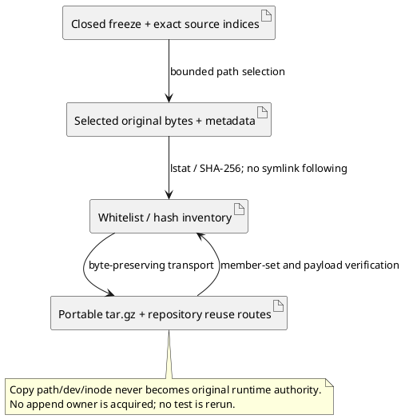

# Closed evidence portability 01

Product Frame: ABIogenesis 5.0 common computational library, T-287. This Writer transports already-closed evidence for checkpoint and another-machine review; it adds no runtime truth, execution, independent acceptance or release claim.

## Bound construction

Executive activation `CLOSED-EVIDENCE-PORTABILITY-01`; frame `repo://abiogenesis/build_tenants/abiogenesis/typescript/design/ABI5_PROJECT_REFERENCE_FRAME_BASIS.md#f-end-to-end-interface-integration` exists and governs interface preservation. Exact STDO v3.0.0-rc.1 manifest `069285ad5a79d59ca2dd835e34a54b3e537b0eeef99c29994b18c339dbe62232`, composition `[]`; unchanged accepted design `cb8dae9f7e684f9b6be730b74125294524ecd7e4d1f035fc03734d7ff1d1160b` and L2 `65f4007521634d808a3fd94bc87707ae4183ddb00ec4ec0da49e37381ee403c1`.

## Grant and computation

Only this new realization directory is writable. Read exact C0 predecessor/successor02, E03 stream-repair and physical-launch-failure, E04 retained-owner execution, final-review disposition and frozen baseline/P1/P3 indices. Select physical proof records, journals, failures, receipts, target/snapshot/temp residues and essential ignored source/emitted fixture bytes. Reuse hash-equal existing repository records. Archive exact package artifacts plus member inventories instead of duplicating complete installed/node_modules/cache trees when they reconstruct selected bytes. Record source and archive addresses separately and retain original path/device/inode metadata.

Inventory first; reject a selected missing path, changed frozen byte, unsupported file type, escaping symlink, or archive above 1 GiB uncompressed. Do not substitute. Max 1 GiB uncompressed per archive includes tar framing; preserve prior files and all originals. Packaging is filesystem-only. Active combined-final-02 and l4-final-candidate-02/realization, continuation17, account/auth/config/system files, Product/runtime/tests/native/model calls, source edits and Git mutations are excluded.

## Exit and limits

Verify frozen references, each selected source byte, exact tar member set and decompressed content hashes, repeat source hashes, and check Git ignore routing read-only. Freeze transport inventory, verification, archive hashes and another-machine instructions; return to Root and stop. First unexpected failure returns without local repair/retry. Final P1/P2/P3/P5/HoG/U1/diagnostics/native/review artifacts not yet closed remain later archival work. Attributed public review summaries remain summaries, not acquired raw reports or hidden reasoning.
