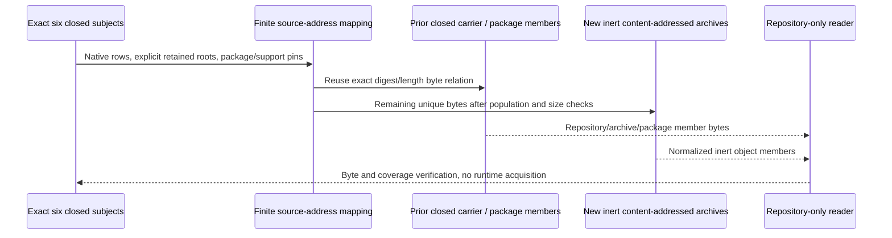

Product/requirements own runtime truth; this selected Proof/Install handoff transports historical bytes only. Original closed coordinates, source identities and physical observations remain evidence. No archive object grants EventStore authority or currentness on another machine.

Native row variants are read explicitly, not inferred from historical summary fields. All selected regular bytes have one transport relation; original mode/device/inode/link observations are separate metadata. Sources are never refreshed to fit. Exclude only explicitly disclosed V8 compile cache and system/ambient/credential material. Existing task-owned npm cache bytes may map to exact existing artifacts; no ambient cache is acquired. Raw traces and event prefixes stay distinct from runtime authority.

Before archives, validate the selected population, every source hash/length/mode and two logical bounds (new uncompressed object payload plus authored metadata below 2 GiB; compressed archive outputs below 1 GiB). Target archives below 90 MiB; deterministic bounded object chunks preserve whole-source digests if a single object exceeds the target. Receiver verification opens only repository-relative carrier files, package members and inert objects, never original absolute source paths. No semantic execution or Git action is selected.
