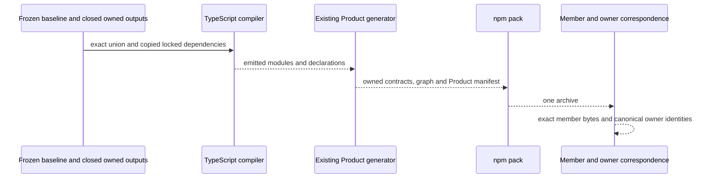

# COMBINED-FINAL-BUILD-01

New separate Writer activation `/root/stdo3_k11_successor_writer`, returning
only to Executive `/root`. The prior K11 result remains closed. This work
constructs one exact combined library candidate for later L4; it performs
no independent acceptance, installed proof, endpoint or test workload.

The selected frame is
`repo://abiogenesis/build_tenants/abiogenesis/typescript/design/ABI5_PROJECT_REFERENCE_FRAME_BASIS.md#f-end-to-end-interface-integration`,
with Build/Install/Identity/Proof. Product's fixed fifteen families, library
prerequisite, sole GTL, direct HoG, ABG admission and existing public owners
remain unchanged. Method is exact STDO 3.0.0 RC1, manifest
`069285ad5a79d59ca2dd835e34a54b3e537b0eeef99c29994b18c339dbe62232`,
empty composition. Accepted L2 is
`65f4007521634d808a3fd94bc87707ae4183ddb00ec4ec0da49e37381ee403c1`.

## Source composition and transformations

Verify the complete immutable 1311-row baseline manifest
`4f4fa05d92e306327f921dcaa6e14f81d851a84d8727b9c3fc391a30e66f37d9`.
Overlay only tenant-owned outputs from the exact freezes recorded in
`activation.json`, in these explicit precedence chains:

- pure → K11 role-source successor, only its two authorized replacements;
- lifetime → stream repair, only its four replacements → P5 preparation,
  only its command-test replacement and fresh-process support;
- currentness → consumer proof's two support/test additions → physical-scope
  successor's event-calculus and consumer-test replacements;
- P3 dependency repair's three proof-support replacements.

No non-tenant GOALS, ticket or work-record overlay enters the payload source
union. Baseline non-tenant context remains separately identified and is not
packaged. Preserve exact prior outputs as preimages, an immutable `source/`
union, a distinct writable `stage/`, and the full precedence ledger.

Copy and verify the closed K11 stage's 4576 dependency entries independently;
no mutable main dependency link, installation or network fallback. Require
Node 24.7.0, npm 11.5.1, TypeScript 5.9.2 and package-lock
`df8d50ad51f46c58d9a38bcc3dd864de0e43337dc8990886b93ad46ab298ef12`.

## Exact effects and derivations

Write only this new directory. Compile once with
`node node_modules/typescript/bin/tsc -p tsconfig.json`; generate once with
`node scripts/generate-product-manifest.mjs`; pack once with
`npm pack --ignore-scripts --json --pack-destination <this-directory>/artifacts`.
All run in the new tenant stage with offline and ignore-scripts npm settings,
local temporary/log/cache paths and retained command receipts. The existing
generator's internal npm dry-run is a package-path projection, not another
archive build. No main build/clean/prepack/test aliases, npm ci, Git,
dependency change, endpoint, native actor, install or test workload is granted.

Existing generator outputs remain derived outputs. Exactly two paths also
occur among baseline source inputs and may change during generation:

1. `contracts/capabilities/capability-definition-graph.json`, produced from
   existing Product contract and capability owners.
2. `contracts/worksite/command-execution-context.inventory.json`, written
   from GTL `WORKSITE_COMMAND_EXECUTION_CONTEXT_INVENTORY` after generator
   lines 92–115 verify actual emitted member bytes and renderer span.

Executive explicitly corrected the original grant's inaccurate
`contracts/native/worksite-command-execution-helper.source-inventory.json`
label to the second path above before generation. This changes no producer
or effect scope. Preserve both preimages and producer-derived successors.
Every other source-union byte remains exact. Never refresh source-owned
material coordinates or weaken the generator to conceal a mismatch.

## Evidence and stops

Freeze HOW, source union, precedence, dependencies, toolchain and grant
before compilation. Verify archive members against staged bytes, npm
integrity, manifest and package/lock identities. Recompute payload identity
through actual Product `payloadInventoryDigest` with owner-typed
`{path, sha256}` rows and `sha256:` digests. Compare baseline/candidate
contract and graph facts with exact unchanged fields and explicit
producer-derived identity changes; do not globally strip refs or digests.
Trace the selected seven retired pure bodies, common lifetime's three
consumers, U1 common join and K11 route through source, emission and archive.
Installed route evidence remains later work.

Preserve all prior realization trees, failed cuts, baseline inputs/build and
the 936 main generated entries. Freeze proof-support inventory for later
P1–P5, without transferring prior candidate P1 credit. Stop on the first
unexpected failure, stale input, unexplained material mismatch or unconfirmed
effect. Preserve the first cause and residue; do not repair/retry or repeat a
successful compiler/generator because a later inventory predicate failed.
Return the exact archive and limitations, then stop editing.
