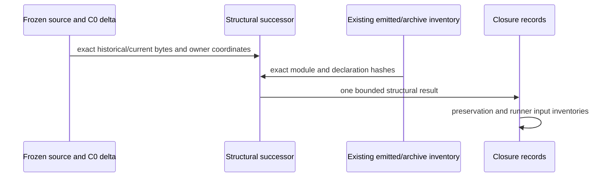

# COMBINED-FINAL-STRUCTURE-02 — evidence successor

Executive activation selects a proof-design correction in the existing final-02
build. The owning frame is `repo://abiogenesis/build_tenants/abiogenesis/typescript/design/ABI5_PROJECT_REFERENCE_FRAME_BASIS.md#f-end-to-end-interface-integration`,
with F-WORKSITE-CAUSALITY owning physical target selection. Product, requirements,
the exact STDO RC1 basis and empty composition, accepted design and L2 remain as
bound in `HOW.md` and `prebuild-freeze.json`. This Writer returns only to Executive.

## Intake and smallest lawful re-entry

First cause `a054de724d00abbdf8f1efe9438a6da9d342c55bde02cb8d858510e5856b08c9`
is the first structural verifier's exit 1. The verifier
`8a76f5d08f7f6ef8e377dd23955ab4133366b90c6f3cc955113c478ce7a700eb`
copied final-01's assertion that the canonical-root predicate was textually inside
`retiredNativeWorkObservations`. The accepted C0 extraction moved that predicate
to `retiredWorksiteObservations`, shared by native retirement and C0 retirement.
This is an evidence-index/source-shape mismatch. The predicate remains in the
physical collector; the native wrapper supplies task root plus changed-path or
write-root scope, and C0 supplies authenticated request root plus exact path.
The C0 result excludes its own successful after observation from retirement.

Product and effect triage select no source or artifact defect from this failure.
Immutable binding identities must not partition a physical root/path. C0 failure
causes still require the full Result/evidence/basis authorization join; index
membership only selects candidates. The old verifier did not follow the extracted
owner. Component behavior checks do not establish this final archive's structural
correspondence. The lawful re-entry is this owning proof HOW and a new verifier.
The original verifier, request, output, receipt and first cause remain immutable.

## Handoffs and computation

The successor consumes the existing source-union and emitted/archive inventories,
the copied historical final-01 source, and the C0 successor's frozen diff. It does
not create a competing runtime carrier or reinterpret Product data. TypeScript's
copied parser supplies only syntax coordinates and exact call/import counts.
Each selected source function and emitted function is bound to its exact file and
body hashes; each emitted module and declaration joins the existing actual archive
member inventory. The unchanged archive must remain
`151ad625652dc426d46a210559afde50f40b93acdf216b5ca9d64969e5eb8e54`.

The unchanged seven pure-body retirement assertions, common owners, three lifetime
consumers, two native unknown-effect consumers, dependency-index assertion and K11
role-source assertions are retained. The replacement C0 cone checks:

- the shared collector selects valid C0 requests by exact canonical root and the
  caller's path predicate, and gathers predecessor/successor references without a
  WorkspaceBinding partition;
- the native wrapper calls that collector once with known changed paths or unknown
  write-root scope, and the C0 Result route calls it once with authenticated request
  root and exact path, retaining successful-after exclusion;
- EC and the native gate import and call the same complete C0 failure Result owner
  and exact pre-event dependency selector in `c_call_outcome`;
- the shared Result owner retains every moved failure identity, digest, evidence,
  causation, ordinal and authorization check and calls the unchanged complete
  `projectWorksiteFailureBasis` owner;
- runtime history adds post-publication failure candidates to the physical target
  dependency bucket; EC and gate still authenticate those candidates independently;
- the previous EC-local failure join and dependency selection are removed/moved.

Historical/current comparison uses exact frozen file bytes, the preserved C0 diff
and bounded source/emission coordinates. No semantic normalization, global digest
stripping or change to owner-produced identities is selected. Structural evidence
does not establish dynamic law or installed reachability.

## Effect grant and exits

Writes are confined to new HOW/triage, successor verifier/runner/request/output/
receipt/report, and previously selected final preservation/support/candidate/freeze
records under `combined-final-02`. The new structural verifier executes once. The
existing compiler, generator, material check, pack, archive check and payload check
are successful and must not run again. No source, emitted, archive, contract or
existing evidence byte changes. No tests, installed/native/endpoint workload,
network, Git, reviewer activation or other worktree writes.

On success, final closure verifies the existing single preflight captures, including
all 30 closed prior roots, main 936 generated records, source/stage/dependency sets,
and copied dependency inode separation. Previously classified active territories
remain excluded without capture refresh; continuation-17 remains no-open/no-mutation.
Complete staged support is inventoried, with a separate finite runner-compatible
input projection and no activation/resource grant. The historical failed structural
attempt and one successful successor are reported separately, never double-counted.
The candidate remains `candidate`, ready only for separately granted L4 proof.

Any new unexpected failure records the actual first cause and stops immediately
for Executive disposition. Freeze one exact handoff after successful closure and
stop editing. No independent acceptance or L5 claim follows from this Writer result.
