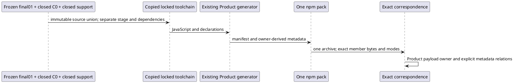

# COMBINED-FINAL-02

Executive `/root` separately activates Writer `/root/stdo3_k11_successor_writer`
to produce one exact isolated combined package for later L4. The frame is
`repo://abiogenesis/build_tenants/abiogenesis/typescript/design/ABI5_PROJECT_REFERENCE_FRAME_BASIS.md#f-end-to-end-interface-integration`,
with Build/Install/Identity/Proof. Product's fifteen families, sole GTL,
direct HoG and ABG admission remain unchanged. Exact STDO is
`stdo://releases/v3.0.0-rc.1/`, manifest
`069285ad5a79d59ca2dd835e34a54b3e537b0eeef99c29994b18c339dbe62232`,
composition `[]`; the manager resolved that installed release. Accepted design
`cb8dae9f7e684f9b6be730b74125294524ecd7e4d1f035fc03734d7ff1d1160b`
and L2 `65f4007521634d808a3fd94bc87707ae4183ddb00ec4ec0da49e37381ee403c1`
retain their original subjects. Product700–704 and the closed C0 supplements
own the selected physical-cause correction; this activation changes no source.

## Exact intake and handoffs

Start with the source union of historical `combined-final-01`, freeze
`d30c05423aaa3b837bc19cee427b74f4031f3e6fef48db6bf21ddad5416af821`.
Replace only five tenant paths selected by the closed C0 successor freeze
`0abc3970a4bff7e7bf64db227a98e0fab9cd201d9b7d593589bd9de7636b2c8a`:
the four ABG sources `event_calculus`, `c_call_outcome`,
`native_worksite_execution`, `runtime_history`, and their existing currentness
consumer test. Its stopped predecessor freeze
`c4a9b7100861c5f89b98399076aef7bda002f191bc0e54ab95532d074146b0f5`
retains its successful compilation and first fixture failure. Acquire these
five files from the successor's exact stage, never the moving worktree.

Replace only `test_env/support/language-structural-fixture.mjs` from the closed
HoG support freeze
`8c0af8cdc2e3ae01d12e05a3baf328ce1637093444659cf0b8540859c241e49b`;
its source SHA is
`6d917069f48fb243a4ae743d77861bdf6130d6724d19440988c5b74d3eed9966`.
This proof support is excluded from the archive. Preserve every other tenant
source from final01 exactly, including the closed pure/K11/E03 outputs.
Omit the explicitly active T-287 ticket from new non-package context and live
protection inventories; the predecessor's historical copy stays untouched.

Independently copy the 4576 final01 dependency entries. No regular file shares
a writable inode; local symlinks stay within the new dependency tree. Require
Node24.7.0/npm11.5.1/TypeScript5.9.2 and the unchanged package lock
`df8d50ad51f46c58d9a38bcc3dd864de0e43337dc8990886b93ad46ab298ef12`.
Freeze source precedence/preimages, tools, dependencies and effects first.

## Effects and preservation

Write only this new `combined-final-02` directory. In its isolated tenant:
run `node node_modules/typescript/bin/tsc -p tsconfig.json` once;
`node scripts/generate-product-manifest.mjs` once; and
`npm pack --ignore-scripts --json --pack-destination <new artifacts>` once.
Use offline/ignore-scripts npm settings and local cache/log/tmp paths. The
generator's existing internal dry-run is its path projection. No main build,
clean/prepack/test alias, install, native/endpoint workload, Git, dependency
change, network or reviewer activation is granted.

Exactly two source-overlapping outputs are derived by the existing generator:
`contracts/capabilities/capability-definition-graph.json` and
`contracts/worksite/command-execution-context.inventory.json`. Retain their
input and produced bytes; every other source input remains exact. Preserve
final01 and all classified closed roots, including failed cuts. Capture that
classification once, excluding the explicitly active
`e04-retained-owner-execution-01` and `final-review-dispositions-01`.
The final proof preparation and HoG driver preparations are closed inputs.
No growing sibling is implicitly a closed result.

Protect the 936 main generated entries. Executive confirmed continuation17
at `T287_SANDBOX_UAT_RUN_02/operator/library-joint-proof-237/continuation-17`
as a no-open/no-mutation territory, not a new recursive scan. Initial path-only
discovery preceded that clarification; no file contents were read. No further
access is selected. The active ticket and review disposition are not package
source or immutable live-tree assertions.

## Bounded exit evidence and stop

Compare every emitted code/declaration file with final01. Exactly four C0
JavaScript files and one `c_call_outcome.d.ts` type-reference spelling may
differ, and must match the closed C0 emissions. All pure/K11/E03/common
emissions remain exact. Compare all 75 catalog rows, 47 contribution rows,
10 GTL publications, 16 capability rows and Public carriers with the actual
owners and explicit producer-derived identity changes. Verify the single
declaration difference as the exact inline-reference to imported-reference
equivalence, without global ref/digest stripping. Reconstruct metadata and
verify unchanged C2 source-owned renderer material against emitted bytes.
Check the selected structural routes only; installed reachability remains L4.

Verify every archive member against staged bytes/modes and use Product's
actual `payloadInventoryDigest` on archive-derived `sha256:` rows. Freeze
package/lock/manifest/archive identity, full dependencies and support, and
finite runner input coordinates with candidate id `candidate`. No earlier
candidate's installed evidence transfers. On the first unexpected integration
failure, retain cause/residue and stop without repair/retry. Finish one exact
handoff, state limits, then stop editing. No independent acceptance or L5 claim.
