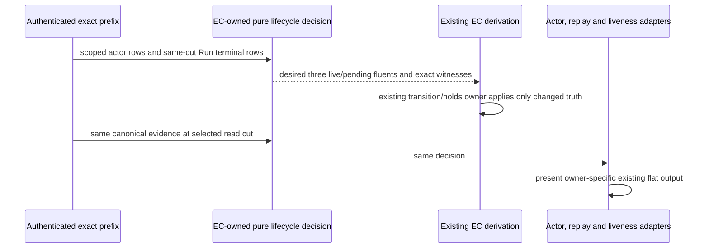

# One EC-owned actor/process lifecycle law

Proposed owning design, not source authority or acceptance. Frame: `repo://abiogenesis/build_tenants/abiogenesis/typescript/design/ABI5_PROJECT_REFERENCE_FRAME_BASIS.md#f-worksite-causality`. Product, HANDLERS and PROJECTION-002/013 remain the WHAT. Terminal HOW 8ec79201… incorporates the four exact accepted posts c295a065…, b0582ef7…, d3dabca8… and 49ca598c…, with the later authentic-artifact correction. The current worker source freeze 4bfdf7e… and accepted-at-design-scope cross-consumer proposal 93d088fb…/HOW 8fb5ca19… are composed prerequisites, not rewritten subjects.

Root and independent assessment identify two source counterexamples: (A) started → termination_unconfirmed before Run terminal has lifecycle.cleanupPending=false but EC pending=true; (B) started → confirmed exit → run_stopped without Actor terminal has lifecycle pending=true but EC selects only the already-removed actor_process_live and creates no pending token. Spawn failure has the same remaining Actor obligation. Existing tests isolated the projector or first introduced uncertainty, masking the missing EC transition. These are source counterexamples, not observed OS incidence or an executed false Run closure. The prior independent source review covered other selected partitions.

## One law, dependency-light boundary

Add `abg/event_calculus_actor_lifecycle.ts`, owned by Event Calculus. It contains one pure `decideActorProcessLifecycle` and the existing canonical logical Process-ref derivation extracted unchanged from actor_process.ts943. Runtime imports are shared pure digest/immutability utilities only; RuntimeEvent and other ABG contracts are type-only imports. It imports neither actor_process, runtime_liveness, full event_calculus, event_prefix nor EventStore at runtime. It has no mutable cache, reducer, store, admission or OS effect. Actor's existing dependency on liveness and EC's liveness-validator dependency therefore create no new cycle.

Concrete callable:

```ts
decideActorProcessLifecycle(
  actorInvocationRef: string,
  actorRows: readonly RuntimeEvent[],
  runTerminalRows: readonly RuntimeEvent[],
): Readonly<ActorProcessLifecycleDecision>
```

Move the existing ActorProcessLifecycleProjection type declaration into this EC-owned module and re-export it from actor_process, preserving the existing public function surface and exact output keys. The internal decision is `Omit<ActorProcessLifecycleProjection, "kind">` plus `cleanupLive: boolean`, `cleanupTokenPending: boolean`, `cleanupProcessRef: string | null`, and exact `actorStartEventRef`, `processStartEventRef`, `runTerminalEventRef` witnesses. These are a transient pure decision, not another runtime carrier. The existing projection wrapper selects its existing keys and kind; it does not return the internal additions. Its existing cleanupPending presents remaining Actor cleanup; cleanupTokenPending names the actual EC token frontier. They must not be silently conflated at a preterminal cut.

Inputs are actual ordered logical RuntimeEvent rows at one authenticated prefix cut, supplied by existing index/envelope accessors. Actor-related rows must contain the complete actor/process relation for that cut; run-terminal candidates are exactly run_stopped and aggregateType=run runtime_failure_observed rows at the same cut. The law owns the kind, identity, same-Run, order and cardinality decisions; callers do not supply independently computed booleans. Ignore unrelated rows by exact actor/parent relation; reject conflicting same-actor Run or Process identities. Match Process aggregate/parent and available payload references, and Actor aggregate/parent relationships. A foreign Run terminal cannot affect the selected actor. There is no latest-event winner.

One start, at most one confirmed Process terminal across exit/spawn-failed, and at most one Actor terminal are retained. Exit requires a prior start; spawn-failed forbids start; Actor terminal requires an earlier confirmed Process terminal. Duplicate Actor starts or terminal variants and reversed order refuse rather than being coalesced. Existing owner admission retains the complete stream/timeout/signal/artifact grammar; this pure projection does not become a replacement admission validator. The uncertainty event remains historical after later confirmation. It is not a second confirmed terminal variant.

For a known actor, derive one Run from its admitted relation. For an empty selection, preserve the existing not_required/null projection and do not import any other Run's state. Process-only synthetic/component prefixes in existing tests remain explicitly lower premises, not proof of complete native grammar; full cross-consumer proof supplies Actor start and exact scope. An input selector that omits an available required join must be fixed, not tolerated through a second lifecycle fallback.

## Decision table and token semantics

Let S denote an admitted Process start, T its confirmed exit/spawn-failed terminal, A the Actor terminal, U any admitted uncertainty observation, and R a matching Run stop/failure. The formerly active Actor witness is its admitted start with no Actor terminal. Raw OS exit never enters this law: T is the admitted semantic event from the confirmed-physical-facts owner.

Precise authority for the preterminal row: accepted 49ca598c… lines29–47 says an already-admitted exit/spawn-failed carries confirmed Process truth across Run terminality and initiates neither process-live nor cleanup-live. Its next clause is conditional: “If Run terminality creates” the pending token, the preterminal Process witness satisfies confirmation, only qualified Actor cleanup remains, and that row consumes the token once. b0582ef7… R3.3 and d3dabca8… R2.1 supply token creation for each formerly active Actor at Run stop/failure. Separately, d3 R2.3 preserves an existing token through uncertainty and later Process confirmation until Actor consumption; it does not create a pre-Run token. c526 HOW line65 likewise says pending remains, without selecting a new initiation frontier.

Root's explicit design disposition after this source check is to preserve that Run-terminal frontier. Current EC's pre-Run uncertainty initiation is the competing decision to retire, not authority. The proposed projector exposes unresolved physical uncertainty and remaining Actor consumption before Run terminality, while actual cleanup-token pending remains absent. The existing projector's pre-Run confirmed-exit cleanupPending=true likewise describes the remaining Actor obligation, not an early token. This is an explicit presentation/token distinction with real supported inputs, not a fallback law or changed Product meaning.

`processLive = S && !T`

`terminationUnconfirmed = !T && U`

`cleanupPending = !A && (T || U || (R && formerlyActiveActor))`

`cleanupTokenPending = !A && R && formerlyActiveActor`

`cleanupLive = cleanupTokenPending && processLive`

| Exact prefix condition | processLive | cleanupLive | Projected cleanupPending | EC cleanupTokenPending | Remaining owner obligation |
| --- | --- | --- | --- | --- | --- |
| Actor started, no Process row, no Run stop | false | false | false | false | Await actual launch/no-child evidence; no absence claim |
| Process started, no uncertainty/terminal | true | false | false | false | Normal running Process; cleanupDisposition still pending |
| A: Process started, uncertainty, Run still active | true | false | true | false | Physical uncertainty and remaining Actor consumption; no Run cleanup token |
| Confirmed exit, no earlier uncertainty, Actor not terminal, before Run stop | false | false | true | false | Actor consumption remains; no Run cleanup token yet |
| B: same confirmed exit, then Run stop | false | false | true | true | One pending token; no second Process terminal |
| Spawn failed, no uncertainty, Actor not terminal, before Run stop | false | false | true | false | Actor consumption remains; no process-start claim |
| Same spawn-failed cut, then Run stop | false | false | true | true | One Actor cleanup token |
| Run stop with started/unconfirmed Process | true | true | true | true | Confirm Process, then consume Actor token |
| Run stop after Actor start but before any Process row | false | false | true | true | Confirm actual no-start or actual process outcome, then Actor consumption |
| Later T after uncertainty, no Run terminal, Actor still nonterminal | false | false | true | false | Historical uncertainty and remaining Actor consumption; no token was initiated |
| Later T after uncertainty and Run terminal, Actor still nonterminal | false | false | true | true | Historical uncertainty remains; Run-initiated token persists |
| Qualified Actor terminal after T | false | false | false | false | Complete; consume once, never initiate another token |

cleanupDisposition retains its existing precedence: Actor terminal → complete; active uncertainty → termination_unconfirmed; projected cleanupPending (remaining Actor obligation) or processLive → pending; otherwise not_required. Thus confirmed Process terminality before Run stop remains pending while Actor consumption is outstanding, even though cleanupTokenPending is false. No timeout, signal request, Run terminal or absence of a Process row establishes physical absence. run_closed is not a cleanup grant; its owner already requires quiescence.

The existing fluent identity stays unchanged. Reuse the exact canonical logical Process-ref formula `process://abiogenesis/` plus sha256Canonical({actorInvocationRef}) for a formerly active Actor with no Process row. Move that formula to the dependency-light module and have actor dispatch consume it too. It is an allocated logical identity, not PID or proof of launch. The public nullable processRef remains null until a Process row is available; internal cleanupProcessRef supplies the exact EC key. Existing admitted Process rows must agree with their owning identity relation; lower component identities remain scoped test premises rather than authority to relabel real actors.



## Actual integration and retirement

EC's existing RuntimeEventCalculusDerivation remains the only incremental transition owner. At actor/process lifecycle events it evaluates the selected actor; at Run stop/failure it evaluates all formerly active Actors of that Run, including those with a confirmed Process terminal or no Process row. Use existing scoped actor/event indexes and admitted actor starts, not the live-Process set. Previously completed Actors yield no pending token. No cross-Run fluent is touched.

Map processLive, cleanupLive and cleanupTokenPending onto the existing actor_process_live, actor_cleanup_live and actor_cleanup_pending identities. The current EC holds/transition machinery initiates only false→true and terminates only true→false; no new state or fold is stored. The token begins only on matching Run stop/failure. It persists through uncertainty and later Process confirmation until Actor consumption. Before Run stop, uncertainty or confirmed exit establishes the remaining Actor obligation, not a token. Run stop creates exactly one per formerly active Actor of that Run. The current liveProcesses census also lacks the matching-Run filter; the replacement uses the exact Run join for both census and effects. Retain source-event/Run attribution in the existing effect rows and contextual identity map.

Delete the independent three-fluent decisions in eventCalculusEffectRefs and the Run-terminal liveProcesses-only branch and process-terminal cleanup branch in advance. Remove the obsolete early cleanup initiation from the static uncertainty axiom declaration too. Historical terminal/uncertainty fluents, actor/process execution-active effects, availability consumption, runtime probe scope handling, unrelated Run effects and U1 retirement remain with their current owners. Full event+prior dependency calls use the same law. The bare-kind eventCalculusEffect surface remains an axiom-name/declaration projection, not a complete scoped lifecycle oracle; its supported production caller is artifact_truth for public_operation_artifact_admitted, not Actor cleanup. Kind-only/partial-payload tests cannot establish this lifecycle law. Do not retain a second executable lifecycle fallback under that API. Bind the three lifecycle names to the one law; keep unrelated axiom declarations intact.

projectActorProcessLifecycle retains its signatures and uses the decision for every lifecycle field/cardinality verdict. Replay uses the decision's exact start/terminal witnesses instead of first-find terminal and local precedence. It still renders terminationConfirmed as confirmed EXIT only, matching its existing transport/read-model contract; spawn-failed remains a separate no-child variant. Stream/artifact/digest presentation remains its own projection. Liveness uses the same processLive and Actor-terminal witness, replacing its started/no-spawn-failure/no-actor-terminal/no-exit conjunction. Frame/CCall liveness with no actor remains governed by its existing frame/call completion predicates; it is a real supported input, not a duplicated actor lifecycle.

Thin adapters retain index access, not transition law. Read only indexed lifecycle bodies needed for the actor and the matching Run terminal; do not materialize whole history. Extend existing dependency/version stamps to cover every consumed Run/actor/process row at the exact ordinal. eventCalculusDependencies must add lifecycle joins independently of native unknown-effect authentication: lack of a native write-scope join cannot erase physical cleanup dependencies. Native U1 dependencies and predicates remain separate. Incremental advancement, forked historical cuts and cold reconstruction run the same law; no new cache or stored summary is introduced. This is a correctness/retirement proposal, not a measured performance improvement.

## Physical guard and carrier boundary

Extract the identical worker/actor artifact-read physical boundary into a pure function in shared/owned_process_lifetime.ts over canonical OwnedProcessFacts: scopeAbsence is absent and either directExit exists or noChildEstablished with launchFailure exists. The latter conjunction is already guaranteed by the lifetime's canonical noChild producer. Name it `hasConfirmedOwnedProcessBoundary`; it performs no I/O, cleanup, schema validation or Error transformation. Use it only where the two existing artifact-read guards enforce that boundary. Final-facts publication and first-error/assessment ordering from 4bfdf7e… stay unchanged.

Do not replace owner-specific terminationConfirmed: helper absent/no-child may yield true and status127; worker exit/terminationConfirmed remain false for no-child; ABG maps the positive no-child facts to spawn-failed. Actor admission still separately requires its admitted start for exit, or no start for spawn failure. The physical guard cannot establish either admission or currentness, and neither it nor the new lifecycle law restores C0 withdrawn by authenticated unknown effect. Existing U1 proof remains mandatory support.

The nine carriers are not one schema. Select one bounded type-only contraction inside the existing actor file: ActorProcessObservation inherits Pick<WorkerTransportResult> for disposition, finalOutput, timedOut, timeoutClass, exitObserved, terminationConfirmed, structuredEventCount, progressEventCount, toolCallCount, toolInvocations, apiRetryCount and optional nativeResultAssessment, because the actual producer copies those fields unchanged. Retire those duplicate field declarations while preserving their optionality and exact flat output bytes. Keep processStatus/processSignal, failureClass, scope/identity, byte lengths and artifact digest projections owner-specific. No runtime construction/spread, serializer, universal evidence type or new Partial fallback is selected. This selected two-interface contraction removes verified repetition; broader carrier consolidation requires separate scope and is outside this blocker.

## Authority and next effects

Proposed production territory: new EC-owned pure module; existing actor_process/event_calculus/replay/runtime_liveness; worker_transport and shared/owned_process_lifetime only for the common physical guard. No event/schema/currentness/HoG/Product or persisted carrier change. The accepted command/HTTP failure design remains a separate composed prerequisite. Root owns the live HOW/L2/status amendment and later source grant. This activation writes only this new design directory; no source/test/import/process/build/Git effect is admitted.

No Product authority gap is identified after Root's explicit token-frontier disposition. The finite direct-consumer scan found no production authorization path requiring an early token: c_call.ts1865 and worksite_construction_recovery.ts243 require complete Actor lifecycle; replay's cleanup-name set presents quiescence. Existing U1 fixture assertions do require adjustment, separately owned as recorded in the proof map. Exact lifecycle joins absent from a supported input, incompatible admitted identity or a newly found real owner relying on early tokens stops implementation for Root before repair. Full execution and whole-path performance remain unproved; no broad historical campaign is selected.
