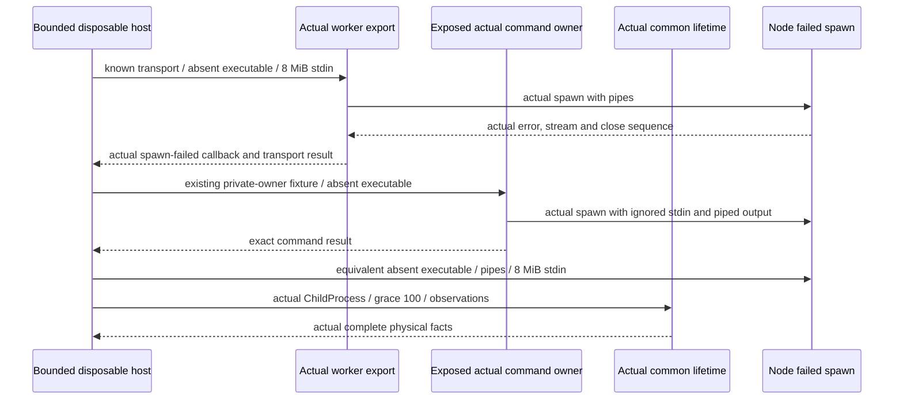

# E03-PHYSICAL-LAUNCH-FAILURE-01 — actual no-PID failed spawn

Writer `/root/stdo3_lifetime_writer` returns only to Executive `/root`. The Executive activation and pre-execution projection clarification select one finite physical failed-spawn population on the closed E03 stream successor. This HOW precedes all new fixture roots and physical launches. No production or existing support/test change is selected.

Product frame: GOAL-035/T-287 common-library realization within the existing fifteen Product families, sole GTL, direct HoG, and ABG-owned admission. Product `Execution, Admission And Advancement` distinguishes actual effects from admission and preserves unknown currentness rather than fabricating rollback or successor observations. REQ-R-ABG3-TRANSPORT-002/003/016 require faithful substrate failure facts. L2 §§4/6 and effects callable contract require no-child launch failure, direct exit, stdio close/disposal, scope absence and first owner failure to remain distinct. No child start is inferred from a returned Node ChildProcess object, and command status 127 is not an internal lifetime fact or ABG result.

Frame: `repo://abiogenesis/build_tenants/abiogenesis/typescript/design/ABI5_PROJECT_REFERENCE_FRAME_BASIS.md#f-end-to-end-interface-integration`, physical Owner and Proof specialization. STDO `stdo://releases/v3.0.0-rc.1/`, manifest `069285ad5a79d59ca2dd835e34a54b3e537b0eeef99c29994b18c339dbe62232`, empty composition; fresh manager verification returned valid with no failures. L2 SHA-256 `65f4007521634d808a3fd94bc87707ae4183ddb00ec4ec0da49e37381ee403c1`. The sole runtime subject is `../lifetime-stream-repair-01/stage/build_tenants/abiogenesis/typescript`, bound by freeze `8668dfa9ddbfb2fcfa860659e383e0527b009afb532e385e876384eba5b1b155` and report `a97f98136375a20f0d3c1bcc34a3e23d30ed96d539c09d09ea669943a71e2307`. Main generated 936 files and all original stages/evidence remain immutable. No moving combined-candidate claim.

The Executive reports independent external review F-A from Claude session `fbc371ae-5f37-4915-b7ff-8a0ad91b713c`, UUID `fb2d6caf-d597-411b-b77c-a52a2d455ed8`, 76 turns/745591 ms, exit 0, no subagents or permission denials. This is an attributed transcription of the Executive message, not original provider output. Review found no production defect. Its bounded hypothesis is that ENOENT with pending large stdin could emit a stream error, changing preserved no-PID launch failure into firstError. ControlledChild evidence does not determine actual Node channel order. This activation resolves only that proof gap on the pinned Node/platform.

Permitted new roots, all observed absent before this record:

- Repo evidence/glue: `.ai-workspace/work/T287_COMMON_LIBRARY_DELIVERY_01/realization/e03-physical-launch-failure-01/`.
- Canonical scratch: `/private/tmp/abiogenesis-e03-launch-failure-scratch-20261021-74d19d63`.
- Canonical retained physical evidence: `/private/tmp/abiogenesis-e03-launch-failure-evidence-20261021-74d19d63`.

The absent absolute executable is `/private/tmp/abiogenesis-e03-launch-failure-scratch-20261021-74d19d63/never-created-executable`. Neither this path nor its target is ever created. Scratch contains only empty `worker-cwd`, `command-cwd` and `direct-cwd` directories. Evidence contains the worker's exact new archive and per-attempt event/return/failure facts. Roots are created once with private permissions; their canonical realpaths must equal these literals. Nothing in a prior root is deleted or reused, and failure roots remain retained.

The fixed population is these three sequential attempts, with no retry or executable fixture child: worker, command, then a separately labelled common-lifetime attempt. Each must settle and its facts/decision must be retained before the next begins. Worker input uses the same canonical `constructKnownWorkerTransportContract('claude', ...)` route and 8388608-byte `x` prompt as the closed F2 discriminator, but selects the absent executable and no prefix args. It invokes the actual exported `runWorkerTransport`, with explicit empty environment, worker_executes lane, 1000 ms inactivity, 2000 ms absolute and 100 ms grace. No Claude binary is invoked. The public result does not contain launchError: the private `ProcessObservation.launchError` reaches `onSpawnFailed(error.message)` and `failureClass=transport_failure`. Executive confirmed this exact oracle refinement before execution; no nonexistent public field is required.

Command exposure reuses the existing focused helper VM mechanism: remove only the shebang and replace the final `await main();` with `export { runCommand };`. Every owner body/import is otherwise unchanged. The emitted-source exposure bytes/hash are retained. Imports resolve only against the frozen stage. No predicate, filesystem confinement, spawn, signal, probe or lifetime function is replaced. The existing physical-test private-owner argument shape supplies one command with actual confined `relativeCwd='.'`, empty args/environment/reports, timeout 1000 ms and grace 100 ms. This is private owner evidence, not a Product task/admission or installed C2 proof. Its normal helper signal listeners are removed only after command settlement, following the prior support pattern.

The direct attempt uses the actual Node spawn with the same pipe options, absent path, empty args/environment, detached POSIX group selection, actual common factory, grace 100 ms, and 8 MiB `stdin.end`. It supplies its own `OwnedProcessFacts`, never inferred from another attempt's public result. No fake ChildProcess, probe, clock, stream error or event is injected. The complete actual launch error object is retained with name/message/code/errno/syscall/path/spawnargs/stack and a stable in-host object id, including identity correspondence to `facts.launchFailure`.

Transparent observation wraps actual spawn only to return the same ChildProcess, and wraps each real emitter's `emit` to log then invoke the original with the same receiver/arguments. It adds no error listener and preserves Node's unhandled-error behavior. Standard `syncBuiltinESMExports` makes the wrapper visible to the worker's unchanged named import. Stream end/destroy calls, real stream states, event order and actual process.kill calls are logged and forwarded without policy changes. `uncaughtExceptionMonitor` records but does not suppress an uncaught exception; no uncaughtException/unhandledRejection recovery handler is added. Logging overhead is acknowledged; this is one observation on Node 24.7.0/macOS, not every possible event interleaving.

Before physical execution, freeze this HOW, literal oracle/configuration, all glue and exposure bytes, canonical known transport contract, exact source/emitted/support/toolchain/dependency inputs, stage inventory and protected-main inventory. Preparation may load definitions and construct the contract; it cannot spawn. The parent then creates the declared roots and starts one finite local Node proof host with a new process group and a 10-second watchdog. The watchdog may kill only that declared proof-host group on expiry and retains the timeout as failure, never as owner completion. Observe actual proof-host exit and independent PID/group absence. No nonexistent fixture PID is fabricated or probed.

Oracle, fixed before output: all three actual ChildProcess objects retain undefined PID and emit no spawn event; no started callback fires. Worker fulfills its transport promise, reports the actual ENOENT spawn-failed callback and returns transport_failure with no direct exit, timeout or result payload. Command fulfills with exitStatus 127, no timeout/direct signal and an ENOENT diagnostic. The direct common facts have non-null ENOENT launchFailure, firstError null, noChildEstablished true and directExit null; retain actual close, disposal, drain, scope, signal and probe facts separately. Host remains alive through each settlement and exits normally without uncaught error. Preserve actual stream errors if any; do not assert that every early stdin close must reject or manufacture an error from absence of a process. N-1 wording remains: observed stream errors are retained.

All actual observations and resource footprint precede assertions. The first unexpected runtime failure, missing owner-construction relation, scope conflict, extra PID/spawn or unknown cleanup stops dependent work and returns preserved evidence before any repair/retry. No production patch, new Product behavior, new Public/event schema, P5 support edit, T-287 edit, R1 registration, installed/native/network/rebuild/npm/test-alias workload or reviewer activation is granted. Final handoff is a closed source/support-corresponding observation with explicit limits, preservation receipt and freeze; Writer then stops.
