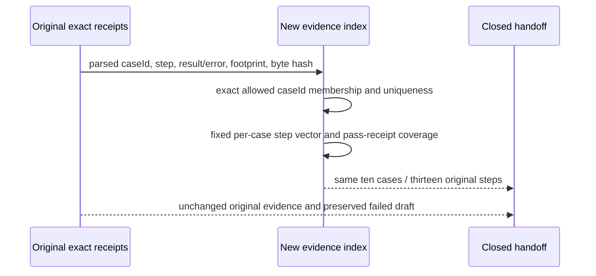

# E04-EVIDENCE-INDEX-02: exact case identity join

Root Executive grants this successor under the same Project end-to-end interface integration/effect frame, exact STDO RC1 basis/composition and accepted L2. Its sole purpose is to close the already executed ten-case result without new physical effects. This is an attributed activation/triage record, not original transcript bytes.

The actual result is SHA-256 `ec7c6966fc9bf9b04deabf0efd56a0761e27720c38a092d3d287f35f90d8eef0`. The first index-failure record is `4367de001ba234a2bed6e41c93df32a948c028d6eef6ca50f732560b726d20f7`; the incorrect draft is `52d5b062d860ff541ad970d88a926502a22a2d0f6613c63e6bc45416fbea54a5`. These and the original raw/archive receipts remain immutable.

Product/runtime meaning stays with the original exact owner input, output/error and physical footprint. A derived proof index does not author that meaning. The defect was a prefix-glob join: asking for `SNAPSHOT-*.json` also selected three distinct case identities. It affected the derived map, prospective report/count/claim and closure manifest. It did not change an executed case or invalidate the original process exit/close and independent absence observations. It was discovered during post-run evidence indexing; no erroneous closed handoff was published.

The lawful re-entry is a NEW `case-outcomes-02.json`, plus new check, report and closure records in this execution directory. The failed draft, failure record, preparation, source, runtime support and physical residue are not edited. No owner/process/test rerun, cleanup or Reviewer activation is selected.

Source carrier is the parsed original owner-step receipt containing `caseId`, `step`, disposition, output/error and footprint. Destination is a non-authoritative index row that retains that exact case identity, raw source path/hash, portable archive path and observed values. Joining uses equality of parsed `caseId`; filename prefixes carry no identity authority. The allowed vector is fixed from the frozen preparation: PERSIST, PUBLISH, RACE, DEST-SYMLINK, DEST-HARDLINK, TEMP-PARTIAL, SNAPSHOT, SNAPSHOT-STALE, SNAPSHOT-SYMLINK, SNAPSHOT-DIRECTORY.

Checks fixed before computation: exact ten IDs and order; one pass receipt per ID; unique `(caseId, step)`; PERSIST steps created/same/different, PUBLISH steps created/identical-collision, RACE actual-link-race, both DEST cases existing-link-collision, TEMP-PARTIAL partial-temporary and each SNAPSHOT case materialize. These total thirteen original steps. Every source step is consumed once by its exact case, no foreign or unknown case is admitted, each pass receipt's observedSteps matches, and the original completed vector is equal. The twenty-five archived files must retain exact raw-source bytes/hash and include exactly thirteen steps, ten pass receipts, one activation and one result. These are new index-congruence checks, not new physical test cases or a repeat of the original owner oracle.

Keep the original execution's real-OS versus controlled-seam limits. The race is deliberately scheduled actual wx/link competition; EIO is injected after an actual five-byte temporary write. The source/table outcome remains bounded private-owner substrate evidence, not installed, ABG-admitted, native, arbitrary-race or complete E04/Product acceptance.

Verify the failed draft/failure hashes unchanged, selected frozen inputs/main936 unchanged and retained evidence/footprint metadata before closure. Original archived evidence already includes all file bytes; scratch-retained.json carries complete regular-file base64, actual node identities and alias targets, so no extra scratch copy or recreated link is needed. Freeze original correct evidence, failed draft, failure and successor together. Any unexpected mismatch stops to Root before correction/retry. After the exact closure freeze, Writer stops.
