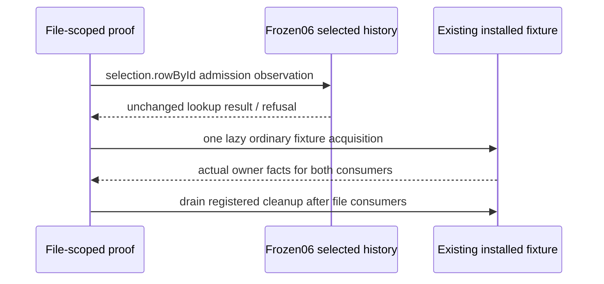

# Reopen18 proof successor06

Root selects only the two proof repairs from closed successor05 (freezec886e40487ecc4a653bfbc7d2e00b7e62c02b68fbfae18d77f8b95b747d3359b). EVENTS-032 and PROJECTION-002/025, accepted library K08–K10 and [the existing five-relation HOW](../final-finite-proof-successor-05/HOW-binding.md) remain unchanged. Original16pass/2fail and all previous failures remain immutable; no baseline pass is inferred.

Source cause1: admitRuntimeEventInternal4054 supplies RuntimeHistorySelection; projectRuntimeEventAtContract2391 invokes selection.rowById, which calls history.indexById directly. The old history.rowById hook saw only appendValidated's127 location checks. Add the exact selection method wrapper; preserve this/arguments/result/exception and restore every monkeypatch in finally. All source-derived counts, linear128/256 cases and exact bytes/events remain unchanged.

Source cause2: test.after invoked inside the first test registered cleanup on that active test. Register one file-level after hook during module evaluation. The lazy fixture's actual cleanup callbacks are collected, then drained after both consumers, continuing through callback errors and preserving failures as AggregateError. This changes test ownership lifetime only; no production resource owner or cleanup behavior is replaced.

Only the named main test changes. Freeze its preimage/diff/afterimage and minimal overlay before one full reopen18. Reuse immutable final06 runtime/archive25e7f390a899f3bd9c49fa11a15feba1f59cb2a1d2ba4bad1f62c1abc4224079 and read-only verified bootstrap package. Reuse closed05 full stage/main936/host preservation inventories rather than another scan. Focused current pins cover the exact overlay links, runtime entrypoints, archive, tool and actual final04 D02 adapter. No compile, ABI pack, dependency installation, main generated or old-cut mutation.

Only after reopen18 passes, execute original template commands4–8 once in order, preserving all filters/exclusions and actual adapter70299b7965b7402c3923b814ca3f36a0b1699c31aa66d5e35a03d911a99d123d. U1/C18 remain prior evidence. Fresh physical06 roots/cache only,600000ms per command,<=3GiB retained, zero native/provider semantics. Existing test-owned cleanup may remove its disposable resources; retain only actual surviving bytes and raw command/output/status/PIDs. First actual integration/assertion failure stops before retry/repair/next command. No independent acceptance.
