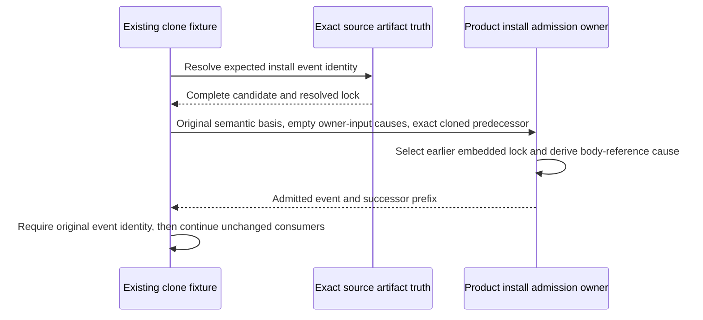

# Reopen18 owner-clone proof successor07

Root selects this support-only re-entry from [closed successor06](../final-finite-proof-successor-06/freeze.json), SHA b4e11378c241054005d02138f0c2396a0a3c0d6a5242036c33cc4369caa61de1. Its 17 passes and one actual artifact_truth_conflict remain unchanged. The Product EVENTS-032 exact operation/scope/causal contract, accepted library K10 semantic-value/physical-body distinction, and [existing proof HOW](../final-finite-proof-successor-06/HOW-binding.md) govern. No Product or runtime algorithm changes.

The originating mismatch is in new-empty-append-sink.mjs: the clone hydrated a complete install candidate/lock but reused the stored payload's lock-body causation as original owner input. environment_admission.ts:912–956 creates compact install bodies only for empty owner-input causes, selecting an exact earlier embedded lock and deriving its body-reference cause. artifact_truth.ts refuses an expanded historical install with nonempty body cause. The second genuine install exposes this relation; the original single-install fixture did not. Both successor06 probe/lifetime fixes remain valid. This causal interpretation is the Executive's source conjunction, checked against the named current sources, not an independent acceptance or new review.

The sole source delta is conditional on an exact sourceInstall acquired from sourceArtifactTruth: pass `{ ...basis, causationEventRefs: [] }` to the existing admitProductInstall. Keep its complete candidate/lock, original expected event lookup and event-ID equality assertion. Keep the legacy fallback and every non-install cause unchanged. The ordinary owner alone reconstructs encoding and admits the event. No raw append, altered validator, new helper, or substitute event is introduced.

The new overlay copies this support file and the byte-identical current main test. Build/dependencies and the other support modules link read-only to the immutable final06 stage. The final06 archive excludes test_env and remains 25e7f390a899f3bd9c49fa11a15feba1f59cb2a1d2ba4bad1f62c1abc4224079. Existing verified bootstrap is read-only. Reuse prior complete stage/main936/host inventories; only selected file identities and current archive/tool/adapter/overlay are checked again. No compile, pack, stage or old-cut mutation.

Freeze support preimage/diff/afterimage, unchanged test, configuration and resources before one full reopen18. The existing two-install owner clone plus exact identity and all downstream negative/currentness assertions is the discriminator. If it passes, run original finite commands4–8 once in order, preserving filters and actual final04 D02 adapter70299b7965b7402c3923b814ca3f36a0b1699c31aa66d5e35a03d911a99d123d. U1 12/12 and C18 18/18 are reused without rerun. Each command remains bounded at600000ms, physical root07 initially absent, total new retention below3GiB, zero native/provider semantic calls. Existing fixture cleanup only; the closed06 failed-clone disposal removed its temporary log, so its coordinate is retained in stdout without a false retained-byte claim. First actual selected failure stops before repair/retry/next command. Return frozen results to Root; no independent acceptance.
