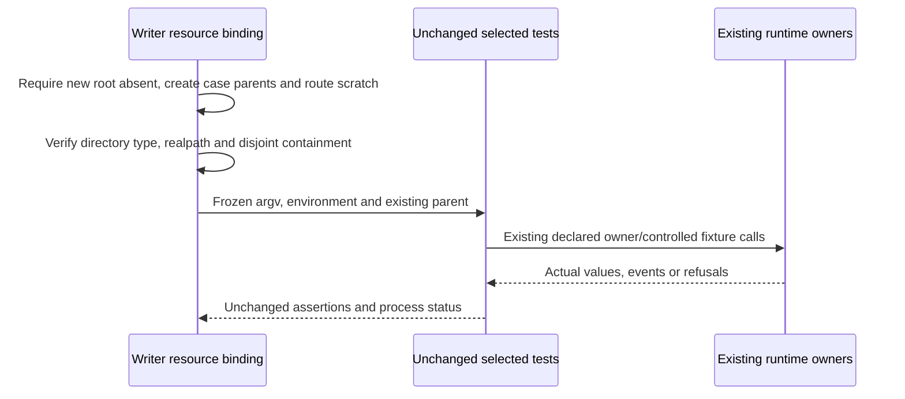

# Finite remaining proof08

Root selects resource-only re-entry from [closed07](../final-finite-proof-successor-07/freeze.json), SHA04c6e9dbdf22eb68ec3024240c7e7e64b951b9fa85f2aa849080e2f0fc09bd89. The original route command supplied a scratch path but its Writer preparation omitted the existing parent required by terminalOwner's mkdtempSync. All seven cases failed before owner acquisition or route assertions; this establishes no Product/runtime/test defect. Preserve that actual failure, and reuse07 reopen18 18/18 and codec14 14/14, plus finite04 U1 12/12 and C18 18/18 without repeats.

Only new execution records and physical08 resources are writable. Reuse immutable final06 runtime/archive25e7f390a899f3bd9c49fa11a15feba1f59cb2a1d2ba4bad1f62c1abc4224079, closed07 overlay read-only, original filters and actual D02 final04 adapter70299b7965b7402c3923b814ca3f36a0b1699c31aa66d5e35a03d911a99d123d. Pin the four selected test files against the closed stage inventory; reuse complete stage/main936/bootstrap preservation without whole scans. No source edits, rebuild, ABI pack, old append-owner opening or cleanup.

Allocate fresh case tmp/cache/log directories and an explicit existing ABI5_ROUTE_PROJECTION_SCRATCH parent. Freeze binding, argv/environment and resource identities before original commands5–8 once in order: seven self-contained route cases with expose-gc and unchanged exclusions; one selected native-workspace physical-process case, zero provider semantics; terminal-quiescence7; exact D02 static owner-adapter case. Per-command bound600000ms, new retained bytes<=3GiB. Existing test-owned disposal only within fresh case roots is selected. Retain raw outputs/status/PIDs and surviving physical bytes; do not invent retained logs removed by ordinary cleanup. First actual selected failure stops remaining commands before repair/retry. Return exact results to Root, without independent acceptance.
