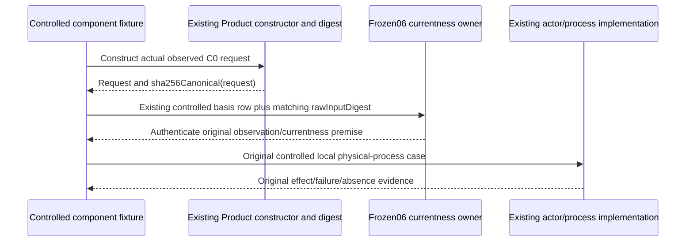

# Finite remaining proof09

Root's Product/currentness/HOW/Proof conjunction selects only the missing controlled-input digest from [closed08](../final-finite-proof-successor-08/freeze.json), SHA6d6aff5c485bf77e4ee8dd62dd093e9aa3a92966738d84f0b8267e675c5e1326. The original physical-process test failed at its prior-currentness assertion before the intended process/effect. c_call_outcome.ts:143–211 authenticates each C0 basis request against its canonical rawInputDigest; the three controlled request rows omitted it, so each necessarily refused. The later native task basis already supplies its own canonical digest. This is fixture contract drift; no supported runtime defect or Product change follows.

Only the existing C0 basis-row loop in main t287-native-workspace-work.test.mjs gains `rawInputDigest:product.sha256Canonical(rawInputValue)`. Existing append computes the row payload digest from the complete payload. Preserve every currentness, actual-effect, admission, absent-path, group-lifetime and no-fabricated-exchange assertion. Preserve the explicit controlled cold invocation/installation/history premises: these are not actual installed Public/native Run admissions or semantic/provider outcomes. Do not assert fabricated currentness or weaken the owning authenticator.

Copy the corrected test into a minimal new overlay; link the immutable final06 build/dependencies and unchanged support. The support's new-empty helper is used for unchanged acquisition only; no clone re-entry is selected. Syntax-check once and bind actual loaded source/emission paths against the closed final06 inventory. No archived stage modification, build, package or protected main936 effect. Archive remains25e7f390a899f3bd9c49fa11a15feba1f59cb2a1d2ba4bad1f62c1abc4224079; proof applies to this exact subject and owner cone. Any separately diagnosed P5 repair and later candidate correspondence remain Executive work, not acceptance here.

After the frozen preflight, execute only original command6's exact physical-process case, then terminal7 and D02's actual final04 owner adapter70299b7965b7402c3923b814ca3f36a0b1699c31aa66d5e35a03d911a99d123d. Reuse08 route7,07 reopen18/codec14,04 U1/C18 without rerun. Fresh physical09 case roots,600000ms per command,<=3GiB retention, zero provider/native semantic calls. The selected local controlled process remains permitted. Existing fixture-owned cleanup only; retain raw command/output/status/PID and actual surviving bytes with removed-resource limits. First selected failure stops remaining commands before repair/retry. Return frozen results; no independent or release acceptance.
