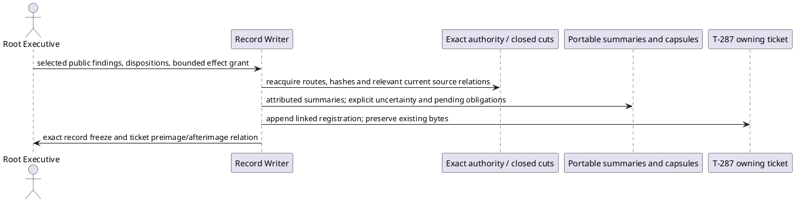

# Final review dispositions — Executive record

## Product Frame

ABIogenesis 5.0 retains its fixed fifteen Product families, sole GTL.TypeScript language, direct HoG traversal, ABG admission/Event Calculus authority and thin Public/SDK/CLI boundaries. The active T-287 slice is the prerequisite common computational library: E03 physical lifetime/timing, K11 explicit STDO environment construction and U1 scoped currentness. Product700–704 and PROJECTION026 preserve attributable effects and withdraw affected currentness without fabricating rollback or successors. Product922–985, CONTEXT008/009, CATALOG013, RUN010 and FN-COMP005 preserve explicit STDO adoption, source material and immutable historical package/Run identities. These records change no Product, requirement, runtime or release boundary.

Root activation `FINAL-REVIEW-DISPOSITION-RECORDS-01` selects only durable recording of Root's dispositions. The Writer is `/root/stdo3_c0_currentness_writer`, not a Reviewer or the decision owner. The requested [F-WORKSITE-CAUSALITY](../../../../../build_tenants/abiogenesis/typescript/design/ABI5_PROJECT_REFERENCE_FRAME_BASIS.md#f-worksite-causality) anchor exists at the accepted current source; no fallback frame or invented anchor is used. Related integration/identity/Owner/Proof routes remain explicit in each capsule. Exact STDO v3.0.0-rc.1, manifest `069285ad5a79d59ca2dd835e34a54b3e537b0eeef99c29994b18c339dbe62232`, composition `[]`, was reacquired through the manager. [Method evidence](method-sources.json) and [source basis](source-basis.json) bind acquired bytes.

## Attributed public review summaries

The full independent reports remain in Root's public tool transcript. This Writer received Root's selected public findings/dispositions and did not acquire the full reports or hidden reasoning. The following are **attributed Executive summaries, not verbatim reports, fresh independent reviews or acceptance**. [Review metadata](review-metadata.json) preserves each session/UUID, model, effort, tool envelope, duration and turn count. Reviewers used Read/Glob/Grep only and claimed no execution or hash verification; Root separately verified hashes. This recording Writer mechanically reacquired the listed local cuts and sources, without executing Product tests.

- [E03 public findings and disposition](E03-public-summary.md): bounded actual no-PID launch gap closed by the later physical evidence; stream, PID and legacy-helper limits retained; historical semantic assembly debt registered.
- [K11 public findings and disposition](K11-public-summary.md): constructor-only explicit STDO adoption, shallow-frozen alias boundary and structural-versus-semantic proof retained; two contingent debts registered.
- [U1 public findings and disposition](U1-public-summary.md): selected CX1 resolved by the closed C0 EC/gate/index successor; nested roots, live cleanup and indeterminate-cause uncertainties registered without invented counterexamples.
- [Registered technical debt](capsules.md): six stable identities, each with evidence, scope, trigger, re-entry, closure test, owner and dependent boundary.
- [Pending final obligations](pending-obligations.md): combined source/package, P1/P2/P3/P5/U1/P4, HoG/E04, passive diagnostics, independent L5, Executive acceptance and checkpoint remain open.

The bounded additive [owning-ticket section](../../../../tickets/active/T-287-deliver-abiogenesis-5-feature-waves.md#final-review-dispositions-01) registers these obligations durably. Each capsule's status is **registered technical debt awaiting trigger**. A trigger returns to Executive selection; it grants no repair, execution, migration, framework change or release exception. Product/authority violations and failures of the selected lawful path remain blockers. Absence of an admitted counterexample is not a proof of universal correctness.

## Record transformation and preservation

The grant permits only this new carrier and one additive ticket section. No GOALS, code, support, build, Git or continuation17 effect is selected. Ticket preimage, appended bytes and afterimage are frozen as transition evidence; subsequent ticket updates remain expected. This is not an immutable-whole-worktree claim, completed full refactor, final L5 acceptance or release readiness.

The [N3 administrative failure and process deviation](N3-preflight-01-failure.md) remain explicit. The first too-strong assertion failed; the Writer corrected it before Root's triage and that corrected check receives no closure credit. Root's `N3-IMPORTER-ACCOUNTING-01` authorizes only the separately retained affected source/link successor check. The classified relation is eight importers without the opt-in plus one conditional command test with a legacy default; this creates no production defect or E03 ownership expansion.
