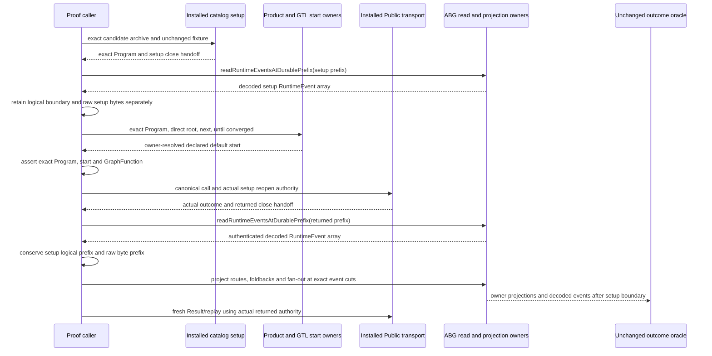

# Ordinary HoG direct-owner driver successor

Product Frame: fixed fifteen-family ABI5.0; T287 common-library prerequisite.
GTL owns the Program and declared default start, HoG directly traverses it,
exact owners perform effects, and ABG admits events and owns runtime truth.
The selected frame is end-to-end interface integration. This preparation changes
the proof caller and its evidence transformation only. It grants no runtime
execution, candidate acceptance, Product/helper change, or new decoder.

The exact first failure is preserved by
`../hog-final06-binding-01/execution/freeze.json` (`2712f991…`). The driver sent
`declaredStartRef` to a direct-root helper. That helper correctly represented it
as caller-selected control, and GTL refused it before Public start. Executive
also identified a latent defect in the same proof path: raw durable JSONL
records were being passed to logical-event oracles despite K10 body references.
The original oracle remains byte-identical (`871bb6ad…`).

The typed joins use existing owning contracts:

| Join | Required relation |
|---|---|
| Fixture Program to start resolution | Omit `declaredStartRef`. The unchanged helper selects `next`; the owner returns `LoadedProductExecutionResolution.resolvedProgramStart`. Assert the exact Program, `abg.root_mode=direct`, its declared default start, `targetKind=next`, and expected start/GraphFunction. The caller does not resolve or fabricate a start. |
| Setup close handoff to logical boundary | Call the existing exported ABG reader on the exact setup prefix. Record its event count and last event id/ordinal with that coordinate. Separately retain raw setup bytes and verify their length/digest against the actual handoff. |
| Returned prefix to oracle events | Use the same ABG reader for decoded `readonly RuntimeEvent[]`. Assert its setup prefix equals the previously read logical events, then slice at the recorded count. Pass this decoded suffix to unchanged owner projections and oracle. |
| Physical evidence | Retain raw final JSONL and assert its setup byte prefix is conserved. Physical records remain storage evidence; no custom body-reference expansion, raw-row event substitution, private event admission or writer is introduced. |
| Fresh Public reads | Preserve the original actual-returned-handoff chaining and full physical-byte conservation oracle. Partial fan-out still gets replay only, with no successful Result read. |

All three case expectations and scope limits remain in the original
`../hog-ordinary-owner-driver-preparation-01/case-map.json`: one successful
declared retry attempt, one workflow child foldback, and an ordinal 0/1/2
complete/block/unstarted fan-out. Original package checks, exact offline seed,
ordinary owner imports, retained cleanup hooks and first-failure stop remain.
The failure phase now names start-call preparation explicitly.

The existing 21 inspected source pins are copied unchanged. Added source routes
for the direct-start contract, ABG exported reader and physical/logical
representation are pinned in `source-inspection.json`; no full source, generated,
dependency or protected-main inventory was repeated. The actual final06 P1
relation remains exact historical evidence. Root has confirmed that P5 repair
will create a new package; no candidate is selected for this prepared driver.

Only syntax checking and static owner-interface inspection are selected now.
They establish no HoG runtime outcome. Before one later three-case execution,
Root must select the successor package, close its prerequisite relation, bind
the existing input inventories and added inspected interfaces to that exact
subject, choose new absent physical roots, and issue a separate effect grant.
`binding-instructions.json` retains the existing configuration/grant shapes,
installed-bin metadata relation, finite cache and 30-minute outer ceiling.
No old freeze, failed root, stage, main source, generated file, package or Git
state is changed by this preparation.
