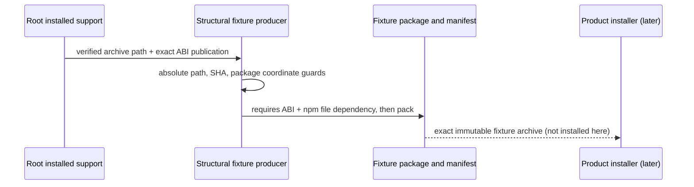

# Retained-law proof preparation and fixture dependency successor

Product/requirements retain the fixed fifteen families, GTL direct HoG traversal and sole ABG admission/Event Calculus authority. Accepted L2 V3/V5 selects retained retry lineage, child/foldback and batch partial/unstarted conservation. This preparation chooses finite owner cases; source assertions, controlled history, actual installed admission and independent acceptance remain distinct.

The current final endpoint activation remains HOLD for the independently triaged C0 issue. The closed combined-final-01 artifact is a historical readiness input only. No proposed HoG workload may run until an Executive grant binds the C0 successor and this support successor.

## Selected support re-entry

Root HOG-FIXTURE-DEPENDENCY-SUCCESSOR-01 admits exactly one support repair. The root-installed-environment producer already authenticates the exact ABI archive and passes `abiPackageArchivePath: artifactPath` in its typed fixture-preparation basis. `language-structural-fixture` discards that field: its Product manifest requires ABI but its npm package has no physical ABI dependency. This is a fixture producer/consumer omission, before HoG execution. The prior smoke repair covered a different consumer.

Preserve the preimage. Consume the explicit absolute path, authenticate its SHA against `abiPublication.artifactDigest`, obtain the real package name from `abiPublication.productSemanticsBinding.packageName`, and reject an absent name before creating fixture files. Emit `{[packageName]: 'file:' + exactArchive}` in package dependencies, preserving sourceTransform, declaration meaning, Product owner, manifest requires and version. Reuse the accepted smoke contract directly; no fallback, dependency range, installer relaxation or general helper is introduced.

Preparation effects are confined to this record root plus the single granted support file. A copied support/fixture source cone imports only the closed final01 emitted Product/GTL owners for one fixture construction/pack. Its config freezes the exact archive, manifest, toolchain, support and fresh local roots first. Use offline npm, scripts disabled, and a new task-owned cache under this record root. Retain cache, npm output, fixture bytes and every result. Missing path, relative path, crossed digest and absent package name must reject before creating a fixture root. The one valid fixture must pack once with exact member byte correspondence and matching physical dependency/Product requires. No installation, traversal, native dispatch, cleanup or retry is authorized.

The source case map will name exact owners, controlled premises, support correspondence, commands, new external-root placeholders and mandatory retention. Historical environment tests receive no automatic reuse credit. The minimum proposed population must not treat helper or constructor checks as installed closure. First unexpected seam or basis failure stops and returns to Executive before repair/retry.
