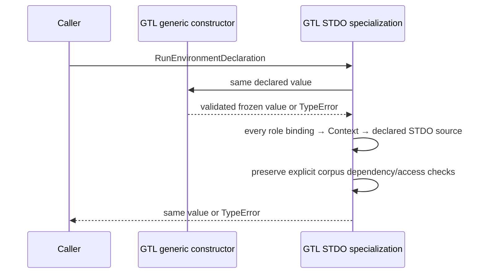

# K11 role-to-native-source successor HOW

Pre-edit owning HOW supplement, selected by Executive `/root` for Writer
`K11-ROLE-SOURCE-SUCCESSOR-01`. This adds the omitted structural relation to
the accepted L2 contract §3; the accepted contract and all old cuts remain
immutable. Smallest lawful re-entry: `design_reframe` correcting a
requirement/HOW gap under unchanged Product and requirement WHAT.

## Authority, failure and scope

Product `specification/PRODUCT.md#stdo-governed-run-environment` and
`REQ-L-GTL3-CONTEXT-008/009` require exact STDO native material and role/frame
bindings; optional corpus access does not make native material optional.
The governing frame is
`repo://abiogenesis/build_tenants/abiogenesis/typescript/design/ABI5_PROJECT_REFERENCE_FRAME_BASIS.md#f-end-to-end-interface-integration`,
with GTL immutable definition/source identity and Proof. The method is
`stdo://releases/v3.0.0-rc.1/`, manifest
`069285ad5a79d59ca2dd835e34a54b3e537b0eeef99c29994b18c339dbe62232`,
empty composition. Native standards are acquired through the STDO manager.

Inputs: accepted library design
`cb8dae9f7e684f9b6be730b74125294524ecd7e4d1f035fc03734d7ff1d1160b`,
L2 contract `65f4007521634d808a3fd94bc87707ae4183ddb00ec4ec0da49e37381ee403c1`,
pure freeze `ce01cdb084f5b0c3827ac9cce481d12e63193a24a1467c9409c9be9a768acca4`
and report `1f2cd5fa046cf39ea42de3ed5022c2b874f814627176664c962143e6ca784b7c`.
The first three hashes bind the antecedent subject, not acceptance of this
successor. Product's fixed fifteen families, sole GTL language, direct HoG,
ABG admission, pure Catalog and thin SDK remain unchanged.

Origin: Executive's attributed summary of independent read-only
`PURE-K11-REVIEW-01`, Claude Opus 5.5 xhigh, session
`a65638fc-d87c-447b-a75c-b533d3a891dd`, reviewer UUID
`cb2866fc-6277-4d38-8447-d59cb7b22d24`, exit 0, 72 turns, 615361 ms,
zero subagents/denials, reported list cost 4.645071199999999 USD (not billing).
Raw stdout exists only in the Executive tool transcript; this record does
not claim a locally hashed raw review. F1 showed a declaration with both an
exact STDO source and a generic member inventory, but every role bound only
to the generic Context. The generic constructor lawfully accepts it. The
old specialization also accepts it because it checks only STDO-source
presence. STDO frame names alone supply no STDO bytes. The existing sunny
helper is sound for this relation. Implementation followed the accepted L2;
the omission belongs first to its HOW. Runtime admission/constructor brands
are outside this finding and repair.

## Selected structural relation

The canonical input and output remain GTL `RunEnvironmentDeclaration`.
`constructRunEnvironmentDeclaration` first checks its existing schema,
unique dependency/basis/Context identities, inventories, member/digest/span
bounds, role policy and access relations, and freezes that same value.

`constructStdoRunEnvironmentDeclaration` retains its exact source predicate:
`/^stdo:\/\/releases\/[^/]+\/$/u` and
`recordFormat === "stdo_source_manifest@1"`. It additionally requires:

For **every** declared role, **some** existing `sourceBindings` entry joins
by `contextRef` to a declared Context whose `sourceLocator` equals the
`basisRef` of **some** declared STDO source selected by that predicate.

This applies whether `corpusAccess` is null or non-null. It does not require
all Contexts or all role bindings to be STDO-owned; extra explicit generic
material and multiple unique STDO sources remain lawful. It does not pick
the first source, impose a release allowlist, or tie every role to the corpus
tool's selected source. Exact identity joins use the existing generic
uniqueness guarantees, so no new source-selection ambiguity is introduced.

No schema, carrier, package, barrel, runtime, publication validator,
acquisition owner or source-development definition changes. No ambient
lookup or fallback is added to production. Non-null corpus keeps every
existing source/representation/tool/role-access check. Null corpus keeps
empty accesses/access refs; permissions, acquisition and resource semantics
are unchanged. Exact-span semantic sufficiency remains independent P4 work;
this structural join cannot establish correct application of method text.

## Effect grant and finite proof

Writer may change only tenant `code/src/gtl/stdo_run_environment.ts`, existing
`test_env/tests/t287-stdo3-run-environment.test.mjs`, and this new work
directory. Preserve source preimages and old acceptance before the code
edit. Create a separate physical copy of the pinned pure stage, including
its 4576 dependency entries; do not link to mutable main dependencies.
Only the two granted source/test replacements and isolated TypeScript
emission may differ. No main build, generator, clean, prepack, pack, test
alias, dependency install, Git, native actor, installed workload, HTTP or
command-execution workload is granted. Read-only STDO manager resolution,
local constructors, bounded tests, compiler and evidence recording are
allowed. Test temporary resources must remain under this work directory.

Before mutation, retain full old inputs plus the actual owner's acceptance
of a generic-only role binding in both corpus branches. After mutation,
prove the same inputs still pass the generic owner but fail the specialized
owner. The focused K11 regression covers standalone and explicit corpus,
each role separately, all roles crossed, generic extra bindings/dependencies,
mixed STDO/generic Contexts, a different unique STDO source, exact URI/format,
and existing explicit corpus refusal checks. Preserve identity/freeze behavior.

Execute the exact constructor-only K11 test names and the existing
`generic exact-byte ingress, crossed Public coordinates, source mismatch and source-unavailable evidence replay`
test (`t287-management-context.test.mjs`, original line 398 negative).
No excluded/skipped case is credited. The K11 Product acquisition case and
historical installed/provider suites are not selected. The historical
pilot uses the historical carrier; the current non-null-corpus native and
default-library helpers use correct STDO Context bindings but require old
installs/Python. Preserve those helpers; the existing declaration-only
K11 non-null corpus construction provides the dependency-ready check.

Stop on the first unexpected integration failure, stale basis, missing
contract, needed out-of-territory edit or unconfirmed physical effect.
Preserve the first failure and return it; do not repair/retry autonomously.
Freeze actual argv, output, modes, digests, sources, generated correspondence,
old-stage/dependency/main-generated preservation, exclusions and uncertainty.
Return only to Executive; no Reviewer activation or L5 claim.

## Attributed review residuals outside this increment

- F2: helper-only D02/D03 evidence needs actual owner projection and
  resolve/bind/verify proof in the final combined subject. A selectedDefinition
  multiple-to-null case may be unreachable if constant-family uniqueness is
  established; no conclusion is fabricated here.
- F3: the reviewer independently found complete H3 spans of 702 and 1260
  bytes. The earlier span oracle reused helper logic. Later P4 must use frozen
  offsets 55240–55942 and 64650–65910, complete member 156797 bytes,
  digest `fcef434630e270d216f494de97ee727ad46690db89a4b73edac4b88ff921c62e`.
- F4: later P4 must assert the disposable mirror's realpath is inside fresh
  resources and differs from the installed STDO root before unavailability
  mutation. This increment does not execute that case.
- Remaining single-match filters in execution_resolution at original lines
  346/769/773 are unselected. `hasExactKeys` NUL-domain naming remains E01.
  The reviewer found seven retired pure bodies semantically satisfied;
  actual owner proof remained indeterminate. These summaries do not create
  additional Writer authority or discharge those obligations.
