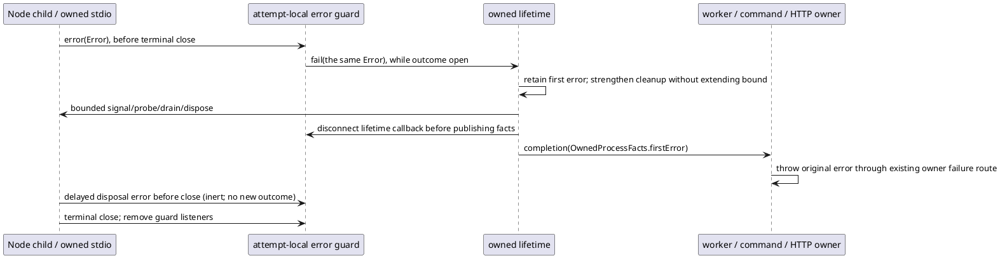

# Owned asynchronous error handoff supplement

This HOW specializes accepted L2 section 4 and Executive E03-STREAM-01. Originating relation: Node emits asynchronous writable EPIPE on child.stdin, outside the synchronous end() try/catch and outside ChildProcess error. The real isolated host terminated before lifetime.completion; later independently observed absence cannot create owner cleanup or admission. Prior tests exercised child/callback failures and missed actual owned stream failure.

Typed handoffs use Node ChildProcess and its existing stdin Writable / stdout and stderr Readable members, Error, existing OwnedProcessFacts and the unchanged Promise owner returns. No contract is redeclared. Register the common error/close guard before an owner writes stdin or attaches data callbacks. Every non-null owned stdio stream has a persistent error listener until its terminal close, not a once-error listener. Repeated stream failures preserve Error identity/code and first-error precedence through the existing fail path; ordinary owner observations stop under that existing policy.

ChildProcess error is a separate channel: with no PID, preserve the existing launchFailure/no-child/onError owner projection. Once a PID exists, an asynchronous child error is an owned postlaunch failure and must use fail, never a fabricated launch failure. Retain its error listener through actual child close as well. The guard itself is internal to this module, not a new general scheduler or process framework.

Completion is still exactly once and bounded. Entering completion cancels timers and removes semantic child lifecycle callbacks. Request disposal on every existing stream; a synchronous disposal failure is retained without skipping the other streams. Errors delivered during that disposal, before the immutable snapshot is published, can fill firstError; an earlier error always wins. A separate internal publication cut prevents any postcompletion outcome rewrite. streamsDisposed may be false if a destroy call throws; actual close remains independent.

After disposal, disconnect every guard from its lifetime callback before publishing frozen facts. An error listener remains inert only on an emitter whose terminal close has not yet occurred; its close listener removes both guard listeners. Already closed streams acquire no residual listener. These listeners retain no lifetime/owner callback after publication, create no timer/global registry, do not keep a process alive, and claim no postcompletion authority. Node's terminal close is the listener-release boundary; fabricated error emissions after terminal close are outside the natural Node stream lifecycle. Actual unresolved OS scope still stops dependent work regardless of disposal.

The three owners already inspect firstError after awaited completion, throw it, and finalize their timers/listeners. HTTP additionally stops its existing port/request polling predicate once firstError is present, then awaits the same cleanup before throwing; this prevents a new HTTP request from being launched after observed stream failure. Worker and command already await completion before subsequent owner work. Worker/command still cut result capture at direct exit; HTTP still permits diagnostic capture through bounded close/disposal. Stream failure introduces no response/port/result or admission value. The emergency parent-exit best-effort route remains distinct.

Finite proof population: (1) actual exported worker transport with identical 8 MiB drain/early-close fixture prerequisites, exact Error code/message, normal host continuation, no fabricated transport result, and independent group absence; (2) controlled errors on stdin/stdout/stderr, repeated and observer-first errors, child no-launch versus postlaunch errors, synchronous and delayed destroy/error, terminal-close disposal and immutable postcompletion facts; (3) controlled command and HTTP owners reject the same error after completion and perform no dependent report/HTTP work after failure; (4) the affected existing direct-exit/capture/HTTP and worker lifecycle regressions; (5) independent literal nanosecond deadlines for positive fractions, minimum positive value and host/safe-integer edges, without the production conversion formula as expected value. Each exact receipt binds source/support/environment; first failure stops. Installed/native/historical joins remain separate Executive obligations.
