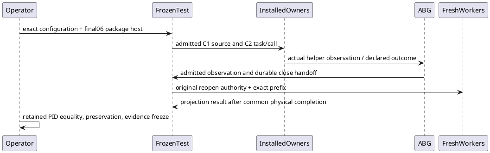

# P5 installed final04 exact binding

This Writer activation specializes the closed P5 preparation HOW/handoff and its final snapshot-parent correction. Its Product remains the selected installed GTL/HoG/ABG outcome; fake-provider transport is explicitly controlled. Product Execution/Admission 693–704 and HANDLERS-002/003/006/008 preserve actual effects, admission and unknown physical scope separately. Current GOAL-035 L3/L4 and L5/release non-closure remain unchanged. The accepted L2 contract and STDO RC1 pins are in activation.json.

Reuse the preparation sequence: exact frozen fixture → installed Product constructors → genuine C1 source admission → installed Public C2/HoG → installed helper commands and HTTP lifetime → ABG admitted full observation → two independent fresh durable-prefix projections. This is the same frozen case, including its separately executed owner-local negative helper attempt; there is exactly one genuine C1→C2 invocation. Both actual helper attempts contain the two command operations and one HTTP probe. Their source, prompt, acknowledgment, full artifact, events, result and close handoffs remain typed by existing owners. No new Product carrier or semantics is introduced.

Only a minimal proof copy is created. The original setup support is copied from the exact E03 stage, and all other transitive support is hash-bound. The final06 build and dependency trees are canonical read-only symlink targets; their finite inventories are checked before and after. No build, pack or writes through these links. The proof copy's manifest is the exact final06 archive/host manifest. Its packageRoot is the actual canonical test root. The static language-smoke program import is included as a setup module dependency; its optional execution route is not selected.

Runtime authorization is now satisfied by Root's actual06 unavailable-owner pass, attributed in activation.json. The named absent /private/tmp root will own host, empty npm cache, npm logs, scratchParent, and the test-created evidenceRoot. The configuration and launch plans freeze before these physical acquisitions or process launch. One offline npm install with scripts, audit, fund and bin links disabled consumes only final06's bundled closure. npm cache is new/empty, user/global npmrc are /dev/null, NODE_OPTIONS is empty, PATH/Node/npm are pinned. Member bytes and full membership must match the archive; only the two declared npm bin targets use archiveMode|0111, with no operator chmod.

The selected test's existing limits are unchanged: test600000 ms, actor60000/90000 ms, canonical helper27750 ms; each fresh child30000 ms and grace1000 ms/drain250 ms. A scoped operator launcher uses the exact common lifetime API for the offline installer (120000 ms work limit) and selected Node test host (630000 ms work limit), each with grace1000 ms. It captures the spawned PID, actual exit/close, stdout/stderr and complete physical facts before checking success. Detached POSIX host ownership does not imply ownership of the separately detached actor/command/HTTP groups. Those remain owner observations and independently captured fixture/process absence; unknown stops dependent work. The enclosing operator root is retained on every outcome.

The source test intentionally captures, without invoking, setup cleanup hooks; it closes only available durable stores. Its declared negative artifact/manifest/source mutations restore the original bytes and retain candidate evidence; they do not remove roots. HTTP's explicit Connection: close and response-finish/server-close premise is unchanged and does not close the prior implicit-connection failed expectation. Root corrected N2 to compare fresh-worker owned child.pid with decoded result.processId, for both workers; HTTP has only fixture-reported PID plus independent absence and existing owner-projected termination. No command PID is inferred from actor identity.

Preflight checks exact preparation/final06 freezes, complete final stage/dependency/archive rows, E03 source/emitted predicates and renderer span, transitive support, toolchain, and protected main936. The finite exit oracle is the unchanged exact selected test plus recorded N2 comparisons, independent known PID/group absence, exact member/mode preservation and immutable inputs. Preserve stdout/stderr and first failure before any report assertion. Any first unexpected prerequisite/owner/assertion failure or unknown physical scope stops; no retry, cleanup, source repair, new native/provider execution, historical Run or continuation17. Root later conjoins this bounded evidence; Writer does not self-accept.
