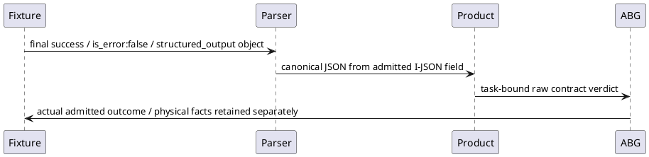

# P5 carrier successor06

Root's read-only conjunction establishes a fixture producer mismatch. Actual C1 Claude args contain --json-schema; its final row omitted is_error:false and structured_output. The exact worker parser rejects that row before its domain candidate reaches Product construction. Normal process exit is preserved independently. C2's fallback and native worksite request likewise select schema response, with no result_text presentation. The separate native assessment presentation is not selected. No production or lifetime defect is established.

Only two final-result producer lines in the one selected main test change: C1 places its existing result object in structured_output; C2 JSON-decodes the actual installed helper stdout into structured_output. Both include is_error:false. Existing schema, requests, actual Bash tool event and helper execution, canonical acknowledgment equality, full artifact, currentness, HTTP201/abi-ok, prefix/replay/negative assertions, counts and timing remain unchanged. No assistant/tool event is added, no result_text route is selected, and no parser fallback is changed.

One bounded pure check uses the exact frozen output observer(true) and canonical JSON owner. It compares retained actual old C1 rows with the corrected final row. For the unexecuted C2 branch it evaluates the exact generated final-line expressions with a declared controlled helper-stdout JSON value and the unchanged test-owned Bash row shape; this establishes parser tool accounting only, not an executed tool or actual C2 artifact. Actual C2 tool/effect counts remain solely for the subsequent installed case. This distinction avoids promoting synthetic pure inputs into process evidence. Syntax is checked after the two-line edit.

Freeze a minimal proof copy with exact original setup18dc, fresh support66bf, replay workerbdb4 and final06 read-only build/dependency links. Reuse the already verified successor05 bootstrap host read-only; no second outer npm install. The actual setup still creates its ordinary consumer installation in new scratch. New scratch/evidence/cache/log roots and two distinct empty task-owned npmrc files prevent prior-root reuse. Keep outer NODE_OPTIONS empty, test600000ms/outer630000ms, actor60000/90000ms, helper27750ms, fresh30000ms+1000grace/250drain. Common lifetime observes the enclosing test; both fresh child.pid/result.processId comparisons are retained after each actual completion. HTTP retains its fixture PID and independent PID/group absence without inventing a new owner carrier.

Before runtime bind changed inputs and canonical paths; reuse exact earlier full inventories without rebuilding or rescanning their whole trees. After execution retain original files, all outcome/physical observations and failed prerequisites, verify relevant preservation and close one evidence cut. Any genuine failure stops before retry/repair. No paid/native semantic claim, Product acceptance, historical continuation, Git action, cleanup or new review cycle is selected.
