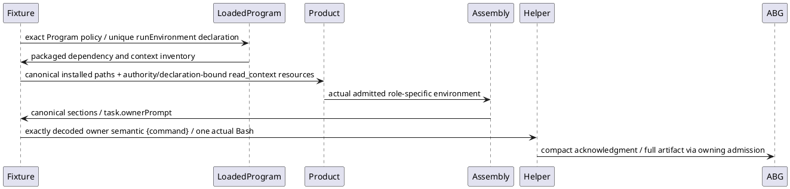

# P5 C2 resource and prompt successor07

Root's Product/Effect/Proof triage selects two same-test caller corrections on the same final06 package. Successor06 admitted C1, then installed C2 refused missing runEnvironmentResources before Product execution resolution/admission. C1's held traversal did not supply C2 Public invocation context. The actual loaded C2 Program declares its packaged command renderer; no method-source substitution or permission relaxation is selected. Separately, actual worksite native assembly renders canonical role/evidence/task/response sections; the fixture's legacy whole-prompt second-paragraph parser would consume the evidence header. This is source-demonstrated latent mismatch, not a claimed second executed failure.

The main test selects resolution.program.policies[gtl.RUN_ENVIRONMENT_POLICY], requires exactly one matching declaration in resolution.programPublication and its one selected dependency, binds the canonical environment.installedRoot plus gtl.WORKSITE_COMMAND_EXECUTION_CONTEXT_INVENTORY.path, and constructs the existing Product RunEnvironmentResources carrier. A new canonical directory under workspaceBinding.roots.archiveRoot supplies temporaryRoot. Permission repeats the exact dependency/path coordinates and actual authorityRef/digest, actorRef, programRef and declaration hash, pythonPath:null and operations:['read_context']. The exact declaration, Program selection and binding are retained before the installed call. No generic factory, new schema or extra authority is created.

The generated controlled transport splits only the declared canonical section boundaries, requires exactly one ## task section, JSON-decodes its unique ownerPrompt string, then decodes the actual owner's second paragraph as its exact one-command semantic tool-input object. Missing/duplicate task sections refuse. It preserves the full actual prompt, one existing actual Bash call, helper raw streams and structured_output. No fallback, synthetic extra tool event, production parser change or legacy unwrapped-prompt path is added.

One finite pure parsing check uses the exact frozen renderInstructionSections body and actual Product renderer with the retained current task and a pure helper plan. The generated fixture parser must preserve the actual semantic object; missing and duplicate task sections must throw. This is pure structure/producer-consumer evidence, not native assembly authentication or helper execution. Syntax is checked once. The preceding carrier-only proof stopped at C1 in05 and missing resources in06, so it could not exercise actual C2 context assembly; its parser-only check tested final response framing and did not cover the request producer-consumer seam.

Freeze the exact changed test and minimal inherited proof copy before one original P5 run. Reuse the verified05 bootstrap read-only, preserve prior cuts, use new07 scratch/evidence/empty cache/log roots and distinct empty npmrc paths, and retain empty outer NODE_OPTIONS. No whole-stage/dependency scan or new outer bootstrap installation. Original C1/C2 payloads, 27750ms budget, actor60000/90000ms, test600000/outer630000ms, fresh30000+1000+250ms and all acknowledgment/artifact/HTTP/currentness/prefix/negative oracles remain. Two fresh actual child.pid values must equal their decoded processId; HTTP retains fixture PID and independent absence only. Root effects and all raw outputs remain on failure; common lifetime completion and independent recorded-scope absence precede dependent work. Stop the first actual failure for Executive; no repair/retry, acceptance or native semantic credit.
