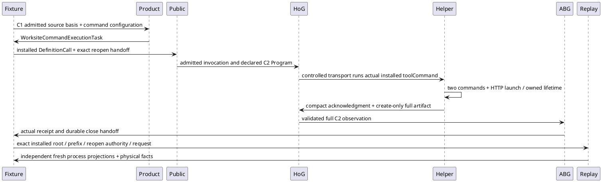

# E03 installed C2 proof preparation HOW

Activation: E03-P5-INSTALLED-PREPARATION-01, continued by Executive P5-PROOF-SUPPORT-01. Writer /root/stdo3_lifetime_writer returns only to /root. Project frame is repo://abiogenesis/build_tenants/abiogenesis/typescript/design/ABI5_PROJECT_REFERENCE_FRAME_BASIS.md#f-end-to-end-interface-integration; applicable Owner, Effect and Proof frames distinguish test fixture, actual installed owners, ABG admission and fresh projection. STDO 3.0.0 RC1 manifest 069285ad5a79d59ca2dd835e34a54b3e537b0eeef99c29994b18c339dbe62232, empty composition; accepted L2 contract 65f4007521634d808a3fd94bc87707ae4183ddb00ec4ec0da49e37381ee403c1; exact stream successor freeze 8668dfa9ddbfb2fcfa860659e383e0527b009afb532e385e876384eba5b1b155. Current Product Execution/Admission 693–704 and HANDLERS-006/008, TRANSPORT-002/003/019 retain effects and failure truth. No Product extension, native semantic claim or release acceptance.

## Selected path and typed handoffs

The Product constructor owns HTTP environment normalization, referenced validation command, exactly one {ABI_HTTP_PORT_FILE} argument, relative port confinement and explicit write territory. Add one http_response_exact predicate linked to the small-success command: launch Node c2-source/service.mjs, evidence/http-port.txt, 5,000 ms launch, 1,000 ms grace, GET 127.0.0.1 /, 1,000 ms request, expected status 201 and body abi-ok. Preserve both original commands and existing ordered predicate prefix. Total canonical task budget is 27,750 ms (two 7,250 ms commands, one 8,250 ms HTTP term and separate owner 5,000 ms); the opt-in launch fixes actor inactivity 60,000 and absolute 90,000, with selected test envelope 600,000 ms. Default test keeps its prior envelope and setup/replay route. Later operator must separately grant all actual execution.

Fixture HTTP sends Connection: close and calls server.close only after response finish; diagnostic PID/finish/close lines are diagnostic stream evidence, never the response or ABG authority. This preserves F1: the prior implicit-connection fixture remains a failed expectation; explicit finite-exit success does not close it or change the production client's keep-alive policy.

The controlled provider emits the existing Claude-shaped carrier and executes the actual installed helper. Record prompt, exact tool input, shell PID, status/signal/error and raw helper stdout/stderr before assertion or throwing. C1 controlled provider identity is likewise retained. These are test transport facts, not paid/native semantics. Actual helper artifact and ABG event prefix remain owners of command/probe observations and admission, respectively. Do not infer inner PID/group facts absent from those carriers. HTTP fixture PID can be independently probed once after owner completion; actual command groups remain owner-projected absence with prior exact common-lifetime support, not an invented external PID census.

## Support boundary and cleanup cut

The first preflight found root-installed-environment's mkdtemp and unconditional after-hook deletion, plus fresh-process-runtime-proof's immediate timeout rejection. Executive selects existing setup interfaces: the opt-in test passes a capture-only after context; deferred cleanup hooks are never invoked, and TMPDIR is bound to the exact canonical scratchParent by later launch configuration. Root setup source is not edited. Retain scratch/evidence on success and failure; explicitly close an available held store without invoking the delete hook. If setup fails before handing its store out, record that limitation and retain the root; no cleanup fiction. Restore caller environment in the test's existing after hook. Existing negative mutations are retained before their finally restorations; original bytes and changed candidates remain evidence.

Only the opt-in replay support path changes. It imports createOwnedProcessLifetime and createMonotonicDeadline from the explicit installedPackageRoot/build/code/src/shared/owned_process_lifetime.js. No fallback, ambient module or new signal/probe/escalation/drain loop. Spawn the existing replay worker with detached true on POSIX, false on Windows, pipe stdio and exact stdin JSON. Bounds are 30,000 ms work timeout and 1,000 ms grace. Common lifetime owns async child/stream errors, original first Error, TERM/KILL, group/direct-child scope and bounded drain. Timeout is owner policy and requests termination through that API. Retain input before spawn, PID and observations, raw stdout/stderr and final directExit/launchFailure/scopeAbsence/closeObserved/streamsDisposed/drainExpired/counters before resolving or rejecting. Serialize Error fields and bigint facts only for evidence; throw the actual first Error object. Success requires absent owned scope, clean exit and parseable result. No second worker starts after failure or unknown. Normal replay worker finally still closes its durable log. The old default helper path is deliberately unchanged, unreachable in selected P5 mode and excluded from its evidence and retirement claims.

## Effects, finite preflight and later exit

This preparation writes only the selected test, fresh-process-runtime-proof.mjs and this new work root. No production, frozen stage or prior evidence mutation. Before source edits freeze this HOW and exact preimages. Permitted checks: syntax and pure Product configuration constructors/callable export presence against the exact stream-repair stage. Constructor cold A/W premises are explicitly non-admitted; no C1/ABG result is fabricated. Preflight pins support dependencies, current source and emitted Product/helper/lifetime/worker/Public modules. Final combined archive/host is not yet available: configuration template must say NOT_GRANTED and require exact paths/digests/new roots before any later execution.

Actual later proof must preserve the original large log/compact ack/admission/replay and negative oracles, add exact HTTP response/port/process facts, retain actual prefix/call/receipt/artifacts, and demonstrate two distinct fresh process PIDs and exact retained projection equality only after each common lifetime settles. Physical absence is separate from admission and comparison success. Any first failed prerequisite, uncertain scope, unsupported seam or source drift stops dependent work and returns exact evidence. This preparation does not execute installation, commands, HTTP, actors, Public or replay, does not rerun the prior 27 cases, and does not confer independent acceptance.
