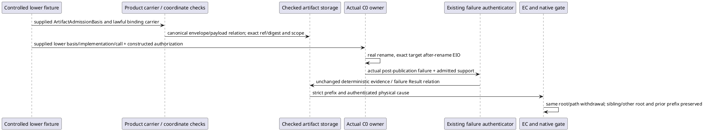

# U1-C0-FAILURE-FIXTURE-02: owning fixture handoff supplement

Root grants this bounded successor after the stopped Writer freeze c4a9b7100861c5f89b98399076aef7bda002f191bc0e54ab95532d074146b0f5. The accepted L2 contract 65f4007521634d808a3fd94bc87707ae4183ddb00ec4ec0da49e37381ee403c1, library design cb8dae9f7e684f9b6be730b74125294524ecd7e4d1f035fc03734d7ff1d1160b, Product700–704 and PROJECTION026 remain governing. STDO v3.0.0-rc.1 manifest 069285ad5a79d59ca2dd835e34a54b3e537b0eeef99c29994b18c339dbe62232 and composition [] are unchanged. Worksite causality remains the owning frame; integration and proof are conjoined locally for this increment and return to Root.

The first run passed nine selected vectors but stopped before the tenth vector's physical effect. Its controlled artifact candidate omitted authorityScopeRef; storage's legacy artifact profile required only operationId/artifactRef/artifactDigest, so appendCheckedArtifactEvent accepted the storage shape. Event Calculus requires the authority-scope fluent identity. Root classified this as the fixture-to-owner handoff being incomplete, not a new production failure. No failed effect, rollback or failure Result occurred in that stopped vector.

The canonical producer is environment_admission.ts:969–1001. ArtifactAdmissionBasis extends PublicOperationAdmissionBasis with the predecessor durable prefix. It binds aggregateId and basisId to authorityScopeRef, carries authorityScopeRef/authorityScopeDigest, exact definition/invocation coordinates, ownerAdmittedDisposition, and matching payload/envelope causation and correlation. artifact_truth.ts:226–290 consumes these same owner coordinates before any install/binding semantics. The predecessor fixture incorrectly used the authority-basis identity as basisId and omitted these metadata. Correct only that existing test's controlled artifact premise using the existing publicOperationBasis fixture function and isExactOperationInvocationCoordinate checker; add no constructor/schema or production exception.

The supplied definition/invocation coordinate, Public workspace binding, lock/install, implementation selection and graph occurrence remain controlled lower premises. The existing Product workspace binding carrier predicate checks the supplied carrier against its supplied established-lock and workspace-authority coordinates. The artifact append is the existing checked storage ingress, not a performed Public bind/install operation and not a full artifact-truth qualification. The test audits all envelope/payload coordinates, carrier/ref/digest/authority joins and exact invocation digest before append. c_call_outcome.ts:143–218 must independently reconstruct the unchanged complete C0 failure authorization using the binding artifact, exact basis, selected implementation and causally ordered call occurrence. That join, the actual Product physical rename and selected EIO, and subsequent evidence/Result append are the bounded component proof.

All four production sources and their five changed emissions are immutable at the stopped compile cut (stage inventory f800ca54592e23a699d06e3a5a8733958a150cba1168b9f58060c3b9e1ff0670; source inputs 1ab466a1d65bf1f9c70796eae918662a3f084318c6afe74f71e440852887533c). A separate stage copies all 1948 frozen files and 4576 dependency entries with no shared regular-file inode, then overlays only the corrected test. There is no compile or dependency change. The stopped stage, evidence, prefixes, 936 main generated files, prior freezes and continuation17 remain untouched. Root's separately closed language-structural-fixture successor remains attributed to Root and is not imported into this historical stage.

After source and fixture preflight, execute the affected focused test exactly once with new TMPDIR/evidence roots. Its monolithic ten vectors may repeat; earlier nine passes receive no duplicate credit. Require actual failure/authentication, evidence-only nonwithdrawal, failure-Result EC and gate parity over full, indexed and physical cold/lazy prefixes, strict pre-event dependency closure, exact prior prefixes, sibling/other-root controls, auth negatives, and successful own-after preservation. No actor launches. The first unexpected integration failure returns immediately to Root with prefix/residue, without local repair or retry. Combined installed/artifact/consumer aggregates, independent review and Executive acceptance remain separate obligations.
