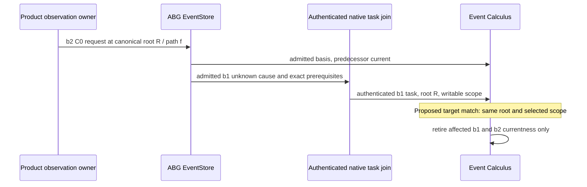

# Proposed owning HOW supplement — physical target scope for C0 retirement

Status: Writer proposal for Executive selection; no production repair is authorized or performed. Product700–704, PROJECTION026 and F-WORKSITE-CAUSALITY already require retirement over potentially affected physical scope. The accepted effects/L2-report.md:121 sentence retaining binding-specific C0 must be explicitly superseded by a new L2 supplement before implementation. The old accepted bytes stay immutable.

**Origin and discriminator.** `event_calculus.ts:620` first validates the C0 request, then excludes it solely because its immutable binding identity/digest differ from the authenticated task. A Product-set change produced b2 while preserving exactly the same WorkspaceAuthorityBasis/canonicalRoot. Its actual Product request and EventStore basis admission establish currentness before the cause. After the authenticated b1 cause, b2 currentness stays true while the shared native invalidator reports the same file invalidated. The cause is lawful under b1; it is not authority to execute under b2. Withdrawing b2's physical currentness does not require granting that authority. The index includes b2, so an index expansion cannot repair this filter.

**Smallest coherent change.** Keep `projectNativeWorkUnknownEffectTask` and all of its cause-owned binding/invocation/grant/causal authentication unchanged. Inside the existing private `retiredNativeWorkObservations`, replace the two target binding-equality exclusions with exact equality between `request.workspaceAuthorityBasis.canonicalRoot` and `task.workspaceAuthorityBasis.canonicalRoot`. Continue requiring `isWorksiteFileReplaceRequest`; its owner validates request/grant/subject/territory/predecessor joins and exact subject URI under that root (`product/worksite_effect.ts:1134`). Compare the already carried canonical root; do not perform filesystem reads, path alias discovery, authority rebinding or ambient normalization in Event Calculus.

The proposed target law is: a validated C0 request belongs to the same physical root **and** its subject path belongs to the selected scope. Preserve two distinct scope computations:

| Cause branch | Scope supplied by existing owner | Required target-path test |
|---|---|---|
| Authenticated unconfirmed termination or transport exception | Unknown after-state; task's declared writable roots | Existing `nativeWorkspacePathWithin(subject.relativePath, task.writeRoots)` containment. Empty writable scope retires nothing. |
| Admitted native observation or failure with actual after-observation | Exact `nativeWorkspaceChangedPaths(before, after)` set, authenticated by current evidence/value joins | Existing exact `changed.has(subject.relativePath)`. An empty set retires nothing. Do not turn a changed file into an entire subtree or clamp known off-scope changes to permitted write roots. |
| Admitted typed native failure with unavailable after-observation | `after === null`, `changedPaths === null`; potentially affected declared writable roots | The same unknown-scope containment as above. No inference of actual changed paths. |

For each matching request, preserve existing retirement of its predecessor ref and, when carried by the selected `c_call_evidenced/worksite_file_replace` row, its typed successor ref. Do not initiate a fluent or manufacture a Result, observation, rollback, final process exit, binding, resource or event. Preserve cleanup/failure facts and unaffected roots/paths. The shared helper's change intentionally applies to **all three rows** above; it is not an undisclosed broadening of known changedPaths.

**Complete affected source cone.** Source lines below refer to the frozen stage files matched in owner-source-correspondence.json.

1. Target currentness originates in `worksiteBasisObservation`/`basis_admitted` (`event_calculus.ts:442,709`) or exact C0 transition Result (`projectWorksiteTransitionForResult`, :510; Result effect :972). The selected C0 request validates through Product. This intake executes the first route; the prior frozen consumer proof retains the actual physical C0-success/Result route separately.
2. Unknown causes enter `projectNativeWorkRetiredObservations` (:592) through `actor_process_termination_unconfirmed` (:910) or the shared actor closed/failed effect (:933). Only the two supported unknown kinds authenticate; actor closed and other failure classes produce no native retirement. No child start gives no authenticated task. This intake executes unconfirmed termination; the transport sibling shares this task/scope projection and retains its prior exact proof.
3. Native Result causes enter the same projector (:597–612) from the `c_call_result_admitted` effect (:992). The projector requires a typed native observation/failure, provenance CCall equality, the exact observation/failure contract, and prior cited native probabilistic transport evidence with matching transport/output digest. Retry failures retain `failureCandidateDigest` as the evidence preimage. Unrelated C0 or other Results return no native retirement; their own C0 transition relation remains separate.
4. `implementation/native_workspace_work.ts::realizeNativeWorkspaceWork` (:24,43–66) observes before dispatch and again in `complete`, even on exchange failure. With an available after-observation it computes actual changedPaths; without one it returns a typed failure with null after/changedPaths. Product construction/validators are `product/native_workspace_work.ts:132–140,174–225`. Successful observations reject scope violations; available-after failures can preserve actual scope-violation changes. This is why known changedPaths must not be replaced with writeRoots.
5. `abg/c_call_outcome.ts::stageCCallResult` / `admitOwnedCCallResult` (:848,1006–1045,1153–1164,1190–1245) preserves `nativeWorkspaceWorkResultMatches` and typed native failure observations even when the report is rejected. `abg/c_call.ts::planCCallRuntimeFailureClose` (:3044,3111–3124,3202–3230) adds retry failure coordinates while preserving the original candidate digest cited by evidence. These source routes are audited, not newly executed in this intake.
6. `eventCalculusDependencies` (:1774–1811) selects authenticated unknown prerequisites plus `worksite-observation-dependency`; native Results select the same worksite bucket. `runtimeHistorySelectorKeys` (`runtime_history.ts:556–565`) puts C0 basis/evidence rows in that bucket without a binding filter. Full arrays and owned indexed projection therefore share the target predicate; the deciding case confirms both are supplied the b2 row. Keep lazy/incremental/cold algorithms unchanged and re-prove agreement on the selected repair.
7. `replay.ts:1187–1233` obtains C0 candidates then filters through `worksite_observation_current`; stale retained truth can consequently survive fresh replay. The native gate `native_worksite_execution.ts:209–246` already matches canonical root and preserves known-path versus unknown-scope semantics. Its actual downstream consumers retain their existing owners. No downstream rewrite is indicated by this counterexample.

**Proof selected for a later repair.** Carry this exact discriminator forward, then add an actual admitted C0-successor variant to the existing authorized focused proof, known-changed/empty-known-set and after-unavailable Result cases preserving their separate scopes, and the fully re-signed E1 grant mismatch. Preserve single-binding, sibling, other-root, empty-write and prefix-mode control evidence through exact support matching. Execute the full U1/consumer aggregate plus actual local native-workspace and terminal regressions on the final combined artifact as the Executive selects. This is a proposal, not an execution grant; this intake stops at the retained falsifier. F2/F3 remain separate residual candidates without automatic waiver or repair.

