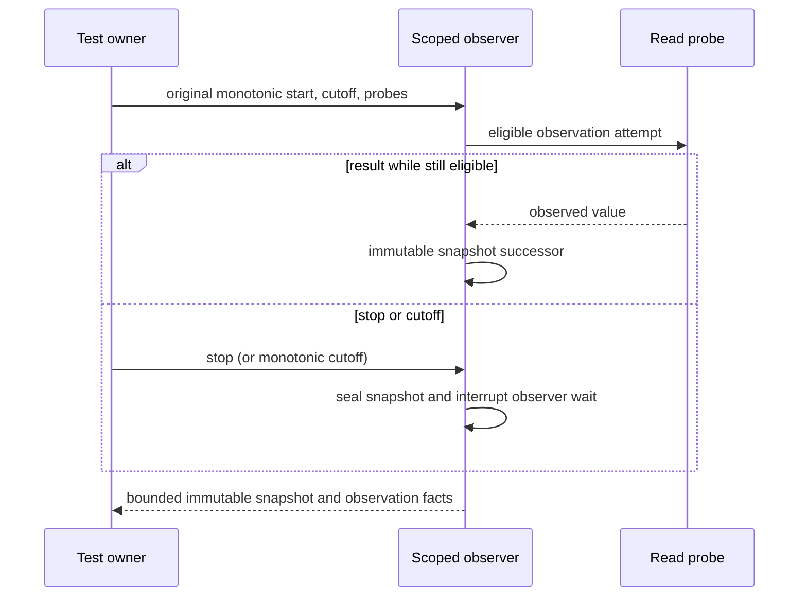

# Foundation correction and observer pilot

Root FOUNDATION-BASIS-01 implements the owner's clarification: “ABG is the application sitting on the best possible implementation of the design.” This candidate reconciles the Product realization profile, owning Design, bootstrap guidance and two requirement clarifications. Product text and its realization constraint change; the fixed fifteen outcomes, behavioral requirements and serialized Public contract remain unchanged. Core Effect stays exactly `3.22.1`.

The [closed triage](../triage/ASSESSMENT.md) identifies the active mechanism exclusion and the complete identified correction cone. [The admitted amendment](ROOT_FOUNDATION_BASIS_01.json) replaces API and immutable-carrier bans with the existing semantic ownership boundary. No static Effect API blacklist was identified; Map/WeakMap tests remain unchanged. D2's restriction is evidenced, but it is not established as the cause of any specific failed author run.

This plan supersedes the implementation approach in the [preserved diagnosis plan](../../rc11-qualification-01/root-cause-01/operator/ROOT_CAUSE_AND_PLAN.md). Its [diagnostic results](../../rc11-qualification-01/root-cause-01/operator/RETURN.json), [independent assessment](../../rc11-qualification-01/root-cause-01/review/ASSESSMENT.md) and [source-extracted counterexamples](/private/tmp/abg-rc11-root-cause-20261110-01/stage2-b/RESULT.json) remain unchanged. Historical red tests, failed native workflows and both qualification debts remain open.

The bounded observer pilot remains prospective in `test_env/tests/t287-owned-process-lifetime.test.mjs`, with one small test support module only if extraction improves the finite controlled proof. Root first assesses the correction's complete impact on ABG's robust Functional approach and any conflicting live remnants, then revises this repair plan before source activation. No native runtime or pilot setup is being prepared or launched. The prospective pilot does not rewrite production transport, add a dependency or select application concurrency/retry. An eventual native author should receive the exact observer, its two call sites, compact diagnosis and current authority, not a broad source-discovery task.

Use one scoped core Effect observer with an explicit stop signal, interruptible waits and a sealed immutable snapshot. A Ref of immutable snapshots and a Deferred for stop/completion are appropriate candidate mechanics; no new Stream/Queue framework is required. Use one declared parent monotonic clock domain anchored at the existing case start and setup cutoff. Effect `Clock.currentTimeMillis` uses wall-clock `Date.now`; it must not be mixed with the existing `performance.now` domain or used to rebase owner clocks. The author must verify the exact pinned API composition.

Check eligibility before every probe and after every awaited result. Stop/deadline handback must be independent of an unresolving external read. Effect `raceFirst` waits for loser termination: naming a race is not proof of bounded return. Observer waits must be interruptible, and finalizers must not wait for unresolved I/O. Passing an AbortSignal where supported does not establish underlying read cancellation. Seal once; late results cannot mutate the returned snapshot or start another probe. Preserve original owner result/error, record immediate settle time and readiness/write/exit/cleanup evidence before assertions or scratch removal. Fiber interruption is not process-group absence.

Prospective finite proof starts with the exact counterexamples: stop during await; cutoff 10/resolve 11; exact boundary 10; never-resolving read; read error; successful completion before cutoff; and late resolution after stop. Assert bounded handback, no next probe, immutable nonmutation and no owned observer fiber/timer residue. Then run the complete affected lifetime population with actual publication timing and independent process absence. Exact commands, observation bounds, retained output and cleanup territory must be bound before execution; no tests or native pilot are activated by this plan.

The separate m5 Proof repair remains necessary: replace callback-count assumptions with complete ordered bytes/records, retain actor facts before cleanup, establish physical startup premises without rebasing deadlines or adding acknowledgements, and exercise an actual late-write attempt/capture-closed relation. Targeted deterministic evidence precedes the complete affected m5/lifetime populations and original nine-file unit invocation. Debt closure requires all selected successor proofs and Root conjunction; a repeated pass or diagnostic green is not replacement qualification. A production contradiction returns to its owning Design.

The smallest native route reuses the maintained installed RC10 Public setup helper and the fresh-imported host pattern from `rc11-qualification-01/native-01`. The new foundation worksite has no workspace manifest: use actual `create.imported`, preserve existing source, select the native Program separately from setup's library Program, acquire a genuine current nominal resource and hold the same caller at PREPARED for Root dispatch. Never copy old Run/resource IDs or serialize a fake resume. Opus 5.5 xhigh, source-only, with strict absolute timeout greater than inactivity is the precedent; a proposed 900s/180s/100-turn envelope still needs exact task admission. External proof follows the actual closed source freeze.

RC11 remains installed locally, unqualified and unpublished; RC10 pin `05a9280f` remains the operational builder. This successor starts at `e2ba05da` on `codex/rc11-foundation-correction`. No new release identity, commit, merge, installation, selector or qualification is selected. Preserve the [metadata-bound packaging result](../../rc11-qualification-01/reviews/packaging-assurance-001/REVIEW.md); this slice does not reopen packaging or claim file-bytes-only reproducibility.
