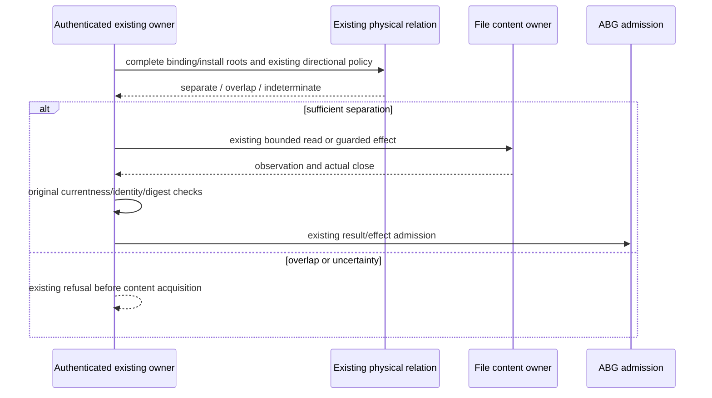

# B21 bounded owner-boundary repair

Root conjoins the closed physical-owner source review and semantic-input
follow-up against fixed5.0 Product and accepted C0/C2 HOW. The source checkpoint
is preserved despite its open findings; no merge gate or B21 completion claim
is introduced. A new exact RC13-native author subject repairs the demonstrated
boundary ordering/asymmetry and omitted authenticated observation inputs.

The helper independently applies the same existing boundary as the host.
Default Testing and semantic-job owners carry already-authenticated roots;
there is no new caller authority, task shape, runtime or global binding rule.
Historical semantic-job provenance does not freeze later physical topology;
the live subject observer must receive the current owner's complete inputs.
This is a missing-input correction, not a claim of a reproduced semantic-job
escape. Root's closed triage is `../../integration-01/B21_SOURCE_REVIEW_CONJUNCTION.md`.

Operator prepares one exact control set and returns before execution. Reuse
proved setup custody and topology controls, but freshly bind all actual roots,
source, original clock and full case prerequisites. Native implementation,
source assurance and mechanical proof retain separate roles. One pass only;
first failure returns to Root. Raw evidence remains external. The next exit is
an exact frozen source with discriminating real-owner proof, followed by Root
conjunction; broad qualification and release are later selected boundaries.
