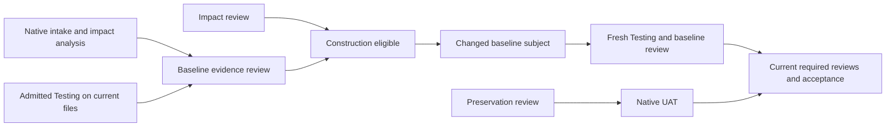

# Disabled installed amendment successor

Preparation only. Product 5.0/S03 requires a specification amendment to be
realized through one ordinary installed Public invocation, with native evidence,
acceptance and required current reviews. ABG admits execution truth; these
external controls declare a consumer process and observe the resulting Run.
They author neither graph choices nor semantic verdicts. S06's keyed-accounting
witness, same-Run continuation, new-Run reuse and full qualification are separate.

The exact prior subject is 8233791ae611f1c5f6e2ec2afd5a1738dd700bb6. This new
carrier is authored on df4b39d3121ef9aeefef78ef7f5dfceafced0560; no original
control or Product source is changed. Root's separate Writer activation selects
the closure in INSTALLED_COMPOSITION_CONTROL_FINDINGS.md and the added baseline
review described here. The original impact and preservation definitions remain
byte-equivalent as JSON values; their meanings are not expanded.

## Declarative composition and discriminating outcome

PROCESS.json extends the maintained amendment definition with one explicit
required review, `baseline`. Construction requires satisfied current `impact`
and `baseline`; UAT still requires `preservation`. The existing GTL prerequisite
owner enforces these conditions. There is no new scheduler or total stage order.

These arrows show material/prerequisite relations, not host-selected execution
order. Testing can observe seed files without an author Result. Both ordinary
unit tests and the exact protected four-case oracle run through that owner.
Changing the requirement from threshold5000 to10000 makes the original seed
fail the 7500,10000 and bulk-discount examples while10000.01 still passes. The
oracle does not install a defect, supply a verdict, or force a graph choice.

The new baseline review asks whether actual current executable evidence and
native intake/impact documents adequately characterize the change. It expressly
allows accurate failing application probes as adequate pre-construction evidence;
missing or unauthenticated evidence remains indeterminate. Its candidate and
sources cover the approval implementation, shared order implementation, amended
tests, requirement/trace, actual analysis and protected oracle. All potentially
changed subject dependencies are declared. Real construction therefore lapses
this verdict. Adequate fresh evidence must satisfy it again; acceptance remains
a separate correctness judgment.

The impact review remains the unchanged assessment of the impact document,
requirement, trace and rubric. Its declaration excludes realization correctness
and test results. An implementation-only change can therefore leave the exact
impact verdict current. If the Executive legitimately revises impact material,
this specific preservation discriminator is unobserved; the host does not claim
success, reinterpret another review or retry.

amendmentCoverage joins actual c_call_result_admitted values, parent standing,
review synthesis producer refs and native Testing command vectors. It requires:

- native intake and design outputs and admitted initial threshold counterevidence
  before the first actual construction change;
- a satisfied baseline whose authenticated producer is that initial Testing;
- that same verdict becoming stale after real construction, followed by a new
  satisfied current baseline whose producer is fresh passed Testing;
- the original satisfied impact verdict remaining current with unchanged
  declared dependencies throughout that same interval;
- native satisfied acceptance over passed Testing after the last construction,
  plus a terminal parent with every required review current and satisfied.

The host separately checks held reads, actual close, fresh result/replay equality,
protected-source conservation and the final independent four-case application
oracle. An unobserved conjunction is a retained failure, never automatic retry.
No synthetic assessor or host verdict is used. The canonical assessment contract,
schema identity, Program declaration and task join still come from the maintained
owners via amendment-consumer.mjs, amendment-setup.mjs and amendmentWitnessInput.

## Why initial failures are usable evidence

At the preparation source, implementation/worksite_command_helper.ts:1418-1427
retains every terminated command regardless of nonzero exitStatus;1456-1468
separates helper/effect/conservation failures. implementation/worksite_command_execution.ts:640-670
returns the observation when that helper succeeds. product/worksite_command_execution.ts:2049-2084
checks the declared command/predicate identity vector, not zero exits.
abg/default_library.ts:478-503 retains Testing streams and predicates in the
parent;381-405 supplies the complete authenticated producer to the native
assessor. product/default_library.ts:176-231 owns declared review dependencies
and prerequisite eligibility. Thus evidence adequacy can be satisfied before the
application passes. This is a source trace, not an executed demonstration.

## Exact acquisition reuse and separate identities

B44 e825092f3c0778553cf07a80abcac876da4ccc58 is reused explicitly:
smoke-custody.py and SMOKE_INPUTS.json are byte-identical; the package import-only
export selection block is byte-identical in amendment.mjs; run.py retains its
finite owner, before/after input custody and separate built-smoke routing. Only
the basic-specific planned write derivation and host command become amendment
specific. The retained owner/physical observer files remain byte-identical to
c1683d3. REUSED_HELPERS.json binds these relations.

There are distinct immutable coordinates, intentionally not relabelled:

- this successor control commit and its CONTROL_MANIFEST.json;
- retained amendment controls/source at8233791ae and its manifest, used by
  controlSourceRoot/controlSourceCommit/retainedControlRoot;
- the separately built smoke subject and receipts from B44's SMOKE_INPUTS.json;
- candidate.sourceCommit/archive/bootstrap package, which must match that exact
  smoke binding. The frozen smoke binding currently names7a2411defd9ef7c1968512703c3b4b1493114453.

No unbuilt worktree is used as the smoke source. The retained source tree check,
all selected maintained bytes, bootstrap/archive equality, complete5302-file
payload, build/native/tool/npm inputs and receipts are conserved at entry/exit
by the reused owners. New process/oracle/control files are covered by this
successor's manifest. Selected credential values are never written: they are
removed before Product imports/setup and exposed only inside the maintained
native invocation interval, whose finally restores the sanitized environment.

## Remaining prospective binding

BINDING.template.json is disabled; paths, candidate, provider, topology acceptance
and clocks are unresolved. Root must independently review and bind an exact
one-shot execution with fresh raw/worksite roots, actual topology and finite
native/host bounds. Basic CLI remains the first composition discriminator.
If the candidate changes, the frozen smoke identity must receive a separately
selected successor; these controls do not silently refresh it. A missing current
analysis/producer or unobserved invalidation is a retained gap, not a fallback.

Only static syntax, JSON, source-reuse and hash checks were performed in this
preparation. No provider, setup, import, test, build, smoke, installation or
qualification evidence is claimed. Exact independent review and execution remain
unperformed; no Product contract gap was found in this bounded source trace.
