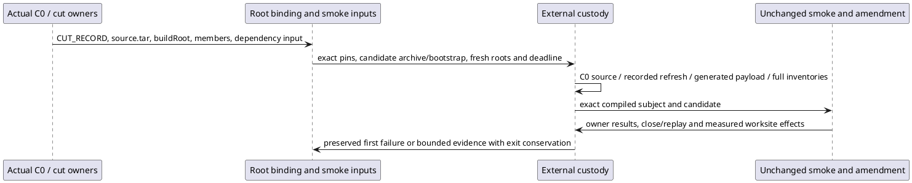

# Amendment04 actual-cut input custody

Product Frame: fixed ABI5/T287 F17/S03 amendment and selective currentness. This is external evidence tooling. Public, ABG and the declared lifecycle, review and Testing owners remain authoritative. It neither qualifies a candidate nor supplies a semantic verdict.

Root selected this separate Writer at74999d972fcd7285dc990d97a9bfb39164559fb7 after b29's closed readiness intake and R14's independent agreement. Exact STDO3.0.4 and acquired stdo-work/reference-frame context apply. The old71da amendment03 remains immutable. No Product, test or native source change is selected.

## Origin and narrow change

Amendment03 run.py53 and smoke-custody.py61–79 required old7a2411d source/proof/archive/bootstrap receipts. An actual prospective RC14 candidate could not satisfy that identity join. Its required retained helper checkout8233791a was also no longer available: the old path now belongs to b865 qualification work. Neither input may be relabelled or overwritten.

The successor reads one external Root hash-bound smoke-input packet described by SMOKE_INPUTS.template.json. Candidate fields stay null until the actual cut. That packet joins the existing CUT_RECORD.json, ARCHIVE_MEMBERS.json and complete dependency inventory; it contains no replacement runtime or qualification schema. The host authenticates and conserves the packet and all consumed inputs on entry and exit.



## Actual producer-to-input mapping

- `candidate.sourceCommit/sourceTree` are the compiled C0 commit/tree in `CUT_RECORD.source`; they are not a later qualification-source commit. Require the actual apply-mode RC14 cut, its prospective status, committed RC14 version and no scratch stamp/claim replacement.
- `smokeSourceRoot` is the extracted source root whose tenant equals `CUT_RECORD.buildRoot`. `CUT_RECORD.source.subject` is a commit-message label, **not a filesystem location**.
- `CUT_RECORD.source.sourceArchive` owns the complete tenant C0 source. Every consumed source file is checked from that authenticated archive, except the two named generated payload outputs and the separately recorded candidate-basis refresh.
- The eleven smoke paths are retained. Ten use exact C0 bytes. `test_env/fixtures/abi5-root-candidate-basis.json` uses the actual `source.scratchBasisRefresh.after` and `candidateBasis` pins, with its original `before` matched to C0 and its value matched to the actual archive identity. No stale C0 fixture, encoded alias or supplied verdict is accepted.
- `ARCHIVE_MEMBERS.json` joins the cut archive and full bootstrap set. Every member is checked against the actual buildRoot; complete build membership, packaged native files and the C0 native-input declaration are conserved. The two generated files join `generated.committed` to C0 and `generated.regenerated` to actual archive members.
- The existing complete dependency reader is reused. Current build node_modules and the actual cut donor match the selected complete inventory and the cut owner's ordered inventory digest; an optional cut pinnedInventory must be the exact selected receipt. C0 package-lock bytes stay exact. No dependency copy, compilation or new ledger is introduced here.
- Existing Node/npm/Python/provider and complete npm-tree pins remain. The actual cut toolchain pins are also observed. Native compiler/header/SDK inputs are producer inputs, not consumer build effects: this host checks their C0 declaration and packaged native outputs, and does not recompile or claim complete-machine closure.

Root must include the external smoke packet, its three receipts, dependency reader/npm root, cut source.tar, dependency donor and exact cut tool executables in `protectedRoots`. Existing planned and paired actual layouts consume that complete set unchanged; buildRoot is protected through smokeSourceRoot. These are declared input protections, not a new Product root policy. Raw evidence remains separate from mutable worksite.

## Retained source and future entry

Declare a fresh read-only checkout at `/private/tmp/abg-rc14-amendment-controls-823-20261116-01`, exact8233791ae611f1c5f6e2ec2afd5a1738dd700bb6. It has **not** been provisioned. Root's later Operator must materialize the already-required maintained source and original amendment-preparation-01 carrier, preserve exact HEAD and hashes, and bind that source/root. No descendant helper source is required. The b865 qualification and71da predecessor branches remain untouched.

BINDING.template.json and SMOKE_INPUTS.template.json are disabled. After the actual candidate, fill a fresh external smoke packet from genuine cut records and pin its path/hash in the binding; do not edit the frozen template. Bind actual archive/bootstrap/C0/tree/manifest/version and the cut/member pins, full protected roots, original finite limits and explicit private credential keys. The canonical entry remains:

```text
PINNED_PYTHON <accepted-amendment04>/run.py ROOT_ACCEPTED_BINDING.json
```

The exact retained lifecycle PROCESS/ORACLE/consumer/setup/host, command owner, paired topology observer, credential interval, first-failure/no-retry and cleanup/budget mechanics are byte-identical to71da. Only input custody and prospective coordinates changed. Static preparation checks prove no smoke, amendment, provider, setup, compilation or qualification outcome. Future actual failure stops for Root intake; no automatic retry is selected.
