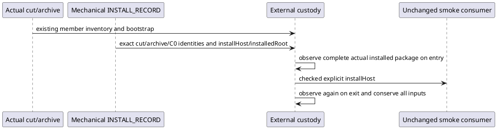

# Amendment06 explicit installed-host custody

Product Frame: fixed ABI5/T287 S01/S03/F17 installed runtime, amendment and selective currentness. These external controls bind observations to the actual cut/install owners; Public and ABG retain runtime authority. Exact STDO3.0.4 and empty composition remain unchanged.

Root selected this Writer through AMENDMENT_INSTALL_HOST_DISPOSITION_01.json#successorWriterActivation at623ff9d87eaeb75b7c9a079460244d98cc969e58. Predecessor c1b6468736c6289e5689c22bf8ab54658a50b14d, helper8233791ae611f1c5f6e2ec2afd5a1738dd700bb6 and failed attempts01/02 remain immutable.

## Origin and owner join

The inherited `bootstrapPackageRoot.parents[2]` happened to invert the old B44 npm package layout. The actual RC14 cut instead has a bare archive bootstrap at `records/bootstrap/package`. The unchanged smoke consumer requires `installHost/node_modules/@abiogenesis/typescript-tenant`; the inferred host did not contain that package. Attempt02 stopped before its Product import, with no amendment setup/lifecycle/provider. Planned topology passed; actual paired roles and all lifecycle/currentness evidence remain unperformed.

The fourth smoke-input receipt is the original mechanical INSTALL_RECORD.json selected by Root. Custody checks its exact path/hash, completed install kind/status, cut receipt, archive, C0, version, Product/content/manifest identities and canonical recorded host/package relation. The explicit candidate binding contains installRecordPath/installRecordSha256/installHost/installedRoot. The archive bootstrap remains independently authenticated and is never relabelled as the installed package.

The existing complete dependency inventory reader also observes the actual imported installedRoot. Its whole regular-file member set, lengths and bytes must equal the existing authenticated ARCHIVE_MEMBERS inventory. Entry and exit results retain the observed tree digest/count/bytes plus original installId/host/root. No large duplicate ledger, new install, alias directory, rebuild or runtime schema is introduced. The driver supplies the checked entry result's installHost to the unchanged smoke consumer.

## Preserved scope and future entry

Every lifecycle/oracle/process/observer/credential/finite process/deadline/failure/cleanup mechanism remains unchanged. Historical git/tar stay byte-custody inputs; Node/npm and every other selected protection remain required. The fourth receipt and actual install host/package must be protected in both physical roles. Actual binding/install roots are still acquired after setup and immediately before dispatch.

The disabled templates require a new accepted binding and explicit fresh execution grant. Do not reuse an old attempt or infer an install host from the bootstrap. Actual mechanical installation is an imported input, not a replacement Public runtime binding. The canonical command remains PINNED_PYTHON <accepted-amendment06>/run.py ROOT_ACCEPTED_BINDING.json.

One read-only custody acquisition is permitted under the Writer grant in the named external readiness root. It imports only the external custody and its authenticated pure inventory reader, never Product, and runs no smoke/observer/provider/setup/build. Its result is readiness evidence only. The original01/02 failures and clocks remain closed; no new execution clock starts in this packet.
