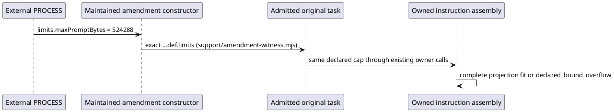

# Amendment07 declared prompt capacity

Product Frame: fixed ABI5/T287/S03/F17 governed amendment. This external immutable process declaration supplies a finite task bound; Public and ABG retain admission, graph selection, currentness and runtime truth. Exact STDO3.0.4 and empty composition remain unchanged.

The pushed `AMENDMENT_PROMPT_BOUND_DISPOSITION_01.json#successorWriterActivation` at `acf3dedcb11f2037e4ce8e157c79af86598f2878` selects this Writer. The exact predecessor is successor06 `5b75c3a38114685d66d443ffc4e23733e24457c1`. Its source, prior controls and failed attempts01/02/03 remain immutable. Amendment03 completed smoke, four paired physical observations and actual Testing/construction, then correctly refused the next selector assembly above its declared task capacity. Application observation success did not establish the missing review refresh, preservation review, final Testing, acceptance or terminal completion.

## Selected transformation

The sole semantic delta is `PROCESS.limits.maxPromptBytes: 131072 -> 524288`. This is a Run-wide assembly cap, including selector, native work and command assembly; it is not selector-only. `maxContextFiles: 64` and `maxContextBytes: 131072` remain exact. Every source/read/write declaration, review/frame/prerequisite, step, oracle, acceptance and provider/lifetime guard is unchanged. No context pruning, larger file context or prescribed graph ordering is introduced. Larger capacity is not a guarantee that every later history fits or that remaining judgments accept; genuine excess still refuses.

## Preserved custody and disabled future entry

All Python and JavaScript executable files are byte-identical to successor06. Its explicit fourth mechanical INSTALL_RECORD/host/package join, complete installed/archive equality, bootstrap distinction, eleven smoke inputs, dependency/build/native/tool entry/exit conservation, historical git/tar custody split, paired physical roles, canonical paths, credentials, finite process owner, first-failure and cleanup checks remain exact. Historical CUSTODY_DIFF, TOPOLOGY_DIFF and INSTALL_HOST_DIFF patches are retained byte-identically as predecessor evidence; PROMPT_BOUND_DIFF is this successor's complete semantic diff. REUSED_HELPERS preserves the historical PROCESS source pin and explicitly describes this one changed leaf.

Only successor-local npm coordinates and preparation records accompany the capacity change. Candidate-dependent fields remain null and execution/provider remain disabled. Both next paid witnesses wait for the accepted B56 repaired exact candidate. A future Root binding must supply that candidate's actual C0/tree/build/archive/bootstrap, original mechanical INSTALL_RECORD and explicit host/package, complete consumed-source/generated/dependency inputs, fresh roots and an independently selected finite execution grant. No old archive or receipt is relabelled.

Canonical future entry remains `PINNED_PYTHON <accepted-amendment07>/run.py ROOT_ACCEPTED_BINDING.json`, after independent review and exact binding. No runtime, Product import, provider, physical probe, smoke, test, build, install or new execution clock is selected or performed here. Static JSON/syntax/inventory and unaffected-byte checks are preparation evidence only. The preparation Return preserves its read-only intake filename observations separately from readiness checks.
