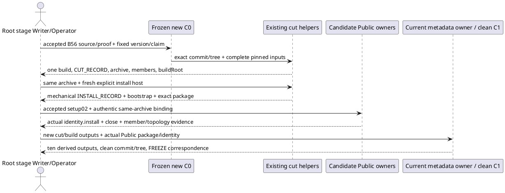

# Candidate02 preparation — execution disabled

Writer002 prepares only this carrier under the pushed selection at
`732514a84759eb0c9b66e7db476b198920710f1e`. The sparse controls branch starts at
`3327a8a2eb2aab58ee502d3b8b1e85a3acd283b5`; that is not a selected candidate.
The original preparation interval is 2026-11-15T20:08:37Z–20:28:37Z.

Fixed ABI5/T287 S07 owns exact qualification and publication. These records
are derived packaging/custody preparation, not runtime authority. Under the
selected still-mutable pre-qualification/no-AF25 window, a new prospective
RC14 may be separately frozen after B56 acceptance. Old C0 d0bc060, C1 228411a,
archive 5f0da1f4, global RC14 install and operational RC13 pin remain intact.
SELF-CONFORMANCE-008 and QUAL-057C/070A retain exact-subject, no-rebuild and
higher-immutable-RC rules at their actual qualification/publication boundaries.
No earlier build, witness, qualification or acceptance credit transfers.

`REFERENCES.json` pins existing controls, material owners, prior recipe/acceptance
records, dependency inventory and tools. It is a reference ledger, not a new
schema or orchestrator. `STAGE_BINDINGS.template.json` separates five future
stages. Every actual B56/C0/claim/archive/install/Public/C1 binding and execution
grant remains null; all stage authorizations are false and no clock has begun.
The Public template preserves its existing runner's exact shape. Its only changes
are the already accepted control manifest and prospective fresh raw/worksite paths.
Future execution needs Root review and separately pushed exact stage grants.

## Existing entry recipe

The following is a human-readable invocation recipe, not executable authorization.
`CUT` and `PUBLIC` mean exact roots in REFERENCES; `NODE` and `PYTHON` mean their
pinned tools. Upper-case candidate values must be acquired from actual accepted
preceding stages. The templates cannot currently supply them.

1. **C0:** Root separately freezes accepted B56 source and any intended truthful
   claim before the build. The four version sites already name RC14. The retained
   stamp helper accepts `already`; prepare validates with `write:false`, so no
   second bump or blind replace is needed. Reacquire current authority mirrors
   through the existing DELIVERY_SEQUENCE owner if their sources changed.

2. **Build:**
   `NODE CUT/tools/prepare-candidate-rc14.mjs --apply --repo C0_SOURCE --commit C0_COMMIT --tree C0_TREE --deps DEPENDENCY_DONOR --dependency-inventory PINNED_DEPENDENCY_RECEIPT --output BUILD_RAW/candidate --scratch BUILD_RAW/scratch`
   Archive selection is the tenant subtree. Preserve the single clean compile,
   native build, manifest, basis refresh and pack sequence. No preliminary dry-run
   build or reused old output. Retain new source.tar, CUT_RECORD, ARCHIVE_MEMBERS,
   actual buildRoot, generated pins and exact payload equality. Never fix the
   future member count to the old5302. Proposed bound:30min/30s exit reserve.

3. **Mechanical install:**
   `NODE CUT/tools/install-candidate-rc14.mjs --apply --cut-record NEW_CUT_RECORD --archive NEW_ARCHIVE --output INSTALL_RAW/records --install-host INSTALL_RAW/install-host --scratch INSTALL_RAW/scratch`
   The new host must be absent with an existing parent; records/bootstrap are
   absent and host/scratch are siblings. The old `/installs/5.0.0-rc.14` is not
   a target. Retain INSTALL_RECORD and its actual installedRoot, installation.json,
   bootstrap and complete member correspondence. Proposed bound:15min/30s reserve.

4. **Actual Public setup:**
   `PYTHON PUBLIC/run.py ACTUAL_PUBLIC_SETUP_BINDING.json`
   Fill the unchanged Public setup02 template from the new C0/tree/CUT_RECORD,
   archive and mechanical bootstrap. `candidate.manifestSha256` is the actual
   bootstrap manifest file hash, not the canonical manifest digest. The control
   source remains exact c1683d3, separate from C0. Use distinct empty npm configs,
   credential-free environment, current npm-tree pin and complete protected set.
   Bind the new actual start/deadline and layout acceptance only in its later grant.
   Existing planned and paired actual role observations remain required.
   Captures are `raw/public-setup-host`; runtime outputs are `raw/public-setup`.
   Consume actual `raw/public-setup/installed/0/identity.json` and package
   `raw/public-setup/sandbox/installed/abg/node_modules/@abiogenesis/typescript-tenant`.
   Mechanical INSTALL_RECORD is not this admitted `.install` carrier.
   Proposed bound:15min/30s reserve,300s host/285s inner,16MiB captures, no provider.

5. **C1 metadata then freeze:**
   `NODE CUT/tools/stage-qualification-metadata.mjs --root C1_SOURCE --record NEW_CUT_RECORD --package ACTUAL_PUBLIC_PACKAGE --install-record ACTUAL_PUBLIC_IDENTITY --scratch METADATA_RAW/metadata`
   Materialize the complete tracked tenant and governing root/spec inputs; no
   source build/node_modules is needed. Copy the two generated outputs and actual
   refreshed candidate basis from new buildRoot. The existing owner derives current
   identity, expected members, recipe, manifest/resources/inventory. Record actual
   metadata HOME/TMPDIR/LANG/LC_ALL; old build TMPDIR is not a substitute.
   Captures belong under `METADATA_RAW/commands/<number>-<name>-host`; the metadata
   scratch must remain absent until the helper creates it. Retain the original
   ten-path write cone. Commit clean C1, then:
   `NODE CUT/tools/freeze-candidate-inputs.mjs --record NEW_CUT_RECORD --root C1_SOURCE --commit C1_COMMIT --tree C1_TREE --output METADATA_RAW/FREEZE.json`
   Preserve C0 compilation lineage, claim and archive/build equality without
   rebuilding. Do not append a Return to C1 after freeze. Proposed bound:20min/30s
   reserve,600s metadata child/300s other children,16MiB captures.

`CUSTODY.json` applies original entry and original exit checks to each stage.
In particular, both actually consumed native07 `process-owner.py` and
`dependency-inputs.py` are explicitly pinned and compared at entry and exit,
alongside ordinary cut/stage/freeze helpers. Prior C1's late observation remains
historical; this packet does not rewrite it. Every first failure preserves the
original error/clock/residue, with no repair/retry. Actual group absence and final
custody must close within the original stage bounds. All bounds here are proposals.

## Preparation evidence and residuals

The original worktree status check ran before initialization of the new
`--no-checkout` index. Root independently found index0 and only .git, not source
deletion, and selected one same-commit initialization in disposition8f963ee7.
Preconditions were reconfirmed; `git read-tree -mu HEAD` ran once; exact branch/HEAD
and a clean137491-row sparse index were then verified. The failed check and
unchanged20:28:37Z preparation deadline remain in RETURN. No runtime attempt began.

Only JSON, source/hash, inventory and static consistency checks apply here. No
helper is copied/modified/imported, no Product/build/test/install/metadata/provider
or physical probe runs. B56 acceptance, all actual candidate identities, future
physical readiness and stage grants are unresolved. B50, formal qualification,
AF25, publication and human acceptance remain separate. Writer freezes this packet
and returns to Root for independent review; no main mutation or push.
