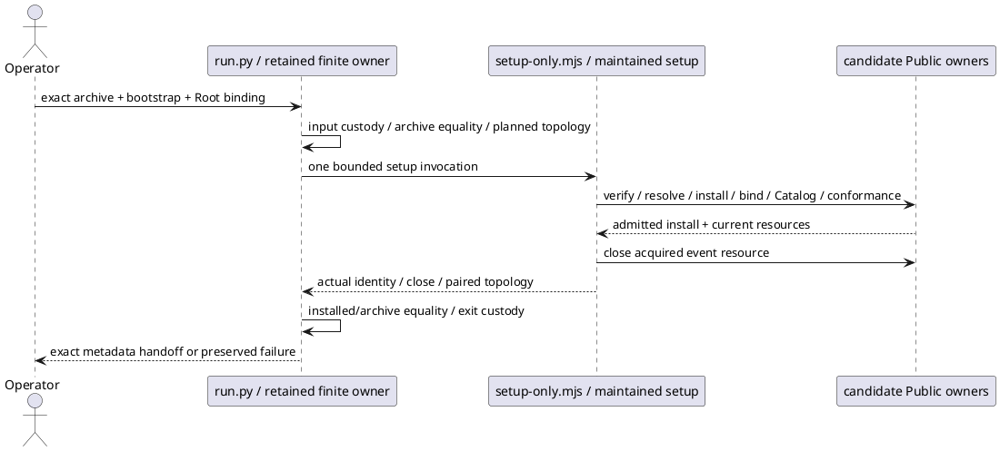

# Prospective RC14 Public setup handoff

Preparation only. Root activated this external-control Writer at source
`9b0757a206fb9ec50afee0c8c57415c475b28dc4` to close step4 of the accepted
`rc14-cut-preparation-01/DELIVERY_SEQUENCE.md`. Fixed5.0 Product S07 and
REQ-P-QUAL-057C require the exact installed prospective candidate. Existing
Public owners alone admit installation; these controls carry evidence and
process custody. No runtime, schema, Product helper or qualification rule changes.

The standalone install script's receipt is not the required admitted identity.
The maintained `public-setup.mjs` already supports the complete setup interval
without invoking a Program: `verifyArtifact`, `publicCaller`, then
`populateSandbox(caller,{retain:false,program:'consumer'})`. It constructs the
fixed consumer fixture, packs it, Public-verifies/resolves/installs candidate
and consumer, binds the workspace, admits the Catalog, checks Program
conformance, and closes its acquired event resource. The installed candidate
identity is projected from admitted events at `public-setup.mjs:263–276`.



## Existing owners and narrow wrapper

`INPUTS.json` pins four maintained source files from immutable `c1683d3` and
four unchanged command/topology files from its accepted control directory.
The basic04 import-condition loader, command bridge and two-role topology
construction are reused with the native-workload branches removed. The bridge
still imports the matching retained `run.py` and calls its zero-argument
`owner()`; there is no successor-loader signature substitution.

The wrapper authenticates the complete bootstrap member set against the actual
candidate archive before any Product import, and loads the five declared
`package.exports` import entries with confinement. It does not call the
maintained convenience loader's private invocation-truth import.

`R = rawRoot/public-setup`; `W = worksiteRoot` is fresh and outside raw and all
protected inputs. The only setup-owned file in W is
`.abiogenesis/workspace-manifest.json`. Setup derives actual event/runtime/
projection/archive roots below `R/resources`, and two install target hosts
below `R/sandbox/installed`. The after-setup physical query acquires the actual
binding/install roots once, then uses the unchanged observer twice:

- Operator custody: outer raw root plus external inputs; archive role = raw.
- Runtime ownership: actual binding roots, both admitted installs and external
  inputs; archive role = actual `binding.roots.archiveRoot`.

Both have the same exact W and their protected-set union must equal the complete
set. Partition is by declared roles, never observed overlap. Pre-setup uses
the same observer over planned custody and the selected manifest write path.

The prior readiness shorthand incorrectly named the install target host as
the package root. Root's actual basic04 identity corrected this during
preparation: the handoff derives `--package` from `.install.installedRoot` and
requires `R/sandbox/installed/abg/node_modules/@abiogenesis/typescript-tenant`.
`--install-record` remains `R/installed/0/identity.json`. No setup was executed
against the earlier shorthand and no prior record is rewritten.

## Future exact binding and command

Execution is disabled. Root must bind the reviewed manifest, actual execution
grant, fresh run/raw/worksite, complete protected roots and original deadline;
final C0 commit/tree, cut-record bytes, RC14 archive/digest, authenticated
bootstrap package and manifest digest remain null. Maintained control source
identity stays separate from the new candidate source. The bootstrap may come
from the accepted installer/extractor over those same archive bytes; no old RC13
install receipt or content is accepted.

Fill setup HOME/TMPDIR/npm cache under the fresh raw root. Select the two
distinct empty npm configuration files in this exact control directory. No
ambient environment or provider credential is passed to any child. Executable
and npm-module-tree pins are in `TOOL_PINS.json`; no version or compatibility
claim was inferred from preparation hashes.

```text
PINNED_PYTHON CONTROL/run.py ROOT_BOUND_BINDING.json
```

The grant is at most15 minutes including30 seconds for exit audit/cleanup.
Each owned command is capped at300 seconds and its remaining original time,
with16MiB stream capture. The setup HOST has an earlier285-second inner
deadline so its separately owned command can close before the enclosing host
ceiling. The original retained owner supplies process-group termination; the
outer finally also checks/closes recorded inner groups after interruption.
First failure retains evidence and returns; there is no retry. A killed setup
without an actual close receipt cannot produce a successful handoff.

On success, consume `rawRoot/RETURN.json`, actual Public identity/close records
and `ARCHIVE_INSTALL_CORRESPONDENCE.json`. The outer Return passes only if
declared inputs conserved and the final original wall/monotonic deadline holds.
Input custody covers controls, selected maintained sources, tracked tenant
source cleanliness, complete bootstrap package, archive, cut record, executables
and complete npm module tree. It is an entry/exit observation, not continuous
monitoring or OS isolation. Worksite conservation covers file/link entries,
not directory metadata. Stream caps do not claim a cap on durable Product
event or identity-record bytes.

```text
node stage-qualification-metadata.mjs --root FINAL_SOURCE --record CUT_RECORD \
  --package HANDOFF.installedPackageRoot --install-record HANDOFF.installRecord \
  --scratch FRESH_METADATA_SCRATCH
```

That later metadata effect has its separate grant. This packet invokes no
lifecycle, provider, build, stamp, qualification or publication. Static syntax,
JSON and hash checks are preparation evidence only. Root separately activates
independent review; the Writer freezes this subject and stops.
