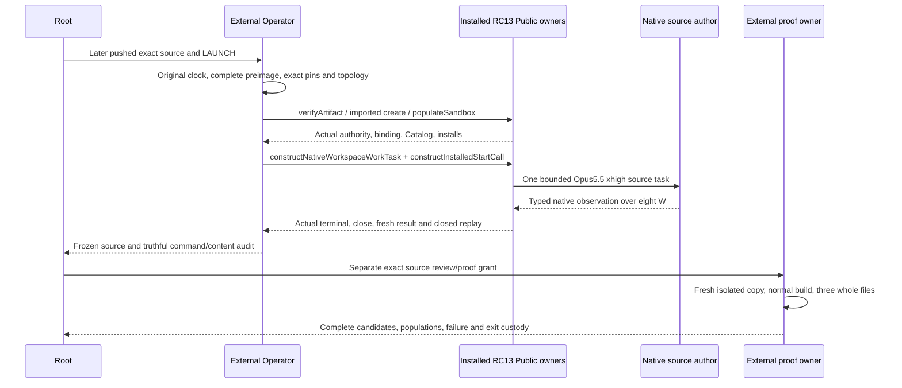

# B64 external source/proof preparation

Product Frame: fixed ABI5 5.0, T287 F17/S06. The required outcome is complete, authenticated historical material for declared revision and independent assessment. This carrier is derived execution/evidence tooling. ABG owns runtime admission; the native Writer owns the eight source files; Root owns source acceptance, proof activation and future candidate/lifecycle. No current witness, qualification or release claim follows.

The exact Root decision is `ROOT_SELECTION.json`; `WRITER_ACTIVATION.json` admits only this preparation. The old candidate02, event carriers and failure stay immutable. An authenticated historical context is not current physical worksite context. The existing generic `sourceResults` native-work relation cannot grant access merely by accepting semantic cause505.

Canonical handoffs reuse the unchanged installed `public-setup.mjs`, `runner.mjs`, Product `constructNativeWorkspaceWorkTask`, API `constructInstalledStartCall`, ABG typed terminal and maintained readback contracts. No copied Public schema or private event writer is added. The five bounded input/process/topology/freeze/setup-custody owners are byte-identical to accepted B56; `REUSE.json` identifies exact changes.

The selected source transformation is Root-owned: native assessor -> unchanged semantic envelope -> authenticated revision subject/parent/cause/use -> exact held-prefix/member access -> derived full instruction material. The native Writer first reconciles the two owning HOW passages, then chooses private realization within the three ABG owners and three tests. Framework source/destination contracts and all original negative admission relations remain owned by those actual sources. The actual old native generation count is zero; source-plus-data suffices for the established defect, with the original inner stack unavailable.

Effects are separate. Native W is eight exact regular-file destinations. Historical failure bytes, main source/authority, dependencies, method, candidate02 and installed RC13 inputs are protected from that W. The same external set is appended to prospective, actual after-setup and immediate pre-dispatch runtime layouts; all actual binding and install roots remain included. `LAYOUT_CHECKS.json` measures shape only (33/34/34 anchors, proof26, owner maximum64), not physical separation. Actual observer success remains mandatory. The archive coordinate is the runtime owner's actual archive, not the enclosing capture container. Historical/OS Tool inputs retain exact byte custody without pretending every system file is a recursive physical protection root.

Proof uses a new isolated mirror, copied exact dependency tree and one normal build of the authored source. Generated capability-definition-graph.json is the exact additional ordinary-build allowance; the inclusive complete built postimage and post-test inventory still conserve it. Three whole files run once without test-name filtering. Preserve39 existing top-level titles, require three named B64 obligations and retain every actual nested/top-level case; no fixed42 total or old pass transfer. The actual admitted assessor/fold/new-Run selector path, held/cold identity, stage presentation and strict refusals must be demonstrated by the authored tests. No paid semantic provider is part of proof. Six authentic old failure leaves inform and constrain source; they grant no old runtime authority.

Every test candidate is retained in full before assertion/parse/stripping. Primary child/parse and secondary capture failures remain distinguishable. The existing process owner captures stdout/stderr/return, stops at first failure, closes its process group and preserves all final comparisons. Missing candidates never become proof. Native return must satisfy inner disposition, typed terminal, exact task and fresh result/closed replay; host exit0 alone is insufficient.

The later source attempt has one original3h enclosure,45min native ceiling,5min inactivity,360turns and180s exit reserve. Proof is at most90min clipped to that original enclosure; no retry or reset. A method deviation remains an actual deviation and needs explicit Root disposition before a successor proof entry, not `deviations:[]` fabrication. This preparation starts no source/runtime clock and grants no execution. New candidate C0/C1/archive/install correspondence and actual S06 remain future selected work.
