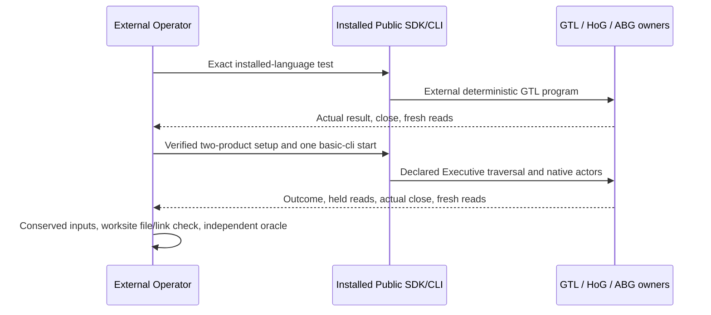

# Installed first-composition controls

Preparation only under `RC14-INSTALLED-FIRST-COMPOSITION-CONTROL-PREPARATION-001`.
This successor addresses C01–C04 under `ROOT_CONTROL_REVIEW.json` at
`f9ea4fba8f8db2f061da79efebf70afd27a75333`; the original d519 controls remain
in ancestry. Root separately reviews this repair; the Operator claims no
independent review or live proof.
No artifact is selected and no execution occurred. Root separately reviews,
binds the final repaired candidate and authorizes one prospective execution.
The unresolved template deliberately cannot launch.

The source is preparation checkpoint `5d28aa1dd0096578072e68e92064cdb7638b25a5`;
its tenant equals activation subject `244895231432a931409298195845b250ad32e0cb`.
`INSTALLED_STEEL_THREAD_PREPARATION.md` and
`INSTALLED_COMPOSITION_CONTROL_FINDINGS.md` own the retained planning findings.
Product S01/S03 and the fixed 5.0 authority split govern this bounded slice.
No amendment, keyed-accounting, continuation or qualification implementation is
included. Their existing obligations remain open.

## Exact entry and prerequisites

Future entry: `python3 run.py /absolute/ROOT_ACCEPTED_BINDING.json`.
That file is an Operator binding, not a new Product or qualification schema.
Root must fill every unresolved field of `BINDING.template.json` and supply:

- the accepted control commit/root and this manifest's SHA;
- the final candidate source lineage, archive path/SHA, package version,
  manifest bytes SHA and an already installed bootstrap package root;
- a fresh external raw root and a separate absent `worksiteRoot`, explicit
  additional `protectedRoots`, run identity, original absolute UTC deadline,
  finite smoke/command/actor/recursion/output limits and `exitAuditReserveMs`;
- explicit Python/Node/npm/provider paths, provider executable SHA, actual
  supported model/arguments and permitted environment; no credentials belong
  in retained binding files;
- a separately accepted topology record identifying the archive/bootstrap,
  protected roots and the separate prospective worksite layout;
- a separate execution grant. A flag in a JSON file is not itself authority.

The preparation activation grants none of those future executions. Earlier
proof archives, old clocks and retained bindings must not fill the template.
The launcher requires an absent raw root and has no retry/resume path. It
compares the archive's complete regular-file set against the bootstrap install
before importing Product. Unsupported archive members refuse explicitly.
Exact final artifact installation remains Root-owned; these controls never
build the Product or silently install a substitute.

`provider.inheritEnvironment` contains only explicitly selected credential key
names. Each selected value must exist in the launching Operator environment;
values cannot appear in the binding or retained setup environment. Only the
basic host receives them. The maintained `workerEnvironment` constructs the
native actor environment at invocation. Version probes, setup commands and
the deterministic smoke receive no selected credentials. An empty key list
is an explicit selection, not evidence that provider authentication works.

The accepted observer is copied byte-for-byte as `physical-topology.py`, SHA
`eb5d0028cf7cb27d233c4512a57882785698c301ba83575396c3fc9eb045fc31`.
`REUSED_HELPERS.json` records both exact helper source paths and hashes.
The launcher observes the prospective layout. After maintained setup produces
the actual environment, the host refreshes that owner projection and includes
every binding root, both admitted install roots, bootstrap, candidate archive,
protected source and the whole raw archive in the actual layout. It observes
that layout after setup and immediately before dispatch. Each bounded observer
call must exit zero and report `ok:true`, `disposition:separated`. The separate
worksite keeps the whole raw archive protected. These observations cover the
accepted controlled ASCII Darwin/APFS relation, not a general race or Unicode
assurance. Final paths and the final candidate remain unresolved.

## Maintained composition and claim limits

`run.py` first invokes the complete maintained
`test_env/tests/installed-language-smoke.test.mjs` with the exact frozen artifact
and install-host environment. It requires one pass, zero failures, cancellations,
skips or todos. This retained test uses internal installed proof helpers and is
an installed-language discriminator, not the strict ordinary-caller S01 proof.
Its helpers may pack/install the separate external deterministic fixture.

Only after that succeeds, `basic-cli.mjs` invokes the maintained scenario
acquisition/snapshot, Public verification/setup, task/start construction,
native dispatch, held/fresh reads and oracle functions. It loads actual Product
modules through declared package exports. It never calls `installedModules`,
imports private invocation truth, uses source runtime or chooses a graph.
The fresh Run earns only its own C2 command evidence; historical source credit
is absent. The immutable basic-cli oracle remains unchanged. Independent semantic
assessment remains native; the external oracle supplies mechanical evidence.

The host preserves original-source digests, inventories worksite files/links,
checks changes against the task's exact write roots and the actual bound archive
root, checks both installs before/after dispatch, and compares held/fresh Public
outcomes after a real close. Fresh reads are not interrupted-work continuation.
All raw outputs, bindings, snapshots and generated consumer artifacts remain in
the external raw tree; none belong in Git.
The measured worksite claim is regular-file bytes and symbolic-link targets,
including additions/removals. Directory metadata, file modes, ownership and
timestamps are not compared and receive no conservation claim.

## Failure and clocks

Every unexpected command, setup, owner, oracle, readback, source-conservation or
population failure stops the sequence. No repair, retry or alternate provider
is selected. `bounded.py` is the exact accepted B12 process owner, SHA
`5800a19cfacef6c87ee28b78871f6bd7427327d7fa60b6bfd6ee140b194121a2`.
Every external command, including Git/preflight/observer children, uses that
owner. A stdin bridge lets maintained setup use it without persisting environment
values. The original deadline never resets. Execution subtracts an explicit
exit-audit reserve; each owner subtracts its existing 15-second cleanup reserve
before launch. TERM/KILL/reap remain finite. Final stdout/stderr sizes are checked
even when a command exits before the polling loop observes an overflow.
No asynchronously armed alarm can interrupt this cleanup path. The bridge
belongs to its enclosing host group; each owned child records its own PID/group.
These are exact cleanup coordinates, not evidence of absence of separately
grouped descendants. Native actors retain their original bounds.
The raw receipt distinguishes host close from descendant absence; forced
termination is a failed run requiring Root triage and cleanup observation.
Normal completion retains actual owner close and raw admitted event coordinates.

The launcher reacquires the same control/helper, maintained-source, binding,
archive, complete bootstrap and provider/interpreter inputs at exit, including
first-failure exit. `INPUTS_ENTRY.json`, `INPUTS_EXIT.json` and
`INPUT_CONSERVATION.json` retain mismatches/acquisition errors. Insufficient
original time or incomplete acquisition cannot produce a conservation pass.
Filesystem calls are synchronous observations, not an atomic snapshot; a
blocking local read can prevent a complete exit receipt and earns no success.

Static checks during preparation parse Python/JSON and run `node --check` only.
No Product import, build, install, test, provider dispatch or scenario evidence
is earned by this control commit. Artifact-dependent setup congruence and live
runtime behavior remain unperformed.
