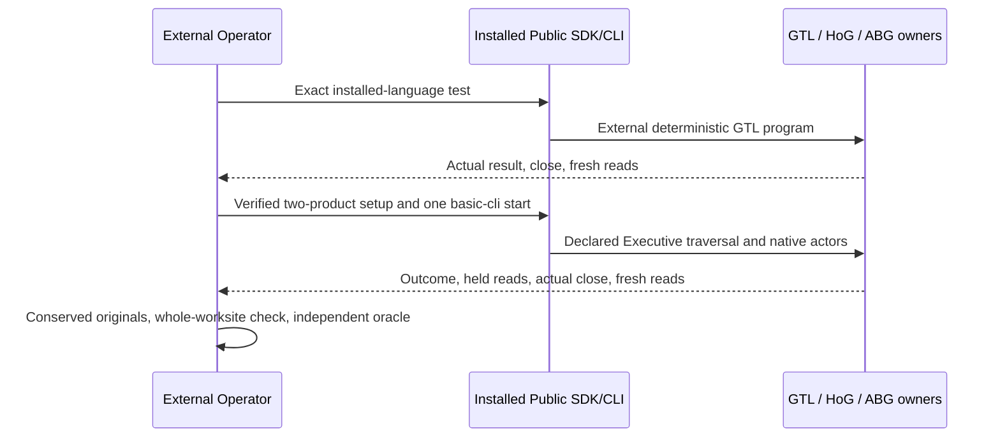

# Installed first-composition controls

Preparation only under `RC14-INSTALLED-FIRST-COMPOSITION-CONTROL-PREPARATION-001`.
No artifact is selected and no execution occurred. Root separately reviews,
binds the final repaired candidate and authorizes one prospective execution.
The unresolved template deliberately cannot launch.

The source is preparation checkpoint `5d28aa1dd0096578072e68e92064cdb7638b25a5`;
its tenant equals activation subject `244895231432a931409298195845b250ad32e0cb`.
`INSTALLED_STEEL_THREAD_PREPARATION.md` and
`INSTALLED_COMPOSITION_CONTROL_FINDINGS.md` own the retained planning findings.
Product S01/S03 and the fixed 5.0 authority split govern this bounded slice.
No amendment, keyed-accounting, continuation or qualification implementation is
included. Their existing obligations remain open.

## Exact entry and prerequisites

Future entry: `python3 run.py /absolute/ROOT_ACCEPTED_BINDING.json`.
That file is an Operator binding, not a new Product or qualification schema.
Root must fill every unresolved field of `BINDING.template.json` and supply:

- the accepted control commit/root and this manifest's SHA;
- the final candidate source lineage, archive path/SHA, package version,
  manifest bytes SHA and an already installed bootstrap package root;
- a fresh external raw root, run identity, enclosing absolute UTC deadline,
  finite smoke/command/actor/recursion/output/cleanup limits;
- explicit interpreter/npm/provider paths, provider executable SHA, actual
  supported model/arguments and permitted environment; no credentials belong
  in retained binding files;
- a separately accepted topology record identifying the archive/bootstrap,
  protected roots and prospective `rawRoot/basic-cli/sandbox/worksite` layout;
- a separate execution grant. A flag in a JSON file is not itself authority.

The preparation activation grants none of those future executions. Earlier
proof archives, old clocks and retained bindings must not fill the template.
The launcher requires an absent raw root and has no retry/resume path. It
compares the archive's complete regular-file set against the bootstrap install
before importing Product. Unsupported archive members refuse explicitly.
Exact final artifact installation remains Root-owned; these controls never
build the Product or silently install a substitute.

## Maintained composition and claim limits

`run.py` first invokes the complete maintained
`test_env/tests/installed-language-smoke.test.mjs` with the exact frozen artifact
and install-host environment. It requires one pass, zero failures, cancellations,
skips or todos. This retained test uses internal installed proof helpers and is
an installed-language discriminator, not the strict ordinary-caller S01 proof.
Its helpers may pack/install the separate external deterministic fixture.

Only after that succeeds, `basic-cli.mjs` invokes the maintained scenario
acquisition/snapshot, Public verification/setup, task/start construction,
native dispatch, held/fresh reads and oracle functions. It loads actual Product
modules through declared package exports. It never calls `installedModules`,
imports private invocation truth, uses source runtime or chooses a graph.
The fresh Run earns only its own C2 command evidence; historical source credit
is absent. The immutable basic-cli oracle remains unchanged. Independent semantic
assessment remains native; the external oracle supplies mechanical evidence.

The host preserves original-source digests, inventories the whole worksite,
checks changes against the task's exact write roots and the actual bound archive
root, checks both installs before/after dispatch, and compares held/fresh Public
outcomes after a real close. Fresh reads are not interrupted-work continuation.
All raw outputs, bindings, snapshots and generated consumer artifacts remain in
the external raw tree; none belong in Git.

## Failure and clocks

Every unexpected command, setup, owner, oracle, readback, source-conservation or
population failure stops the sequence. No repair, retry or alternate provider
is selected. The outer absolute deadline is never reset; expiry or capture
overflow terminates the launched host process group, then uses the explicit
finite grace for SIGKILL/reap. It cannot claim absence of separately grouped
descendants. Native actors retain their own absolute/inactivity/grace limits.
The raw receipt distinguishes host close from descendant absence; forced
termination is a failed run requiring Root triage and cleanup observation.
Normal completion retains actual owner close and raw admitted event coordinates.

Static checks during preparation parse Python/JSON and run `node --check` only.
No Product import, build, install, test, provider dispatch or scenario evidence
is earned by this control commit. Artifact-dependent setup congruence and live
runtime behavior remain unperformed.
