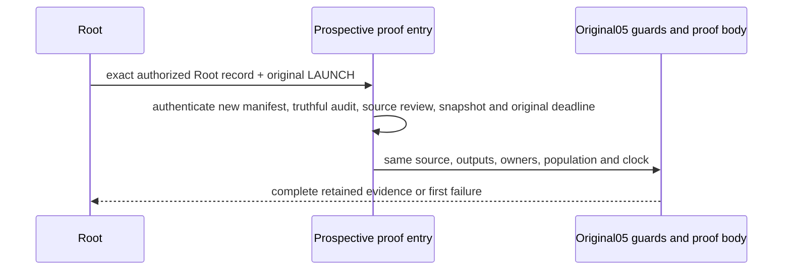

# Native05 prospective proof re-entry

Product Frame: fixed 5.0 / T287 RC14 fixture and Proof work. Product, requirements, runtime owners and installed RC13 remain unchanged. These external controls are derived execution/evidence tooling. ABG admission, actual typed terminal and fresh replay own native truth; neither audit nor host exit creates it. This population is bounded technical evidence, not qualification or release.

Basis: `stdo://releases/v3.0.4/`, manifest `102817a3f4bea4dca1d6fa0fc634b94404dd2ba82ba6d8c38b273402dda9f95b`; Definition SHA `b5720642ff00ebcb47f77ae68df3a960ab70f82cd1227c0712edda9d40745f44`, empty composition. Project basis is `ABI5_PROJECT_REFERENCE_FRAME_BASIS.md#exact-basis`. Applicable owners: Product Governance And Release Boundary; REQ-P-QUAL-057A/C/D exact subject and evidence limits; original native05 ACT/PROOF_PLAN and Root's current bounded re-entry. `stdo status --definition .../stdo_abiogenesis.json --verify` returned installed/valid true with no failures during this preparation.

Root explicitly activated /root/b29_vm_triage as a separate external-control Writer in this new carrier only. Root selected a truthful prospective audit gate after receiving the actual command/read audit: installed stdo-work was not acquired by the native author; all 12 readFirst paths were content-read before first edit; no prohibited effect was observed. Context readRoots were not exclusive read authority. STDO work says narrow write territory is not a narrower reasoning boundary. The missing skill acquisition remains an actual historical process deviation, never cured or rewritten as deviations: []. This preparation neither accepts authored source nor grants execution.

The original runner could accept only an empty deviation set and correctly required return to Root. The selected repair copies that runner, fixes HERE to the immutable original05 control directory, and replaces only that audit entry. ENTRY_DIFF.patch shows every changed byte. Completion, native source/preimage/diff, setup custody, exact build/native/dependency/retained inputs, physical topology, case populations, finite process ownership, original wall/monotonic deadlines and final conservation remain unchanged. All 22 original control bytes and original LAUNCH remain untouched.



No evidence is retroactively admitted. AUTHOR_AUDIT.json binds retained actual command/read/source/close observations and the full raw native stdout. ROOT_AUTHORITY.template.json is disabled and unresolved. Root must bind the new manifest digest and an actual independent source-review receipt for the exact diff, preserve the named residual, independently review/checkpoint the controls, then supply an authorized Root record. That record is the existing Executive disposition, not a new Product schema/owner or a cryptographic actor-authentication mechanism. PROOF_REENTRY.json will retain its actual path/hash with the new manifest/audit identity before the unchanged proof body.

Original source HEAD is a0b0ab5dd37322b66f69909d6a1c7ab75e7ee3fa plus five audited dirty tests, binary diff 4974775018b7141208da5e5a5cd493aabad21a8173ed1c21e8a88455e6b16361. Full source observation: 1422 rows including the conserved setup-owned manifest, SHA 7112bcae6de83be4eabc453745a06bbef94592594984995bdb6619fd61cfbda9. The eleven prior partial paths stay immutable. Original control source is def9a97ed3ab9d15d69d1221ee0a84160d87d773.

There is one unperformed proof population: 16 serial whole files, 71 preserved original top-level titles with three already accepted title transitions, exactly two named unavailable historical gates. Required seven retained inputs (669118059 bytes), 782 compiled outputs, two generated payload outputs, 4576 dependency members and 1295 actual prebuild source rows retain the original guards. No rebuild, extra provider, new source or repeat population is selected.

Original host deadline is 2026-11-15T12:21:55.242224+00:00. Proof gets at most 90 minutes clipped to that same deadline, retains the 15-second cleanup reserve and final wall/monotonic checks, and stops on the first failure. Same outputs: raw05/proof-01 and /private/tmp/abg-rc14-regression-proof-20261115-05. They are absent at preparation; mkdir exclusivity prevents repeated entry. No new clock, renamed outputs or retry.

Prospective command (only after separate Root authority):

```sh
/usr/bin/python3 /Users/jim/src/apps/abiogenesis/.ai-workspace/work/T287_RELEASE_RESUMPTION_01/rc14-release-gap-01/integration-01/native05-proof-reentry-01/prove.py '/Users/jim/Library/Application Support/ABIogenesis/development-runs/rc14-regression-repair-20261115-05/LAUNCH.json' /absolute/path/to/ROOT_PROOF_AUTHORITY.json
```

Preparation checks are Python AST syntax, JSON/hash integrity, five current source hashes, original22 control hashes, exact text inversion to the predecessor and complete unchanged proof-function/main-body conservation. No runner import, Product import, test, build, setup, provider, proof, Git operation or source edit occurred in this Writer entry. Independent review and actual Root/source disposition remain pending.
