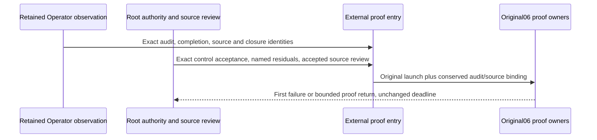

# Native06 prospective proof entry

Product Frame: fixed ABIogenesis 5.0/T-287/RC14 fixture proof. This is derived external execution/evidence tooling; ABG admission, typed terminal results, fresh replay and declared resource owners remain runtime authorities. No Product, native test, original controls or raw predecessor is changed.

Authority: Root's separate external Proof-entry Writer activation on main `8b4a0140cbcbdec07408061aba0485a61be6f739`, under the existing finish-RC14/T293 grant. Exact STDO 3.0.4 selection was verified through installed read_basis/status; Definition b5720642ff00ebcb47f77ae68df3a960ab70f82cd1227c0712edda9d40745f44, manifest 102817a3f4bea4dca1d6fa0fc634b94404dd2ba82ba6d8c38b273402dda9f95b, project basis #exact-basis, empty composition. Installed stdo-work and its COORDINATED_HANDOFF, PRODUCT_BASIS and ACTIVATION acquisition references were content-read by this controls Writer. This does not retroactively satisfy the native author's omitted reads.

## Cause and selected re-entry

Native06 actually completed its typed native task and closed with fresh result/replay. The exact Operator observation records successful installed-SKILL and all13 required source reads before Edit, permitted command/source effects, and three omitted method-reference acquisitions. The original proof gate requires deviations:[] and is therefore not the lawful entry for this observed subject. Preserve noncompliance as noncompliance. No author rerun, automatic waiver, new proof population or reset is selected. The independent source review remains separately required.

Reuse the accepted native05 proof-reentry mechanism. AUTHOR_AUDIT.json is a compact factual projection of the original hash-bound observation, not an acceptance. It names each omitted reference and preserves the separate read-only wc error and pre-clock Operator receipt correction. The disabled Root authority template proposes the exact residual IDs; only Root may select their disposition and supply independent source-review evidence over this exact diff.

## Typed handoffs and invariants



The new entry authenticates this carrier, original06 manifest/runner, original observation and evidence, unchanged source postimage/diff, actual launch, named uncured residuals and the separately accepted source review. The original06 typed completion, close/fresh replay, source/build/dependency/input custody, retained001/002 causal relation, physical topology, case/name/candidate conservation, finite command/cleanup and final deadline guards are unchanged. Exact reversal of ENTRY_DIFF.patch recovers the original runner byte-for-byte; every pre-existing helper AST is equal. Only fixed HERE, the new audit/authority entry, its explicit second argument and one PROOF_REENTRY receipt are added.

The proof remains14 fresh whole files plus2 retained files under the existing full causal equivalence,71 named top-level cases,2 permitted historical gaps and complete cases3/7 candidate artifacts. Existing original proof root/subject are used once; there is no proof retry and no proof was started by this preparation. Original host deadline remains 2026-11-15T13:12:34.310925+00:00; the original90-minute proof clock is clipped to that same enclosing deadline. Delayed preparation does not extend it.

## Prospective invocation

After Root review, checkpoint/push, exact source-QA acceptance and separate execution activation only:

```text
python3 -B <accepted-checkout>/.ai-workspace/work/T287_RELEASE_RESUMPTION_01/rc14-release-gap-01/integration-01/native06-proof-reentry-01/prove.py '/Users/jim/Library/Application Support/ABIogenesis/development-runs/rc14-regression-repair-20261115-06/LAUNCH.json' <exact Root-authorized external proof authority>
```

ROOT_AUTHORITY.template.json is disabled and cannot launch. Root supplies a distinct external authority, binding the manifest SHA, audit SHA, original observation, original deadline and independently accepted source-review receipt. Hash/syntax/AST checks establish only this control delta. No Product import, provider, build, test or proof occurred here; no qualification, native method compliance or release acceptance is claimed.
